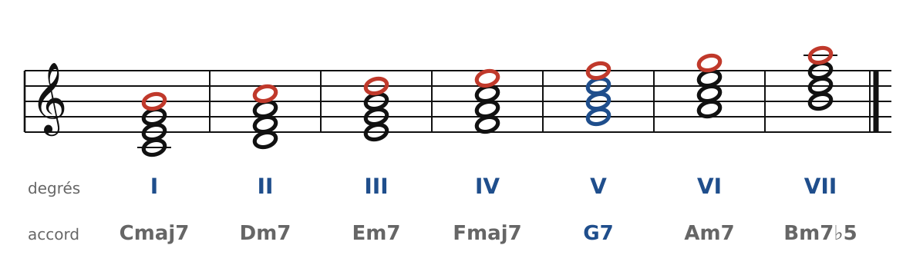
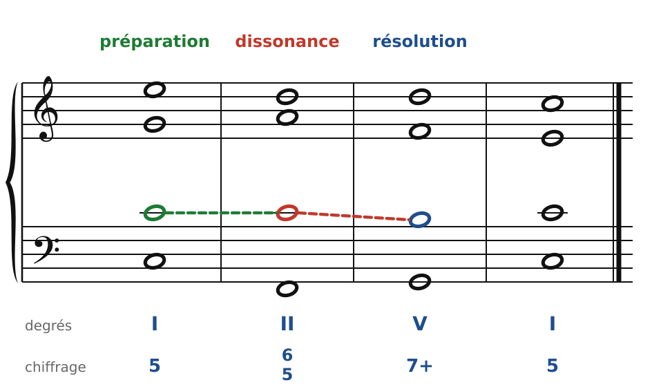
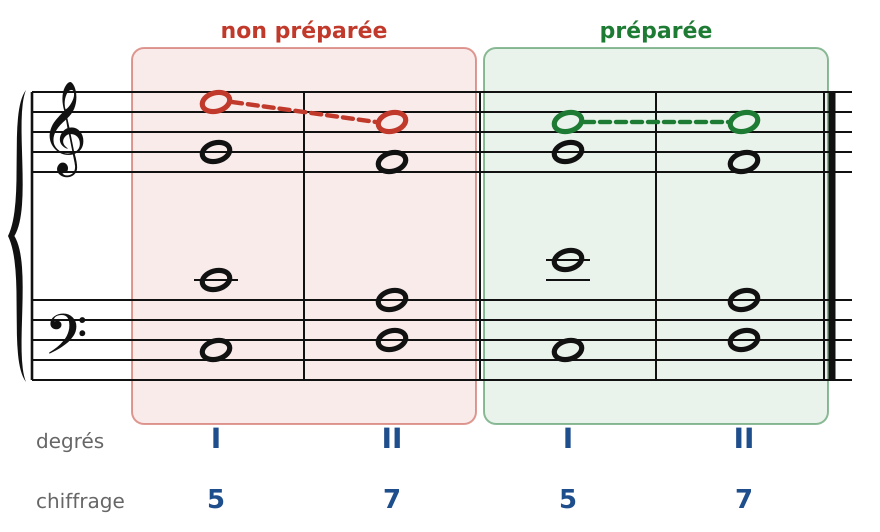
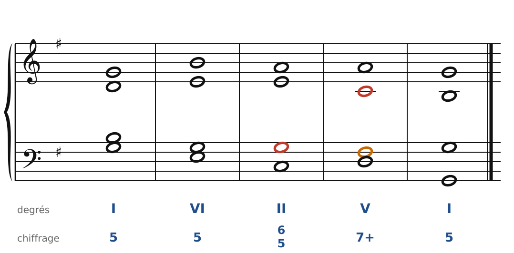
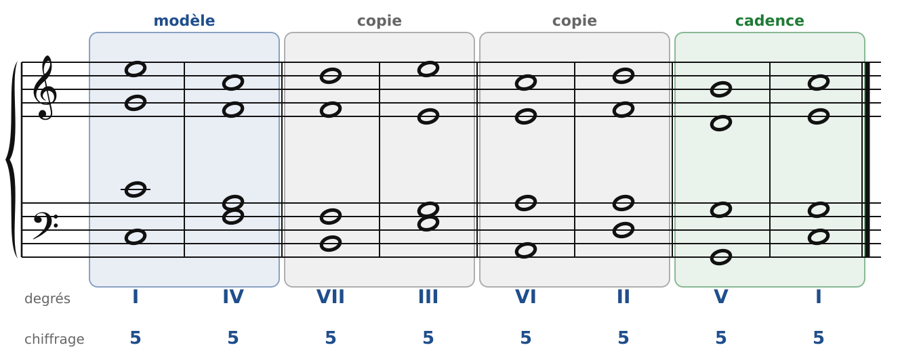
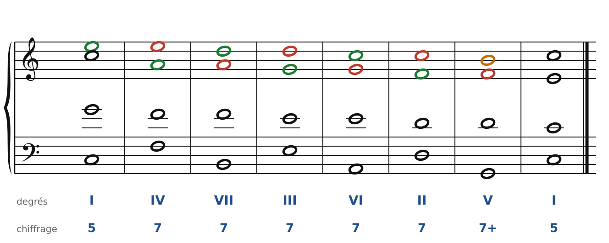

[← 18. La septième de dominante](18-la-septieme-de-dominante.md) · [Sommaire](../README.md#sommaire) · [20. La septième diminuée et la neuvième →](20-la-septieme-diminuee-et-la-neuvieme.md)

## 19. Les septièmes d'espèce et les marches harmoniques

On peut ajouter une septième à **n'importe quel degré**, pas seulement au V. Les accords de 7e construits sur les autres degrés s'appellent les **septièmes d'espèce**. Ils n'ont pas de sensible à résoudre, mais leur septième reste une dissonance, qu'il faut traiter avec soin.

### Un accord de 7e sur chaque degré

🔊 [Écouter](audio/h19-degres.mp3) · [MIDI](audio/h19-degres.mid)

En Do majeur, avec les seules notes de la gamme (septièmes en rouge) :

- sur I et IV : une 7e **majeure** (Cmaj7, Fmaj7) ;
- sur II, III et VI : un accord mineur avec une 7e mineure (Dm7, Em7, Am7) ;
- sur V : la 7e de dominante (G7, en bleu), le seul accord avec une sensible et un triton… et une 7e mineure sur un accord majeur ;
- sur VII : un accord diminué avec une 7e mineure (Bm7♭5), la **7e de sensible**, qu'on retrouvera au chapitre suivant.

Les jazzmen connaissent bien ces sept accords : ce sont les accords de la gamme majeure. En harmonie classique, on les traite tous de la même façon. Le plus utile de loin est le **II7**, surtout au 1er renversement (**II6/5**).

### Préparation, dissonance, résolution

🔊 [Écouter](audio/h19-preparation.mp3) · [MIDI](audio/h19-preparation.mid)

La septième d'un accord d'espèce se traite en **trois temps**, exactement comme la dissonance de 4e espèce en contrepoint :

1. **Préparation** (en vert) : la note est déjà là, **à la même voix**, dans l'accord précédent, où elle est consonante. Ici, le Do du ténor dans le I.
2. **Dissonance** (en rouge) : elle reste en place pendant que l'accord change. Dans le II6/5, ce Do devient la 7e de Ré-Fa-La-Do.
3. **Résolution** (en bleu) : elle **descend d'un degré** dans l'accord suivant (Do-Si, dans le V7).

La résolution est la même que pour la 7e de dominante. La différence, c'est la **préparation**, obligatoire pour les 7es d'espèce.

🔊 [Écouter](audio/h19-faux.mp3) · [MIDI](audio/h19-faux.mid)

**À gauche (faux)** : le soprano saute de Mi sur Do, qui est la 7e du II7. Cette dissonance arrive sans préparation : elle sonne dure, comme une fausse note.
**À droite (juste)** : le soprano chante déjà Do dans le I, et le garde. La dissonance se glisse en douceur.

### Le II6/5, l'accord qui prépare la cadence

🔊 [Écouter](audio/h19-ii65.mp3) · [MIDI](audio/h19-ii65.mid)

Au chapitre 7, le II6 préparait la cadence. Le **II6/5** fait la même chose, avec une note de plus : la basse est encore le 4e degré (Do en Sol majeur), et la 7e (Sol) se prépare facilement, puisque c'est la tonique, présente dans l'accord d'avant. Elle descend ensuite sur Fa♯, la sensible du V7.

L'enchaînement **II6/5 - V7 - I** est l'une des formules les plus employées de toute la musique tonale (en jazz, c'est le fameux « II-V-I »).

### Les marches harmoniques

Une **marche harmonique** (on dit aussi une séquence) est un petit **modèle** de deux accords, répété plusieurs fois en montant ou en descendant, toujours avec le même dessin à chaque voix.

🔊 [Écouter](audio/h19-marche1.mp3) · [MIDI](audio/h19-marche1.mid)

Le modèle est **I-IV** : la basse descend d'une quinte (ou monte d'une quarte). On le répète un degré plus bas (VII-III), puis encore un degré plus bas (VI-II), avant la cadence V-I. Toutes les fondamentales s'enchaînent par quintes descendantes : c'est la **marche la plus naturelle** de la musique tonale (le « cycle des quintes »).

Deux règles propres aux marches :

- Dans une marche, l'oreille suit le **dessin**, pas la tonalité. On y accepte donc le VII à l'état fondamental, et sa **sensible n'est pas obligée de monter** : elle suit le modèle.
- Le modèle doit être **juste** (sans quintes, sans octaves), et chaque copie reproduit exactement le même mouvement à chaque voix.

### Une marche de septièmes

🔊 [Écouter](audio/h19-marche2.mp3) · [MIDI](audio/h19-marche2.mid)

Si l'on ajoute une 7e à chaque accord de la marche, on obtient une **chaîne de septièmes** : chaque 7e (en rouge) est préparée dans l'accord précédent (en vert) et descend d'un degré dans le suivant, où elle devient la tierce. La note qui résout une 7e prépare aussitôt la suivante. C'est l'un des effets les plus beaux de l'écriture à quatre voix, très employé par Bach, Haendel et Vivaldi.

### Les règles à retenir

- Une 7e d'espèce est **préparée** (même note, même voix, dans l'accord précédent) et **descend d'un degré**.
- Le **II7** et surtout le **II6/5** préparent la cadence : II6/5 - V7 - I.
- Chiffrage des 7es d'espèce : **7**, **6/5**, **4/3**, **2** (sans le +, puisqu'il n'y a pas de sensible).
- Une marche répète un modèle juste. Dans une marche, la sensible ne monte pas forcément.

---

[← 18. La septième de dominante](18-la-septieme-de-dominante.md) · [Sommaire](../README.md#sommaire) · [20. La septième diminuée et la neuvième →](20-la-septieme-diminuee-et-la-neuvieme.md)
