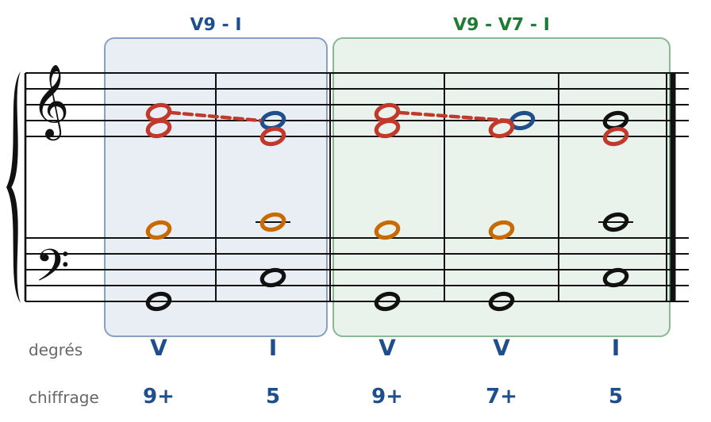
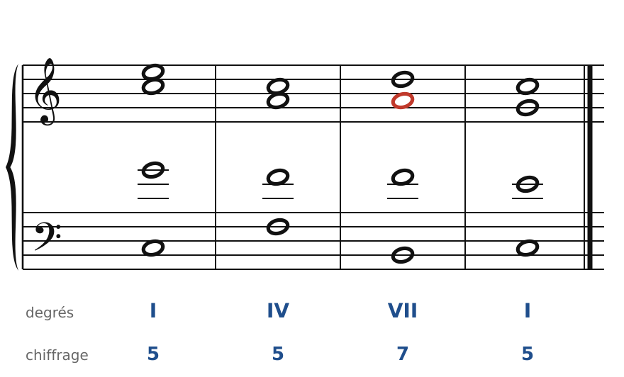
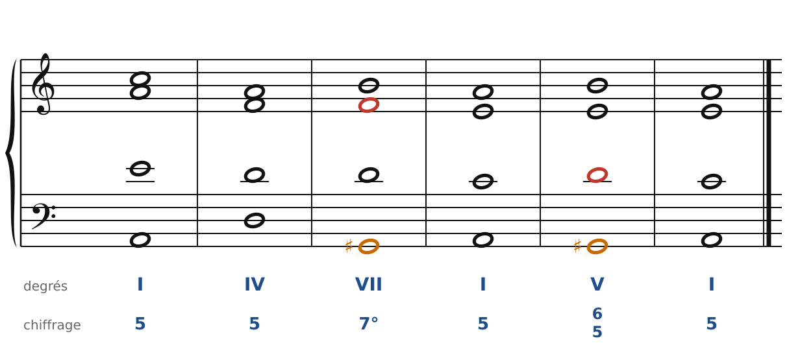
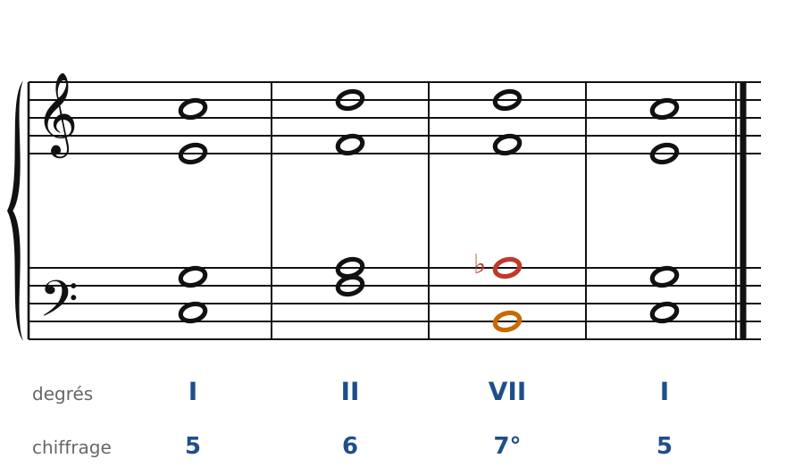

[← 19. Les septièmes d'espèce](19-les-septiemes-d-espece-et-les-marches.md) · [Sommaire](../README.md#sommaire) · [21. Les dominantes secondaires et la modulation →](21-les-dominantes-secondaires-et-la-modulation.md)

## 20. La septième diminuée et la neuvième de dominante

On peut empiler encore une tierce sur le V7 : on obtient la **9e de dominante**, un accord de cinq sons. Il est rare en entier, mais ses formes **sans fondamentale** sont parmi les accords les plus expressifs de la musique classique et romantique : la **7e de sensible** et surtout la **7e diminuée**.

### La 9e de dominante

🔊 [Écouter](audio/h20-neuvieme.mp3) · [MIDI](audio/h20-neuvieme.mid)

En Do majeur : **Sol-Si-Ré-Fa-La**. La 9e (La) est **majeure** en majeur ; en mineur, elle est **mineure** (Fa sur Mi, en la mineur). Chiffrage : **9+** (on écrit aussi 9 au-dessus de 7 et de +).

À quatre voix, il faut supprimer une note : c'est la **quinte**. Restent la fondamentale (à la basse), la sensible, la 7e et la 9e.

Les règles de la 9e :

1. La fondamentale reste **à la basse** (on ne renverse pas l'accord de 9e complet).
2. La 9e se place **au-dessus de la sensible**, et à **au moins une 9e** de la basse. Sinon, elle frotte contre la sensible (un intervalle de 7e majeure ou de 2de) et sonne mal.
3. La 9e **descend d'un degré**, comme la 7e. Elle peut se résoudre sur I (La-Sol, à gauche), ou d'abord sur l'octave de la fondamentale, à l'intérieur du même accord (V9 - V7, à droite).

La sensible (en orange) monte toujours, et la 7e (en rouge) descend.

### La 7e de sensible

🔊 [Écouter](audio/h20-sensible.mp3) · [MIDI](audio/h20-sensible.mid)

Si l'on enlève la fondamentale (Sol) du V9, il reste **Si-Ré-Fa-La** : c'est l'accord de 7e construit sur le VII, qu'on appelle la **7e de sensible** (Bm7♭5). Il garde la fonction de dominante, et se résout sur I :

- la sensible Si **monte** sur Do ;
- la 7e (La, ancienne 9e) **descend** sur Sol ;
- Fa **descend** sur Mi ;
- Ré va sur Do ou sur Mi.

Comme pour le V7, sa 7e n'a pas besoin d'être préparée. Attention aux quintes : Ré et La forment une quinte juste, qui ne doit pas descendre en parallèle sur Do-Sol. La solution : mettre La **sous** Ré (une quarte), comme dans la figure.

### La 7e diminuée

🔊 [Écouter](audio/h20-diminuee.mp3) · [MIDI](audio/h20-diminuee.mid)

En **mineur**, la même chose donne **Sol♯-Si-Ré-Fa** (en la mineur) : trois tierces mineures empilées. C'est l'accord de **7e diminuée** (G♯°7), chiffré **7°** dans ce cours (les traités écrivent un 7 barré). C'est la 9e de dominante mineure (Mi-Sol♯-Si-Ré-Fa) sans fondamentale.

Sa résolution sur I :

- la sensible **Sol♯ monte** sur La (en orange) ;
- la 7e **Fa descend** sur Mi (en rouge) ;
- Si descend sur La, Ré descend sur Do.

Cet accord est très tendu, presque dramatique. On l'entend dans Bach (les passions), Mozart (Don Giovanni), Beethoven (la sonate « Pathétique »)… et dans toute la musique de film.

🔊 [Écouter](audio/h20-diminuee-majeur.mp3) · [MIDI](audio/h20-diminuee-majeur.mid)

On l'emploie aussi **en majeur**, en abaissant le 6e degré : **Si-Ré-Fa-La♭** en Do majeur. Le La♭ (la 7e, en rouge) descend sur Sol. C'est un emprunt au mode mineur, très courant chez les classiques et les romantiques.

### Une curiosité : l'accord symétrique

La 7e diminuée est faite de **quatre tierces mineures** qui partagent l'octave en quatre parts égales. Si on la renverse, on retrouve toujours le même empilement. Il n'existe donc que **trois** accords de 7e diminuée différents, et chacun peut se lire dans quatre tonalités (en changeant le nom d'une note : Sol♯ = La♭). C'est un outil précieux pour **moduler** vers des tons éloignés, qu'on retrouvera dans la sixième partie.

### Les règles à retenir

- **V9** : sans la quinte, la fondamentale à la basse, la 9e au-dessus de la sensible ; la 9e descend.
- **7e de sensible** (VII7, en majeur) et **7e diminuée** (VII7 en mineur, ou en majeur avec le 6e degré abaissé) : ce sont des accords de dominante sans fondamentale. La sensible monte, la 7e descend, et la 7e n'a pas besoin d'être préparée.
- Ne double ni la sensible ni la 7e.

---

[← 19. Les septièmes d'espèce](19-les-septiemes-d-espece-et-les-marches.md) · [Sommaire](../README.md#sommaire) · [21. Les dominantes secondaires et la modulation →](21-les-dominantes-secondaires-et-la-modulation.md)
