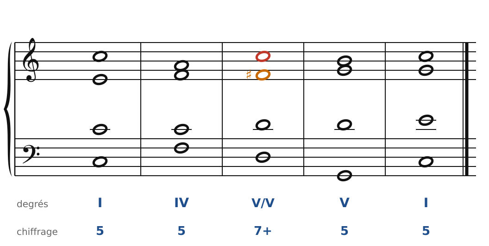
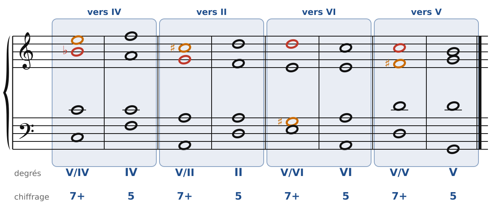
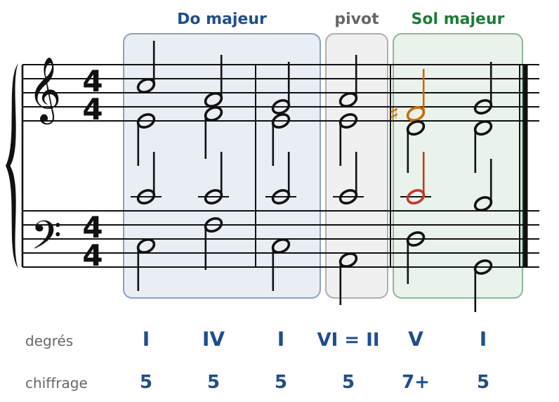
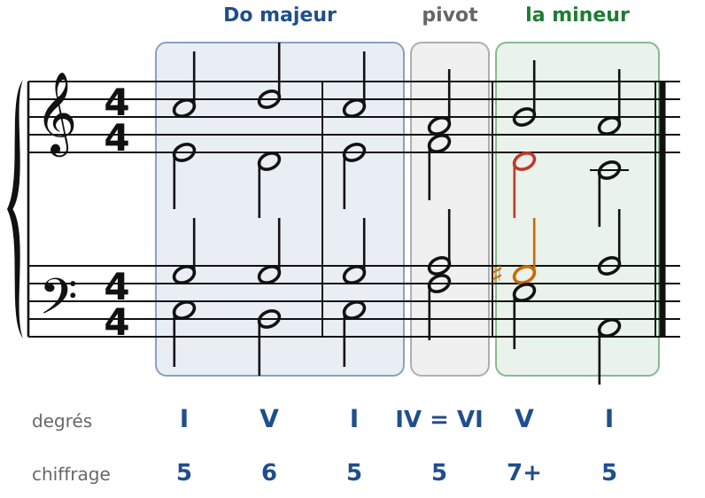

[← 20. La septième diminuée et la neuvième](20-la-septieme-diminuee-et-la-neuvieme.md) · [Sommaire](../README.md#sommaire) · [22. Exercices →](22-exercices.md)

## 21. Les dominantes secondaires et la modulation aux tons voisins

Le V7 a tant de force qu'on a envie de l'utiliser **devant d'autres accords que le I**. On fabrique pour cela la « dominante » d'un autre degré : c'est une **dominante secondaire**. Et quand on s'installe vraiment dans un nouveau ton, on **module**.

### La dominante de la dominante

🔊 [Écouter](audio/h21-vv.mp3) · [MIDI](audio/h21-vv.mid)

En Do majeur, le V est G. Quel accord serait le « V7 de G » ? C'est **Ré-Fa♯-La-Do** (D7). On l'écrit **V7/V** (« cinq sept de cinq »), ou V/V sans la 7e.

Le Fa♯ n'appartient pas à Do majeur : c'est une **sensible passagère**, la sensible de Sol. Elle se comporte comme une vraie sensible :

- **Fa♯ monte** sur Sol (en orange) ;
- la **7e Do descend** sur Si (en rouge) ;
- on ne double ni Fa♯ ni Do.

Le V7/V se place là où l'on mettrait un II ou un IV : juste avant le V. Il rend la demi-cadence ou la cadence parfaite beaucoup plus énergique.

### Les autres dominantes secondaires

🔊 [Écouter](audio/h21-secondaires.mp3) · [MIDI](audio/h21-secondaires.mid)

On peut faire la même chose devant **chaque accord majeur ou mineur** de la tonalité (pas devant le VII, qui est diminué). En Do majeur :

| Dominante secondaire | Notes | Accord | Se résout sur | Sensible passagère |
| --- | --- | --- | --- | --- |
| V7/IV | Do-Mi-Sol-Si♭ | C7 | IV (F) | Mi (monte sur Fa) |
| V7/II | La-Do♯-Mi-Sol | A7 | II (Dm) | Do♯ (monte sur Ré) |
| V7/V | Ré-Fa♯-La-Do | D7 | V (G) | Fa♯ (monte sur Sol) |
| V7/VI | Mi-Sol♯-Si-Ré | E7 | VI (Am) | Sol♯ (monte sur La) |

Remarque le **V7/IV** : c'est le I avec une 7e mineure (Si♭). La note ajoutée n'est pas la sensible, c'est la 7e ; la sensible passagère est Mi, la tierce, qui monte sur Fa.

Pour trouver une dominante secondaire : prends l'accord visé, monte d'une quinte, et construis un accord **majeur avec une 7e mineure**. Les altérations qui apparaissent (Fa♯, Do♯, Sol♯, Si♭) sont les signes d'une dominante secondaire, et ce sont elles qu'il faut surveiller.

### Les tons voisins

Une **modulation**, c'est un changement de tonique : la musique s'installe dans un nouveau ton, avec une nouvelle cadence. Les modulations les plus simples vont vers les **tons voisins**, ceux dont l'armure ne diffère que d'une altération au plus :

| Ton de départ | Tons voisins |
| --- | --- |
| Do majeur | la mineur (relatif) · Sol majeur et mi mineur (dominante) · Fa majeur et ré mineur (sous-dominante) |
| la mineur | Do majeur (relatif) · mi mineur et Sol majeur · ré mineur et Fa majeur |

Les tons voisins ont presque toutes leurs notes en commun. C'est pour cela que l'oreille passe de l'un à l'autre sans effort.

### Moduler avec un accord pivot

🔊 [Écouter](audio/h21-mod-sol.mp3) · [MIDI](audio/h21-mod-sol.mid)

La méthode classique tient en trois temps :

1. **Un accord pivot**, commun aux deux tons. Ici Am : c'est le VI de Do majeur… et le II de Sol majeur. On l'analyse des deux façons (**VI = II**).
2. **La dominante du nouveau ton**, de préférence avec sa 7e : D7, le V7 de Sol. Son Fa♯ (en orange) est la nouvelle sensible : c'est lui qui annonce le changement de ton.
3. **Une cadence** dans le nouveau ton : V7-I en Sol.

Le pivot rend la modulation douce : l'oreille ne sent le changement qu'au moment où arrive la nouvelle sensible.

🔊 [Écouter](audio/h21-mod-la.mp3) · [MIDI](audio/h21-mod-la.mid)

Vers le **relatif mineur**, c'est encore plus facile : F est le IV de Do et le VI de la mineur (**IV = VI**). Puis E7, le V7 de la mineur, avec sa sensible Sol♯, et la cadence V7-I.

### Dominante secondaire ou modulation ?

Les deux utilisent une sensible passagère. La différence est une question de **durée** :

- une **dominante secondaire** colore un seul accord, puis on reste dans le ton (I - V7/V - V - I : on est toujours en Do) ;
- une **modulation** s'installe : nouvelle sensible, **cadence** dans le nouveau ton, et la musique continue dans ce ton.

### Les règles à retenir

- **V7/X** : l'accord majeur avec 7e mineure construit une quinte au-dessus de X. Sa tierce est une sensible passagère, qui monte ; sa 7e descend.
- Les **tons voisins** ont la même armure à une altération près.
- **Moduler** : accord pivot (commun aux deux tons), V7 du nouveau ton, cadence.

---

[← 20. La septième diminuée et la neuvième](20-la-septieme-diminuee-et-la-neuvieme.md) · [Sommaire](../README.md#sommaire) · [22. Exercices →](22-exercices.md)
