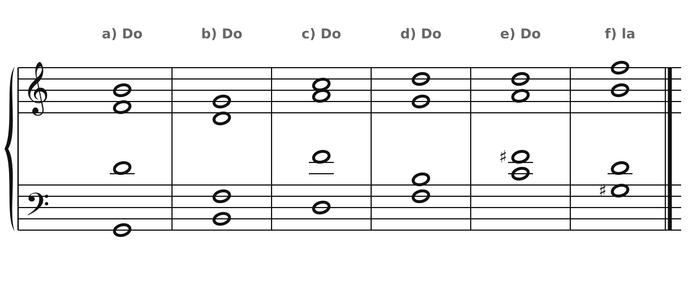
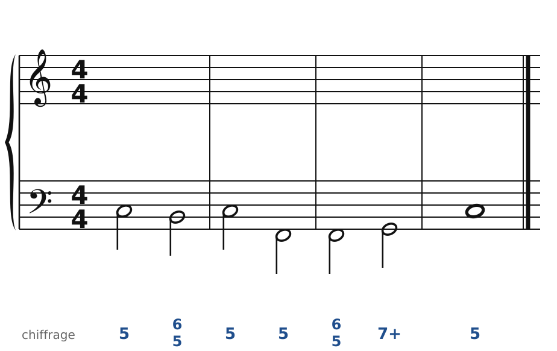
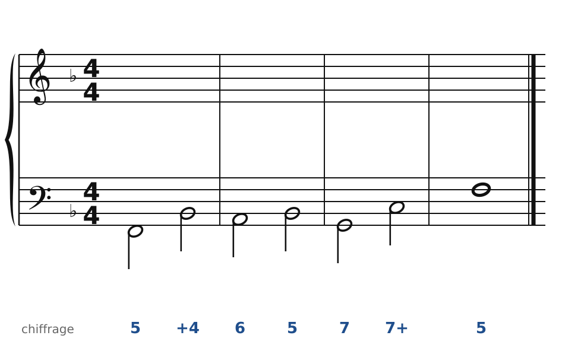
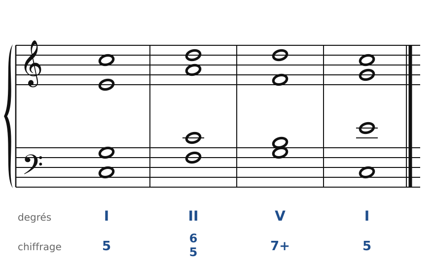
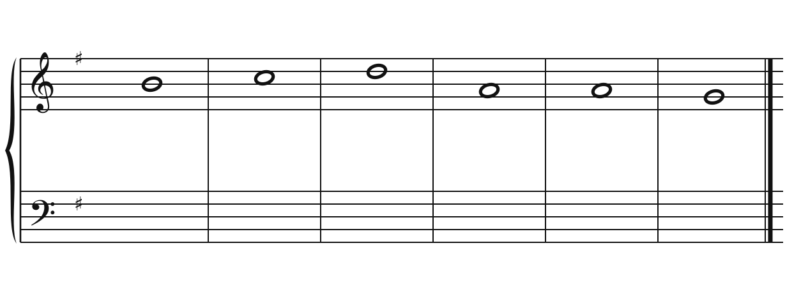
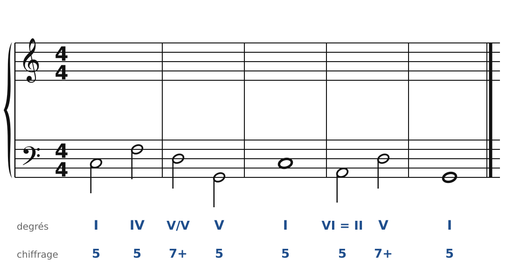

[← 21. Les dominantes secondaires et la modulation](21-les-dominantes-secondaires-et-la-modulation.md) · [Sommaire](../README.md#sommaire) · [23. Corrigés →](23-corriges.md)

## 22. Exercices

Dans la **version web** du cours, les exercices 2 à 6 se font directement sur la portée (bouton **✏️ Faire l'exercice ici**). Pour les basses chiffrées et le chant donné, le menu des accords propose aussi les accords de 7e (V7, II7…) : à toi de choisir le bon d'après la basse et le chiffrage. Les septièmes non préparées ou non résolues sont signalées au fur et à mesure.

Pour t'entraîner davantage, le [cahier d'exercices](../cahier/README.md) propose 26 autres exercices sur ces quatre chapitres.

### Exercice 1 : chiffrer des accords de 4 sons

Pour chaque accord, donne son nom (en lettres), son degré dans la tonalité indiquée et son chiffrage (7+, 6/5, +6, +4, 7, 7°…).

### Exercice 2 : basse chiffrée en Do majeur

Trouve les accords, écris le soprano, puis l'alto et le ténor.

**Indice** : il y a deux 6/5 de nature différente. Le premier a la sensible à la basse (c'est un V) ; le second a le 4e degré à la basse, et sa 7e doit être préparée.

### Exercice 3 : basse chiffrée en Fa majeur

Même consigne.

**Indice** : avec +4, la basse est la 7e du V7 : elle descend ensuite d'un degré.

### Exercice 4 : chasse aux fautes

Cet enchaînement I - II6/5 - V7 - I contient **trois fautes**. Trouve-les et corrige-les (la basse ne bouge pas).

### Exercice 5 : chant donné en Sol majeur

Harmonise cette mélodie. Prépare la cadence par un II6/5 et finis par V7 - I.

### Exercice 6 : une dominante secondaire et une modulation

Basse donnée avec ses accords : un V7/V en Do majeur, puis une modulation vers Sol majeur par l'accord pivot Am (VI = II). Écris le soprano, puis l'alto et le ténor.

---

[← 21. Les dominantes secondaires et la modulation](21-les-dominantes-secondaires-et-la-modulation.md) · [Sommaire](../README.md#sommaire) · [23. Corrigés →](23-corriges.md)
