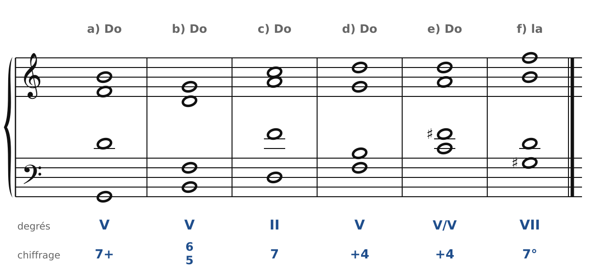
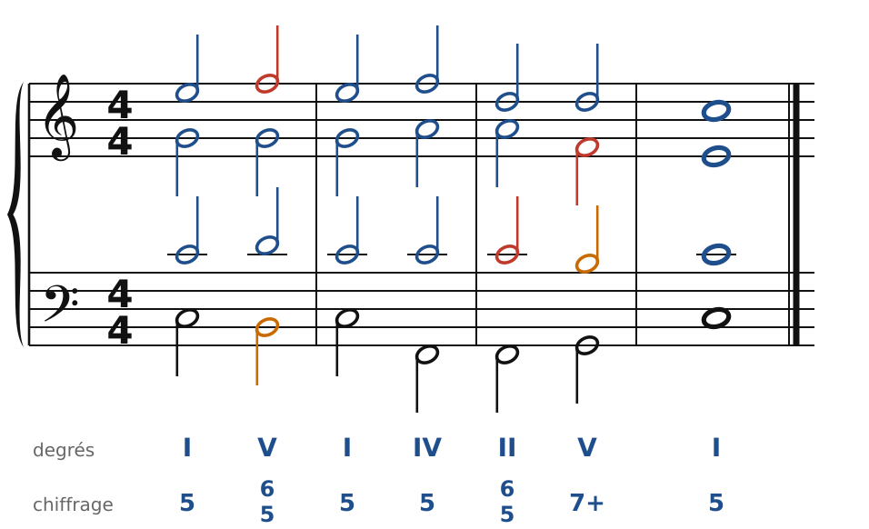
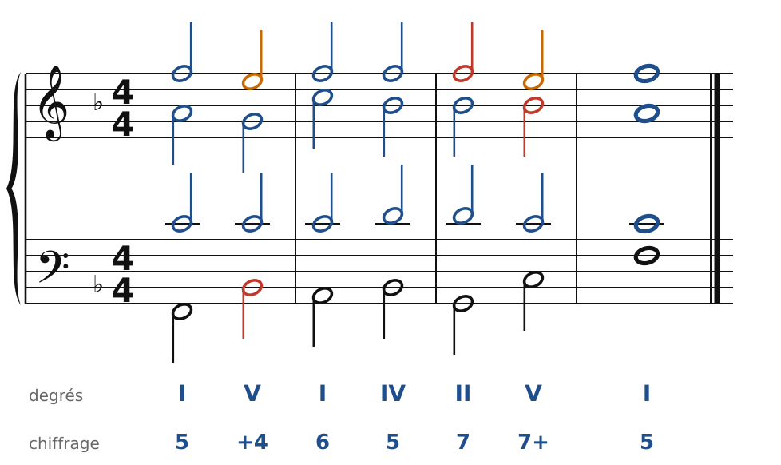
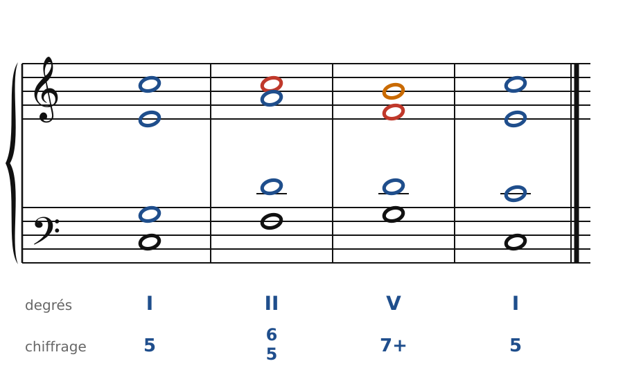
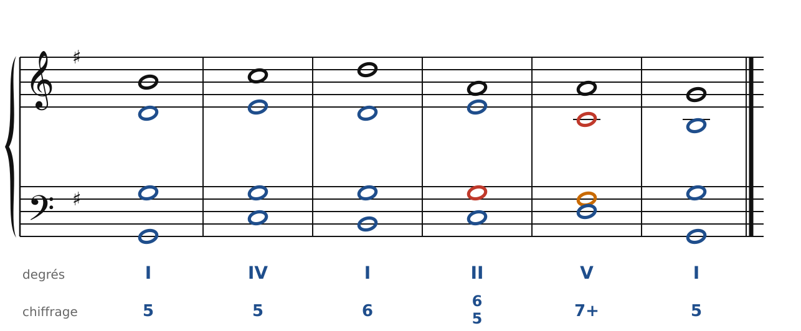
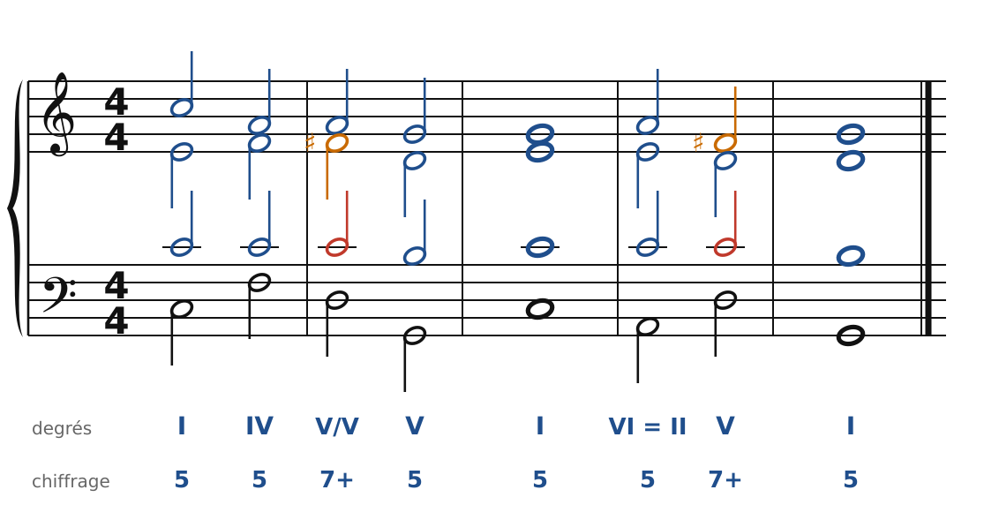

[← 22. Exercices](22-exercices.md) · [Sommaire](../README.md#sommaire) · [24. La sixte napolitaine et les sixtes augmentées →](24-la-sixte-napolitaine-et-les-sixtes-augmentees.md)

## 23. Corrigés

Il y a souvent plusieurs bonnes réponses : les corrigés montrent une solution, contrôlée par le vérificateur du cours. Les septièmes sont en rouge, les sensibles des accords de dominante en orange.

### Exercice 1 : chiffrer des accords de 4 sons

🔊 [Écouter](audio/h23-c1.mp3) · [MIDI](audio/h23-c1.mid)

- **a)** Sol-Si-Ré-Fa, la fondamentale à la basse : G7, **V7+**. Accord complet.
- **b)** Si à la basse, puis Ré, Fa, Sol : G7 au 1er renversement, **V6/5**.
- **c)** Ré-Fa-La-Do, Ré à la basse : Dm7, **II7**, une 7e d'espèce.
- **d)** Fa à la basse : G7 au 3e renversement, **V+4**. La basse devra descendre sur Mi.
- **e)** Ré-Fa♯-La-Do avec Do à la basse : D7, la dominante de la dominante au 3e renversement, **V/V +4**. Le Fa♯ est la sensible passagère.
- **f)** En la mineur, Sol♯-Si-Ré-Fa : G♯°7, la **7e diminuée** sur le VII, **7°**.

### Exercice 2 : basse chiffrée en Do majeur

🔊 [Écouter](audio/h23-c2.mp3) · [MIDI](audio/h23-c2.mid)

Accords : I - V6/5 - I - IV - II6/5 - V7 - I. Le premier 6/5 (sensible Si à la basse) est un V7 renversé : la basse monte sur Do. Le second (Fa à la basse) est un II7 : sa 7e, Do, est préparée par le IV et descend sur Si dans le V7.

### Exercice 3 : basse chiffrée en Fa majeur

🔊 [Écouter](audio/h23-c3.mp3) · [MIDI](audio/h23-c3.mid)

Accords : I - V+4 - I6 - IV - II7 - V7 - I. Dans le V+4, la 7e (Si♭) est à la basse et descend sur La (I6). La 7e du II7 (Fa) est préparée au soprano dans le IV, et descend sur Mi dans le V7.

### Exercice 4 : chasse aux fautes

🔊 [Écouter](audio/h23-c4.mp3) · [MIDI](audio/h23-c4.mid)

Les trois fautes :

1. **Accords 1-2 : quintes consécutives** entre ténor et basse (Sol-Do, puis Do-Fa).
2. **Accords 1-2 : la 7e du II6/5 n'est pas préparée** : le ténor saute sur Do. Il faut que le Do soit déjà là, à la même voix, dans le I.
3. **Accords 3-4 : la 7e du V7 ne descend pas** : l'alto monte de Fa à Sol. Elle doit descendre sur Mi.

Le corrigé garde Do au soprano dans les deux premiers accords (la 7e est préparée), et fait descendre Fa sur Mi à la fin.

### Exercice 5 : chant donné en Sol majeur

🔊 [Écouter](audio/h23-c5.mp3) · [MIDI](audio/h23-c5.mid)

Accords : I - IV - I6 - II6/5 - V7 - I. La 7e du II6/5 (Sol) est préparée par le I6, puis descend sur Fa♯, la sensible du V7, qui monte à son tour sur Sol.

### Exercice 6 : une dominante secondaire et une modulation

🔊 [Écouter](audio/h23-c6.mp3) · [MIDI](audio/h23-c6.mid)

Le V7/V (D7) apporte Fa♯, qui monte sur Sol, et sa 7e Do descend sur Si. Après la cadence en Do, l'accord de Am sert de pivot : VI de Do, II de Sol. Le D7 qui suit est maintenant le V7 de Sol majeur, et la cadence V7 - I confirme le nouveau ton.

---

[← 22. Exercices](22-exercices.md) · [Sommaire](../README.md#sommaire) · [24. La sixte napolitaine et les sixtes augmentées →](24-la-sixte-napolitaine-et-les-sixtes-augmentees.md)
