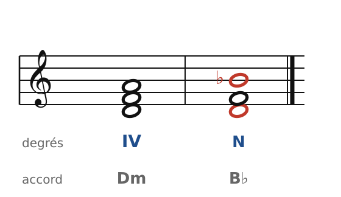
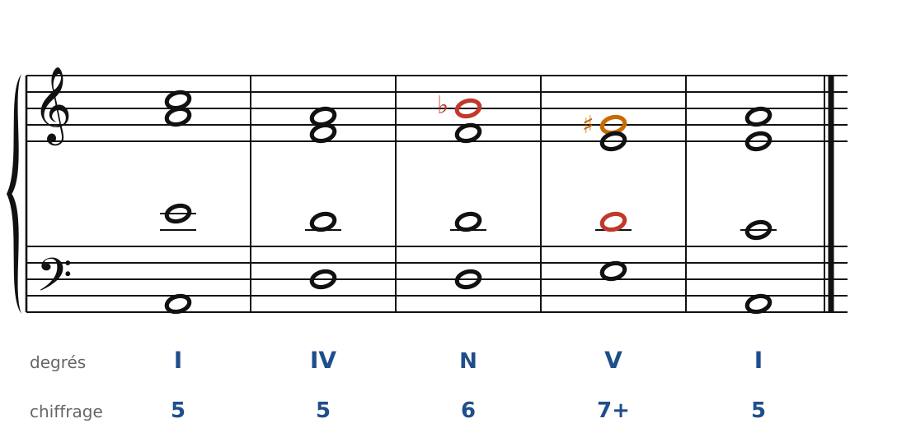
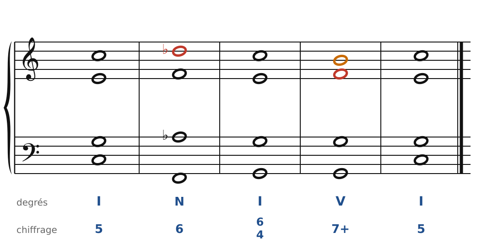
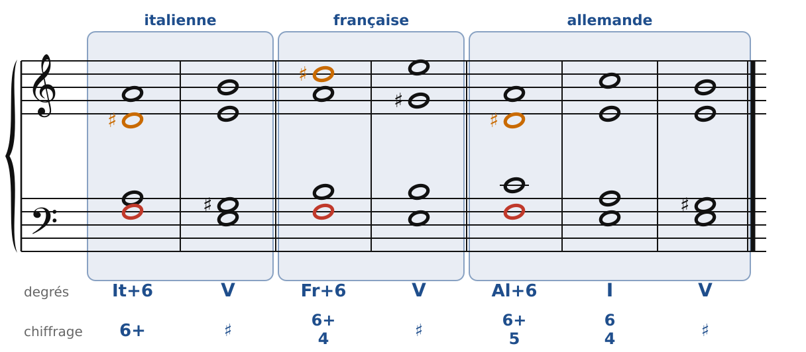
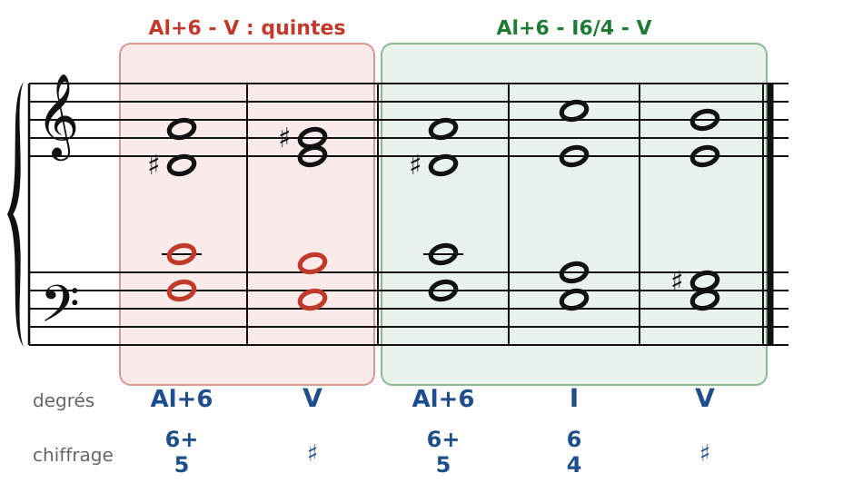
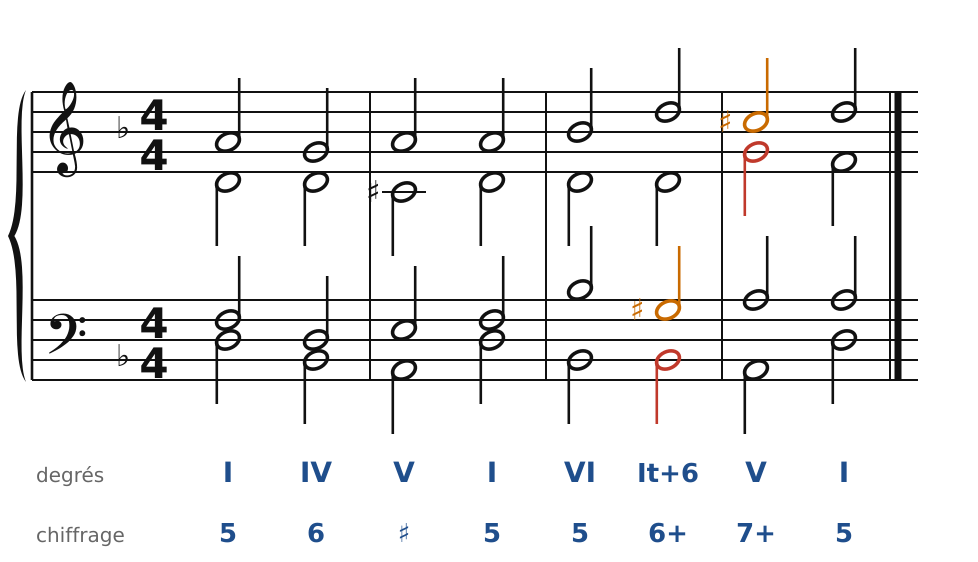

[← 23. Corrigés](23-corriges.md) · [Sommaire](../README.md#sommaire) · [25. Pédales et formules de cadence →](25-pedales-et-formules-de-cadence.md)

## 24. La sixte napolitaine et les sixtes augmentées

Les compositeurs classiques aiment colorer la préparation de la cadence avec des **accords chromatiques**, qui empruntent des notes étrangères à la gamme. Les deux familles les plus célèbres sont la **sixte napolitaine** et les **sixtes augmentées**. Toutes deux préparent le **V** (ou le I6/4 de cadence), et toutes deux se servent du **6e degré abaissé** ou du **2e degré abaissé**, qui descendent d'un demi-ton.

### La sixte napolitaine

🔊 [Écouter](audio/h24-napo-accord.mp3) · [MIDI](audio/h24-napo-accord.mid)

En la mineur, on prend l'accord de IV (Ré-Fa-La) et on remplace La par **Si♭**, le 2e degré abaissé : **Ré-Fa-Si♭**. C'est un accord **majeur**, B♭, construit sur le 2e degré abaissé. On l'emploie presque toujours au **1er renversement**, avec le Ré (la tierce) à la basse : d'où son nom de **sixte napolitaine** (on l'écrit **N6**, ou II♭6). Ce nom vient des compositeurs d'opéra napolitains du XVIIIe siècle, qui l'aimaient beaucoup.

🔊 [Écouter](audio/h24-napo.mp3) · [MIDI](audio/h24-napo.mid)

Les règles :

1. La basse est le **4e degré** (Ré en la mineur) : le N6 prend la place d'un IV ou d'un II6, juste avant la cadence.
2. On double de préférence la **basse** (c'est permis ici, bien que l'accord soit majeur) ou la quinte. On ne double pas le Si♭.
3. Le **Si♭** (en rouge), note expressive, **descend** : sur La (dans un I6/4 de cadence) ou directement sur **Sol♯**, la sensible du V. Ce mouvement Si♭-Sol♯ est une **tierce diminuée** : c'est le seul cas où on l'accepte, et il sonne très expressif (ici à l'alto).
4. On évite le mouvement Si♭-Mi, qui ferait une quarte augmentée.

🔊 [Écouter](audio/h24-napo-majeur.mp3) · [MIDI](audio/h24-napo-majeur.mid)

En **majeur**, la sixte napolitaine est un emprunt au mineur : Fa-La♭-Ré♭ en Do majeur. Ici le Ré♭ du soprano descend sur Do dans le I6/4 de cadence.

### Les sixtes augmentées

Une **sixte augmentée** est un intervalle d'une sixte majeure agrandie d'un demi-ton : en la mineur, **Fa-Ré♯** (10 demi-tons). Ses deux notes sont deux « sensibles » vers la dominante Mi :

- **Fa** (le 6e degré) **descend** d'un demi-ton sur Mi (en rouge) ;
- **Ré♯** (le 4e degré haussé) **monte** d'un demi-ton sur Mi (en orange).

Les deux notes **s'écartent** et arrivent à l'octave sur la dominante. On ne double jamais ni l'une ni l'autre.

Il y a trois sixtes augmentées, qui ont des noms de pays :

🔊 [Écouter](audio/h24-sixtes.mp3) · [MIDI](audio/h24-sixtes.mid)

| Nom | Notes (en la mineur) | Ce qu'on ajoute à la sixte Fa-Ré♯ | Chiffrage |
| --- | --- | --- | --- |
| **Italienne** (It+6) | Fa-La-Ré♯ | la tonique (La), **doublée** | 6+ |
| **Française** (Fr+6) | Fa-La-Si-Ré♯ | la tonique et le 2e degré (Si) | 6+/4 |
| **Allemande** (Al+6) | Fa-La-Do-Ré♯ | la tonique et le 3e degré (Do) | 6+/5 |

Le 6e degré (Fa) est presque toujours **à la basse**. En majeur, on abaisse le 6e degré : La♭-Do-Fa♯ en Do majeur.

### Le piège de la sixte allemande : les quintes « de Mozart »

🔊 [Écouter](audio/h24-quintes.mp3) · [MIDI](audio/h24-quintes.mid)

Dans la sixte allemande, la basse (Fa) et le Do forment une **quinte juste**. Si l'on va directement sur V, Fa descend sur Mi et Do sur Si : ce sont des **quintes consécutives** (à gauche, entre ténor et basse). On les appelle souvent « quintes de Mozart », parce que Mozart les écrit parfois… mais en écriture d'école, on les évite.

La solution (à droite) : passer par le **I6/4 de cadence**. Le Do reste en place, puis descend sur Si dans le V. C'est pour cela que la sixte allemande va presque toujours vers I6/4.

### Une phrase en ré mineur

🔊 [Écouter](audio/h24-phrase.mp3) · [MIDI](audio/h24-phrase.mid)

La sixte italienne (Si♭-Ré-Sol♯) arrive après le VI, avec le même Si♭ à la basse, puis se résout sur le V7 : Si♭ descend sur La, Sol♯ monte sur La.

### Les règles à retenir

- **N6** : accord majeur sur le 2e degré abaissé, au 1er renversement (basse = 4e degré). On double la basse. Le 2e degré abaissé descend (sur la tonique ou sur la sensible).
- **Sixtes augmentées** : 6e degré abaissé à la basse, 4e degré haussé au-dessus. Les deux notes s'écartent d'un demi-ton vers la dominante. On ne les double pas.
- **Italienne** (tonique doublée), **française** (+ 2e degré), **allemande** (+ 3e degré, qui va sur I6/4 pour éviter les quintes).

---

[← 23. Corrigés](23-corriges.md) · [Sommaire](../README.md#sommaire) · [25. Pédales et formules de cadence →](25-pedales-et-formules-de-cadence.md)
