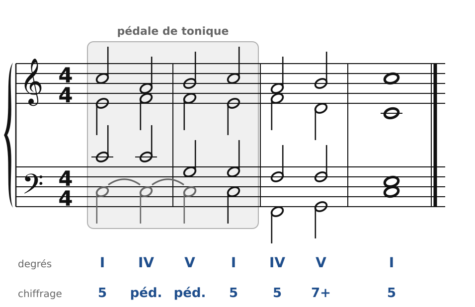
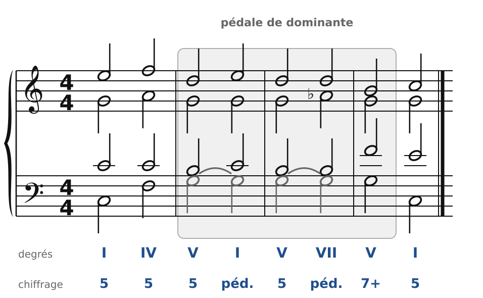
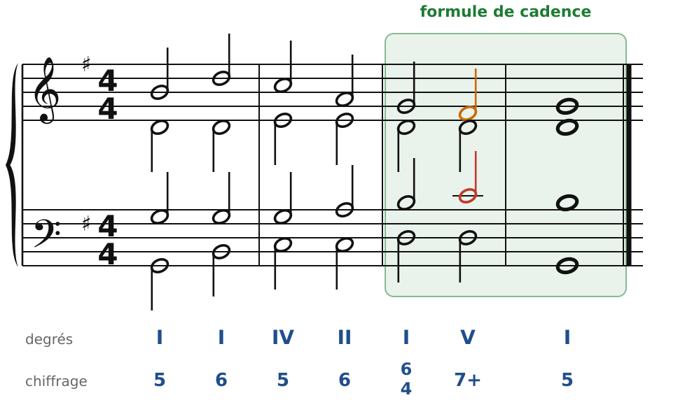
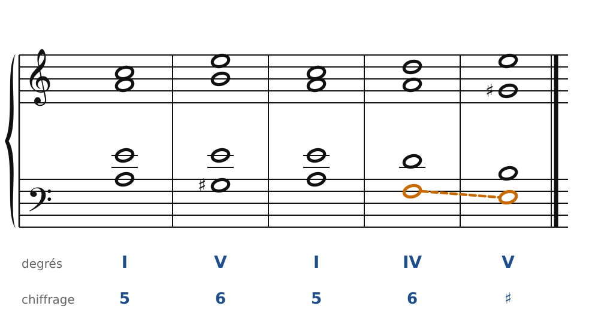
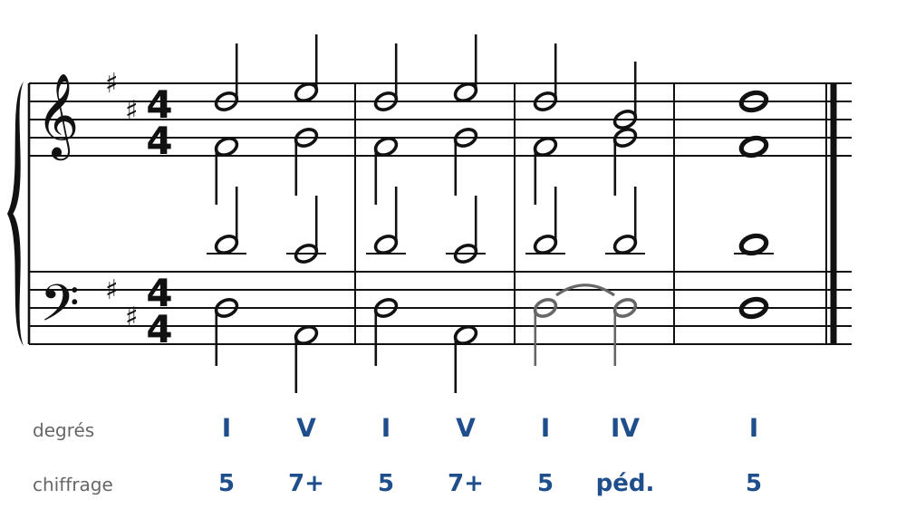

[← 24. La sixte napolitaine et les sixtes augmentées](24-la-sixte-napolitaine-et-les-sixtes-augmentees.md) · [Sommaire](../README.md#sommaire) · [26. Écrire pour quatuor à cordes →](26-ecrire-pour-quatuor-a-cordes.md)

## 25. Pédales et formules de cadence classiques

La musique classique (Haydn, Mozart, Beethoven) est faite de **phrases** très lisibles, qui finissent par des cadences bien préparées. Ce chapitre présente deux outils qu'on entend partout dans ce style : la **pédale** et les **formules de cadence**.

### La pédale de tonique

Une **pédale** est une note tenue (ou répétée) à la basse, pendant que les accords changent au-dessus. Elle peut ne pas appartenir aux accords qu'elle soutient : l'oreille l'entend comme un fond immobile.

🔊 [Écouter](audio/h25-pedale-tonique.mp3) · [MIDI](audio/h25-pedale-tonique.mid)

Ici, le Do de la basse (en gris) reste en place pendant I - IV - V7 - I. Au-dessus, les trois voix supérieures font de vrais enchaînements, avec toutes les règles habituelles (notes communes, 7e qui descend…). Dans le chiffrage, on écrit simplement **péd.**

Les règles de la pédale :

1. Elle commence et finit sur un accord **dont elle fait partie** (ici, le I).
2. Les **trois voix du haut** forment des accords complets et s'enchaînent correctement entre elles.
3. On n'analyse pas l'accord avec la basse : le IV au-dessus du Do est un IV, pas un accord de quarte et sixte.

La pédale de tonique sonne comme un **apaisement** : on l'entend souvent au début d'un morceau, ou à la toute fin, dans la **coda**.

### La pédale de dominante

🔊 [Écouter](audio/h25-pedale-dominante.mp3) · [MIDI](audio/h25-pedale-dominante.mid)

Sur un Sol tenu, les voix du haut alternent I et V, puis une **7e diminuée** (Si-Ré-La♭) : la tension monte, et l'on attend la résolution sur I. La pédale de dominante crée une **attente**. Les classiques l'emploient avant le retour du thème principal, ou avant une cadence importante.

### La grande formule de cadence

🔊 [Écouter](audio/h25-cadence.mp3) · [MIDI](audio/h25-cadence.mid)

Presque toutes les phrases de Mozart finissent par la même suite de fonctions :

1. **Tonique** : I (ou I6) ;
2. **Préparation** (« sous-dominante ») : IV, II6 ou II6/5 — ou une sixte napolitaine, une sixte augmentée ;
3. **I6/4 de cadence**, sur le temps fort ;
4. **V7** ;
5. **I**.

La basse fait souvent Sol-Si-Do-Do-Ré-Ré-Sol (en Sol majeur) : elle **monte** vers la dominante, puis saute sur la tonique. Retiens cette formule : c'est le squelette de milliers de cadences classiques. Pour la rendre plus brillante, on peut ajouter un trille sur la note du soprano dans le V7.

### La demi-cadence phrygienne

🔊 [Écouter](audio/h25-phrygienne.mp3) · [MIDI](audio/h25-phrygienne.mid)

En mineur, il existe une demi-cadence très typique : **IV6 - V**. La basse descend d'un **demi-ton** (Fa-Mi en la mineur, en orange), comme la fin d'une gamme phrygienne. On l'entend chez Bach, mais aussi souvent dans les mouvements lents classiques, juste avant un mouvement rapide.

### La coda : cadences répétées et pédale

🔊 [Écouter](audio/h25-coda.mp3) · [MIDI](audio/h25-coda.mid)

Pour terminer un morceau, les classiques **répètent** la cadence (V7-I, V7-I), puis se posent sur une pédale de tonique, avec un IV au-dessus (une « cadence plagale » sur la pédale). Écoute la fin de presque n'importe quelle symphonie de Haydn ou de Mozart : c'est cette formule, avec beaucoup d'énergie.

### Les règles à retenir

- **Pédale** : note tenue à la basse ; les trois voix du haut font des accords complets et s'enchaînent bien. Elle commence et finit dans un accord dont elle fait partie.
- **Pédale de tonique** = détente ; **pédale de dominante** = attente.
- **Formule de cadence** : I - (IV, II6 ou II6/5) - I6/4 - V7 - I.
- **Demi-cadence phrygienne** (en mineur) : IV6 - V, basse par demi-ton descendant.

---

[← 24. La sixte napolitaine et les sixtes augmentées](24-la-sixte-napolitaine-et-les-sixtes-augmentees.md) · [Sommaire](../README.md#sommaire) · [26. Écrire pour quatuor à cordes →](26-ecrire-pour-quatuor-a-cordes.md)
