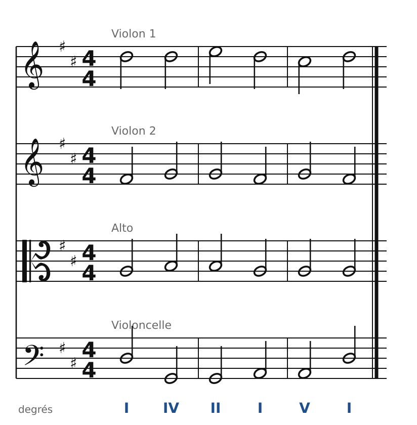
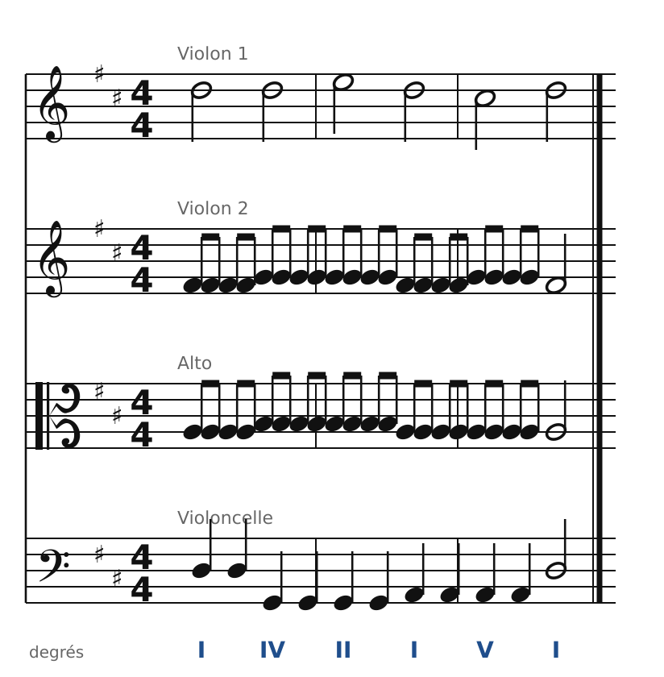
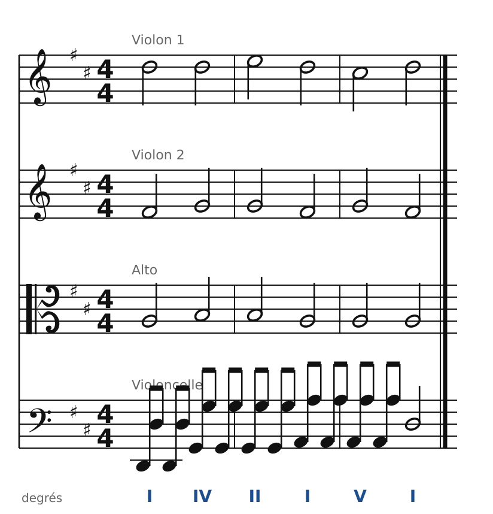
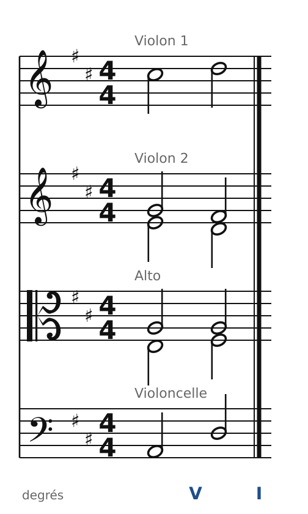

[← 25. Pédales et formules de cadence](25-pedales-et-formules-de-cadence.md) · [Sommaire](../README.md#sommaire) · [27. Analyse : Beethoven, quatuor op. 18 n° 1 →](27-analyse-beethoven-op18-n1.md)

## 26. Écrire pour quatuor à cordes

Depuis le chapitre 1, on écrit pour le quatuor à cordes comme pour un chœur : une note par instrument et par accord. C'est la base, et c'est toujours juste. Mais Haydn, Mozart et Beethoven donnent aux cordes une écriture bien plus vivante. Dans ce chapitre, on garde **la même harmonie** et on change seulement la **texture** : la manière de distribuer et de faire bouger les notes.

### Les instruments et leurs tessitures

| Instrument | Clé | Note la plus grave | Registre confortable pour l'accompagnement |
| --- | --- | --- | --- |
| Violon 1 et 2 | sol | Sol3 (corde à vide) | Sol3 - Mi6 |
| Alto | ut 3e ligne | Do3 (corde à vide) | Do3 - Ré5 |
| Violoncelle | fa | Do2 (corde à vide) | Do2 - La4 |

Les cordes vont plus loin que les voix : le 1er violon peut monter très haut, et le violoncelle descend une sixte sous la basse vocale. On peut donc **écarter** davantage les voix, surtout la basse.

### La texture de choral

🔊 [Écouter](audio/h26-choral.mp3) · [MIDI](audio/h26-choral.mid)

Une phrase en Ré majeur (I - IV - II6 - I6/4 - V7 - I), écrite comme un choral : chaque instrument chante une voix. C'est la texture des mouvements lents « religieux » (Haydn, *Les sept dernières paroles du Christ*), ou des débuts de phrase solennels.

### La mélodie accompagnée : les batteries

🔊 [Écouter](audio/h26-batteries.mp3) · [MIDI](audio/h26-batteries.mid)

La texture la plus classique : le **1er violon chante** la mélodie, le **violoncelle** joue la basse en noires, et le **2e violon** et l'**alto** répètent leurs notes en croches. Ces notes répétées s'appellent des **batteries**. Elles remplissent l'harmonie et donnent du mouvement, sans gêner la mélodie.

Ce qu'il faut savoir :

- Les batteries répètent les notes **du choral** : les enchaînements restent ceux de l'écriture à quatre voix. Si le choral est juste, la texture l'est aussi.
- Elles s'arrêtent souvent sur l'accord final, pour bien marquer la fin.
- Le tempo des batteries (croches, doubles croches) change complètement le caractère : calme en croches, agité en doubles croches (pense au début du quatuor op. 18 n° 1 de Beethoven, chapitre suivant).

### La basse en octaves

🔊 [Écouter](audio/h26-basse.mp3) · [MIDI](audio/h26-basse.mid)

Ici, ce sont les trois instruments du haut qui tiennent les accords, et le **violoncelle** qui bouge, en **octaves brisées**. Une octave brisée ne change rien à l'harmonie : c'est toujours la même note de basse. Cette texture donne de l'élan, très souvent dans les finales.

### Les doubles cordes

🔊 [Écouter](audio/h26-doubles-cordes.mp3) · [MIDI](audio/h26-doubles-cordes.mid)

Un instrument à cordes peut jouer **deux notes à la fois** (une **double corde**). À la cadence finale, le 2e violon et l'alto ajoutent chacun une note : l'accord passe de quatre à six sons, plus puissant.

Les règles :

- Les **meilleurs intervalles** sont la tierce et la sixte (faciles à jouer, sur deux cordes voisines). Les quintes et les octaves sont possibles, mais plus difficiles à jouer justes.
- Les notes ajoutées **doublent** des notes de l'accord : ce sont des renforts, pas de nouvelles voix. On ne les juge donc pas comme les quatre voix réelles (des octaves entre une note ajoutée et une voix réelle sont permises). Mais on ne double toujours pas la sensible ni la septième si elles doivent se résoudre.
- On les réserve aux moments forts : cadences, accords répétés, fins.

### La méthode

1. Écris d'abord **le choral à quatre voix**, avec toutes les règles.
2. Choisis une **texture** pour chaque phrase : choral, mélodie accompagnée (batteries), basse en mouvement…
3. Garde les notes des voix réelles ; ajoute des notes de passage au 1er violon pour orner la mélodie.
4. Vérifie les **tessitures** de chaque instrument, et réserve les doubles cordes aux moments forts.

### Les règles à retenir

- Une texture de quatuor est un **choral juste**, habillé : on répète, on brise ou on double les notes sans changer les enchaînements.
- **Batteries** au 2e violon et à l'alto, mélodie au 1er violon, basse au violoncelle : la texture classique de la mélodie accompagnée.
- **Doubles cordes** : tierces et sixtes, aux moments forts ; ce sont des renforts.

---

[← 25. Pédales et formules de cadence](25-pedales-et-formules-de-cadence.md) · [Sommaire](../README.md#sommaire) · [27. Analyse : Beethoven, quatuor op. 18 n° 1 →](27-analyse-beethoven-op18-n1.md)
