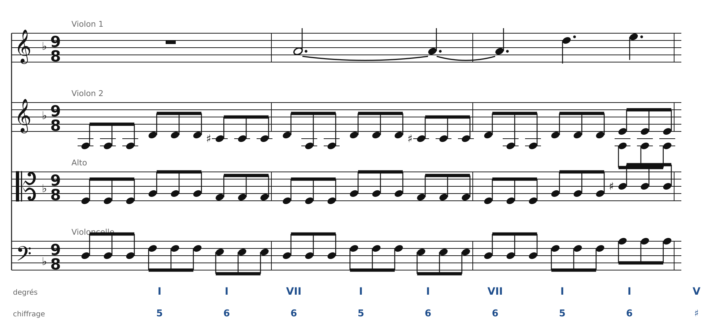
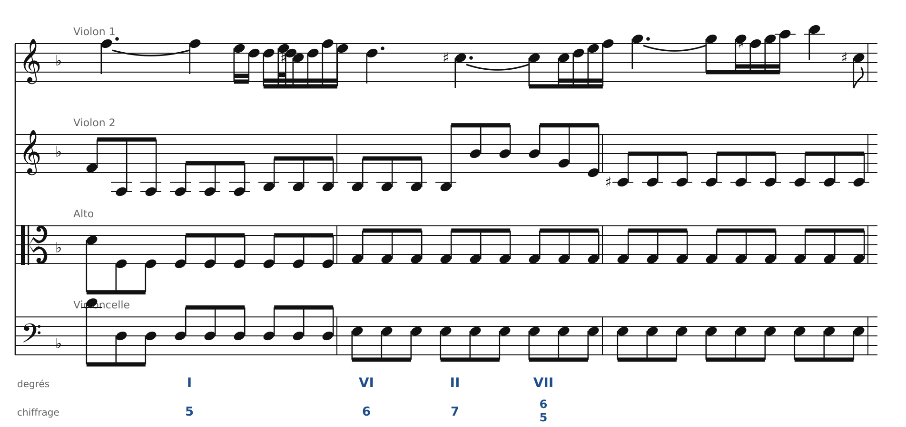
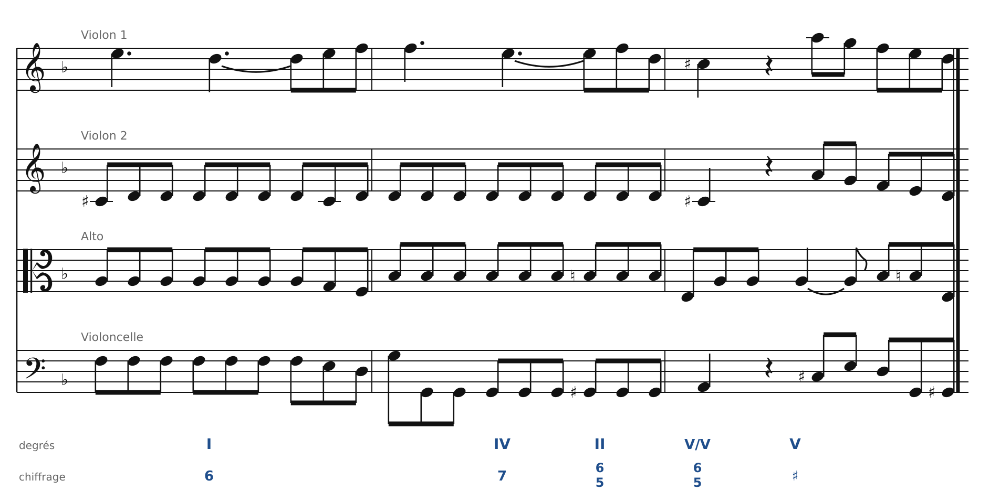

[← 26. Écrire pour quatuor à cordes](26-ecrire-pour-quatuor-a-cordes.md) · [Sommaire](../README.md#sommaire) · [28. Exercices →](28-exercices.md)

## 27. Analyse : Beethoven, quatuor op. 18 n° 1, Adagio

Le premier quatuor de l'opus 18 de Beethoven (composé en 1799-1800, publié en 1801) contient un mouvement lent bouleversant, en **ré mineur** : *Adagio affettuoso ed appassionato*. Beethoven aurait confié à un ami qu'il pensait, en l'écrivant, à la scène du tombeau de *Roméo et Juliette*. Voici ses neuf premières mesures, avec l'analyse harmonique sous la portée.

La mesure est à **9/8** : trois temps, chacun d'une noire pointée (trois croches). On analyse un accord par temps.

### Mesures 1 à 3 : la tonique, et une mélodie qui s'élève

🔊 [Écouter](audio/h27-mes1-3.mp3) · [MIDI](audio/h27-mes1-3.mid)

- **La texture** : le 2e violon, l'alto et le violoncelle jouent des **batteries** en croches (chapitre 26). Le 1er violon entre à la mesure 2 avec une longue note tenue, La, qui monte ensuite par degrés (La-Ré-Mi-Fa).
- **L'harmonie** : I - I6 - VII6, deux fois, puis I - I6 - V. Le **VII6** (Mi-Sol-Do♯, sensible à l'intérieur) est une dominante sans fondamentale : c'est le V7 sans son La (chapitre 20). La basse fait Ré-Fa-Mi : une petite broderie autour de la tonique.
- La mesure 3 arrive enfin sur un vrai **V** (La à la basse), qui ouvre la phrase.

### Mesures 4 à 6 : la tension monte

🔊 [Écouter](audio/h27-mes4-6.mp3) · [MIDI](audio/h27-mes4-6.mid)

- Mesure 4 : retour sur **I**, puis **VI6** (Si♭ dans les voix intérieures). Le 1er violon s'orne d'un petit groupe de notes rapides (doubles et triples croches), typique du style classique.
- Mesure 5 : **II7** (Mi-Sol-Si♭-Ré), une 7e d'espèce, puis la **7e diminuée** **VII6/5** (Do♯-Mi-Sol-Si♭ avec Mi à la basse). Elle dure **deux mesures entières** (5 et 6) : la basse reste sur Mi, les batteries continuent, et le 1er violon monte jusqu'à Si♭5. C'est le point de plus forte tension de la phrase.

### Mesures 7 à 9 : retour et demi-cadence

🔊 [Écouter](audio/h27-mes7-9.mp3) · [MIDI](audio/h27-mes7-9.mid)

- Mesure 7 : la 7e diminuée se résout sur **I6** : la basse monte d'un demi-ton (Mi-Fa), et le Do♯ du 2e violon, d'abord gardé comme une note étrangère, monte sur Ré (chapitre 20).
- Mesure 8 : la **formule de cadence** (chapitre 25) : **IV7** (Sol-Si♭-Ré-Fa), puis **II6/5** (Mi-Sol-Si♭-Ré sur Sol) et enfin **V/V 6/5** : Mi-Sol♯-Si-Ré, avec Sol♯ à la basse. Le Sol♯ est la sensible de la dominante (chapitre 21), et il monte sur La.
- Mesure 9 : **demi-cadence** sur **V** (La-Do♯-Mi). La phrase s'arrête sur une question.

### Ce qu'il faut retenir

- Une texture de quatuor riche (batteries, mélodie ornée) repose sur une **harmonie simple et très claire**, à un accord par temps.
- Beethoven prolonge un seul accord, la **7e diminuée**, pendant deux mesures entières : l'harmonie avance lentement, et la tension vient de la durée.
- La fin de phrase suit exactement les formules étudiées : préparation (IV7, II6/5), **dominante secondaire** (V/V), **demi-cadence**.
- À la basse, presque tout se fait **par degrés** (Ré-Fa-Mi, Sol-Sol♯-La) : une basse qui chante, comme dans un choral.

La partition complète du quatuor se trouve sur IMSLP (bibliothèque de partitions libres). Écoute tout le mouvement : la même musique revient plusieurs fois, de plus en plus dramatique.

---

[← 26. Écrire pour quatuor à cordes](26-ecrire-pour-quatuor-a-cordes.md) · [Sommaire](../README.md#sommaire) · [28. Exercices →](28-exercices.md)
