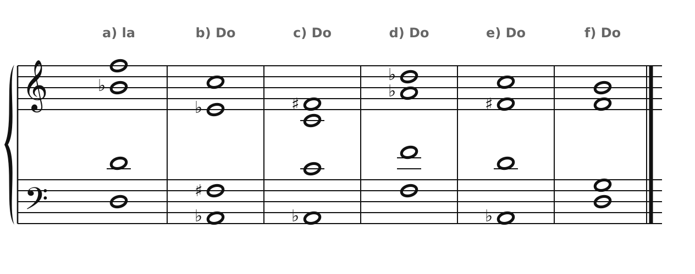
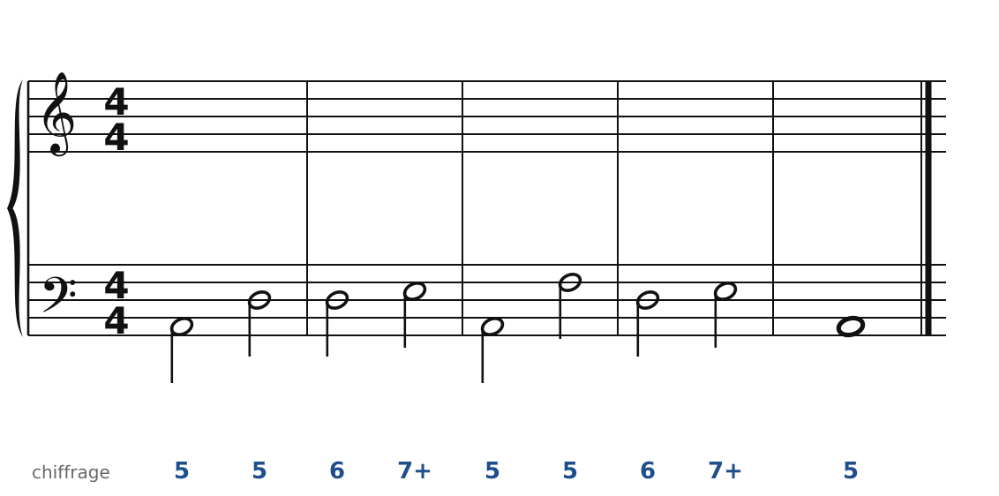
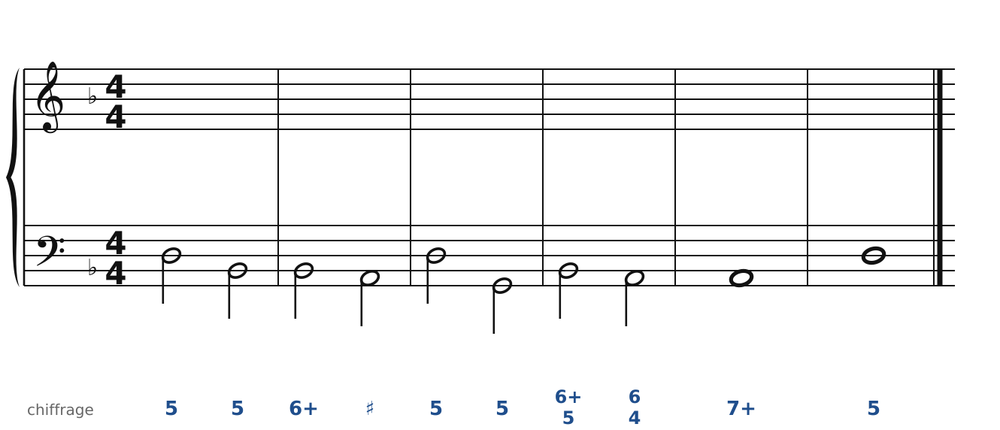
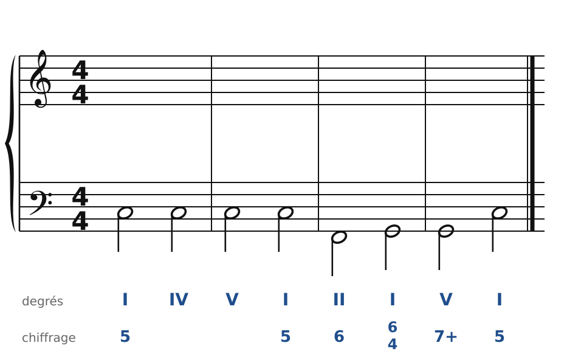
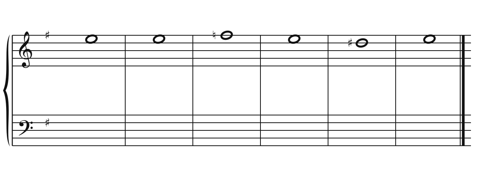
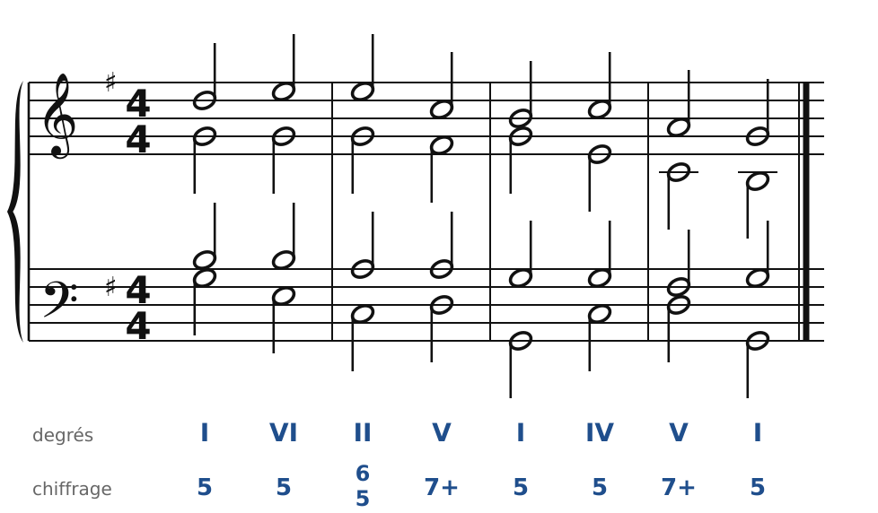

[← 27. Analyse : Beethoven, quatuor op. 18 n° 1](27-analyse-beethoven-op18-n1.md) · [Sommaire](../README.md#sommaire) · [29. Corrigés →](29-corriges.md)

## 28. Exercices

Dans la **version web** du cours, les exercices 2 à 5 se font directement sur la portée (bouton **✏️ Faire l'exercice ici**). Le menu des accords propose la sixte napolitaine (**N**) et les sixtes augmentées (**It+6**, **Fr+6**, **Al+6**). Une sixte augmentée mal résolue, ou une note de la sixte doublée, est signalée tout de suite.

Pour t'entraîner davantage, le [cahier d'exercices](../cahier/README.md) propose 16 autres exercices sur les chapitres 24 à 26.

### Exercice 1 : reconnaître les accords chromatiques

Pour chaque accord, dis s'il s'agit d'une sixte napolitaine, d'une sixte augmentée (laquelle ?) ou d'autre chose, dans la tonalité indiquée.

### Exercice 2 : basse chiffrée en la mineur, avec une sixte napolitaine

**Indice** : un 6 sur Ré, juste avant la cadence, avec un Si♭ dans l'armure de l'accord… c'est N6. Fais descendre le Si♭.

### Exercice 3 : basse chiffrée en ré mineur, avec deux sixtes augmentées

**Indice** : 6+ et 6+/5 sur Si♭ : sixte italienne puis allemande. La seconde va sur I6/4.

### Exercice 4 : une pédale de tonique

Basse donnée avec ses accords, en Do majeur. Les accords 2 et 3 sont posés sur une pédale de Do : écris-les avec les trois voix du haut seulement. Écris le soprano, puis l'alto et le ténor.

### Exercice 5 : chant donné en mi mineur

Harmonise cette mélodie et prépare la cadence avec une sixte napolitaine.

### Exercice 6 : pour quatuor à cordes (sur papier)

Recopie ce choral pour quatuor à cordes, en texture de **mélodie accompagnée** : mélodie au 1er violon, **batteries** en croches au 2e violon et à l'alto, basse en noires au violoncelle.

🔊 [Écouter](audio/h28-ex6.mp3) · [MIDI](audio/h28-ex6.mid)

---

[← 27. Analyse : Beethoven, quatuor op. 18 n° 1](27-analyse-beethoven-op18-n1.md) · [Sommaire](../README.md#sommaire) · [29. Corrigés →](29-corriges.md)
