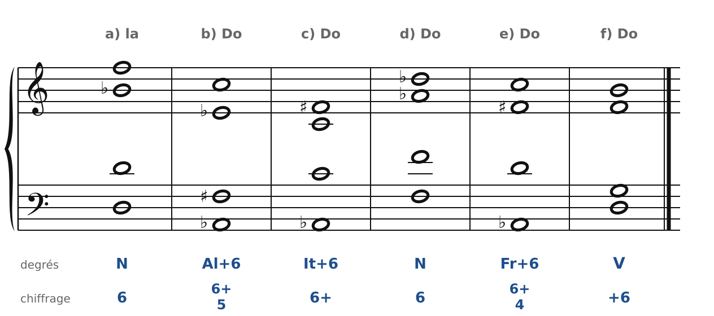
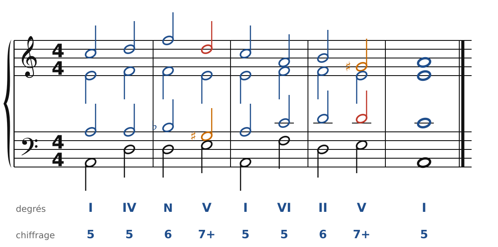
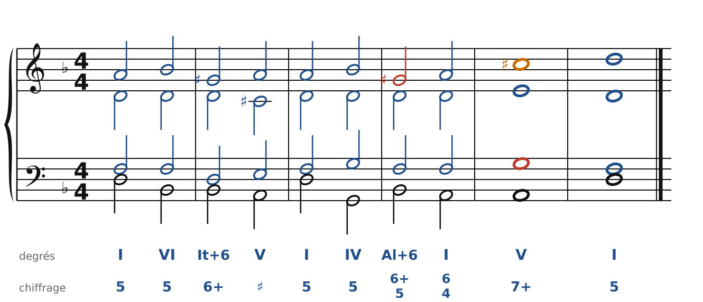
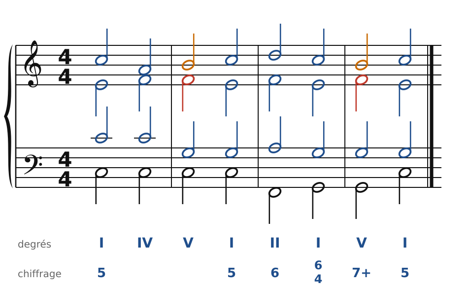
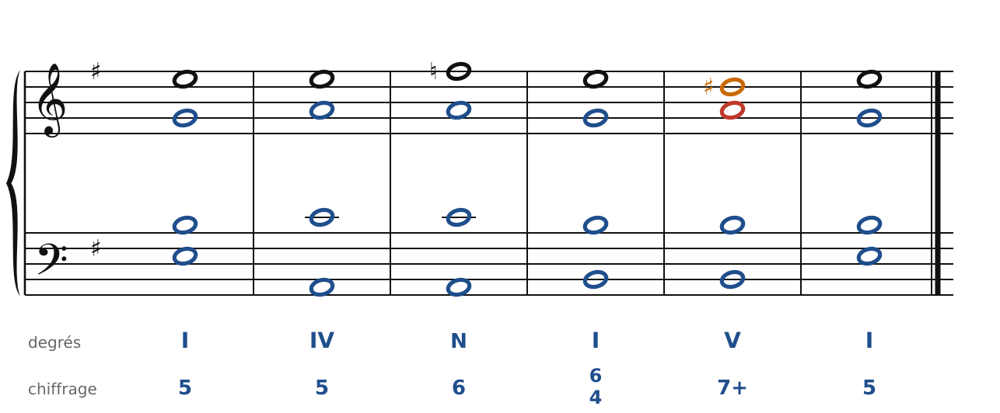
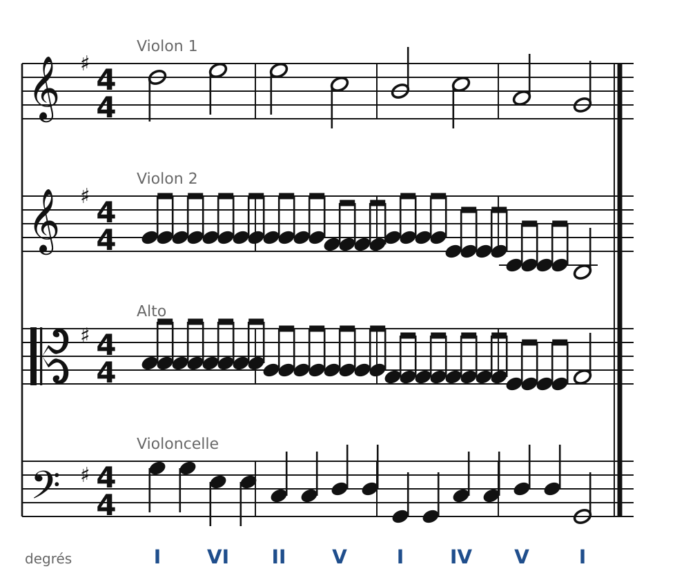

[← 28. Exercices](28-exercices.md) · [Sommaire](../README.md#sommaire)

## 29. Corrigés

Il y a souvent plusieurs bonnes réponses : les corrigés montrent une solution, contrôlée par le vérificateur du cours.

### Exercice 1 : reconnaître les accords chromatiques

🔊 [Écouter](audio/h29-c1.mp3) · [MIDI](audio/h29-c1.mid)

- **a)** En la mineur, Ré-Fa-Si♭ avec Ré à la basse : **sixte napolitaine** (N6). La basse (Ré) est doublée.
- **b)** La♭-Do-Mi♭-Fa♯ : **sixte allemande** de Do (Al+6). La♭ et Fa♯ forment la sixte augmentée.
- **c)** La♭-Do-Fa♯, avec Do doublé : **sixte italienne** (It+6).
- **d)** Fa-La♭-Ré♭ avec Fa à la basse : **sixte napolitaine** en Do majeur (emprunt au mineur).
- **e)** La♭-Do-Ré-Fa♯ : **sixte française** (Fr+6).
- **f)** Ré-Fa-Sol-Si : ce n'est pas un accord chromatique, c'est le **V+6** (G7 au 2e renversement).

### Exercice 2 : basse chiffrée en la mineur

🔊 [Écouter](audio/h29-c2.mp3) · [MIDI](audio/h29-c2.mid)

Accords : I - IV - N6 - V7 - I - VI - II6 - V7 - I. Dans le N6, la quinte (Fa) est doublée, et le Si♭ du ténor descend sur Sol♯, la sensible : une tierce diminuée, permise ici.

### Exercice 3 : basse chiffrée en ré mineur

🔊 [Écouter](audio/h29-c3.mp3) · [MIDI](audio/h29-c3.mid)

Accords : I - VI - It+6 - V - I - IV - Al+6 - I6/4 - V7 - I. Dans les deux sixtes augmentées, Si♭ (basse) descend sur La et Sol♯ (soprano) monte sur La. La sixte allemande passe par le I6/4 : le Fa reste en place, ce qui évite les quintes Si♭-Fa, La-Mi.

### Exercice 4 : une pédale de tonique

🔊 [Écouter](audio/h29-c4.mp3) · [MIDI](audio/h29-c4.mid)

Au-dessus du Do tenu, les trois voix du haut font I - IV - V7 - I : le Do est gardé au ténor, la 7e (Fa) du V7 vient de l'accord de IV et descend sur Mi. Puis la formule de cadence II6 - I6/4 - V7 - I.

### Exercice 5 : chant donné en mi mineur

🔊 [Écouter](audio/h29-c5.mp3) · [MIDI](audio/h29-c5.mid)

Accords : I - IV - N6 - I6/4 - V7 - I. Le Fa (2e degré abaissé, au soprano) du N6 descend sur Mi dans le I6/4 ; le chant se termine par Ré♯-Mi (sensible - tonique).

### Exercice 6 : pour quatuor à cordes

🔊 [Écouter](audio/h29-c6.mp3) · [MIDI](audio/h29-c6.mid)

Chaque voix du choral passe à un instrument : soprano au 1er violon, alto au 2e violon (en batteries), ténor à l'alto (en batteries), basse au violoncelle (en noires). Les enchaînements restent exactement ceux du choral. À la fin, tout le monde s'arrête sur l'accord final.

---

[← 28. Exercices](28-exercices.md) · [Sommaire](../README.md#sommaire)
