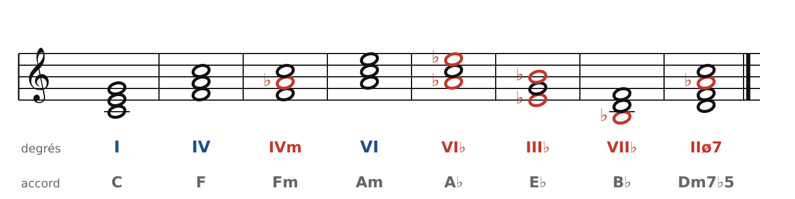
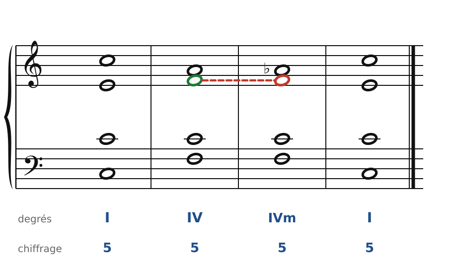
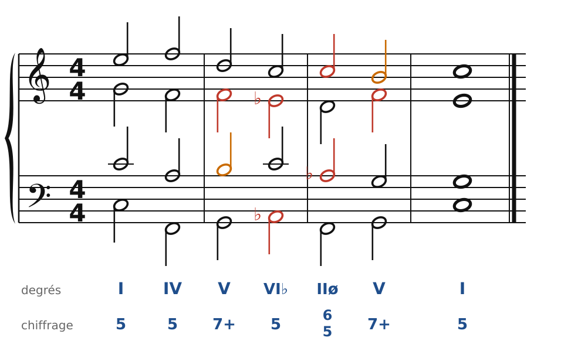
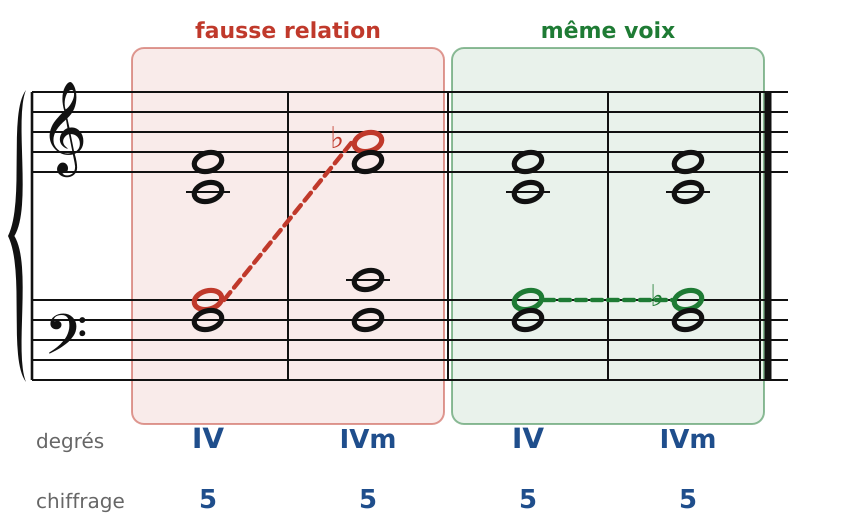
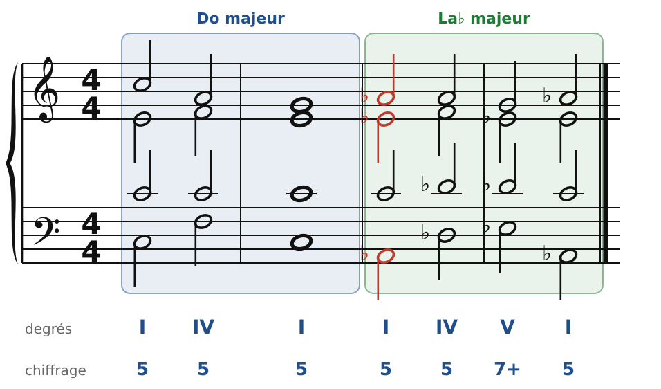
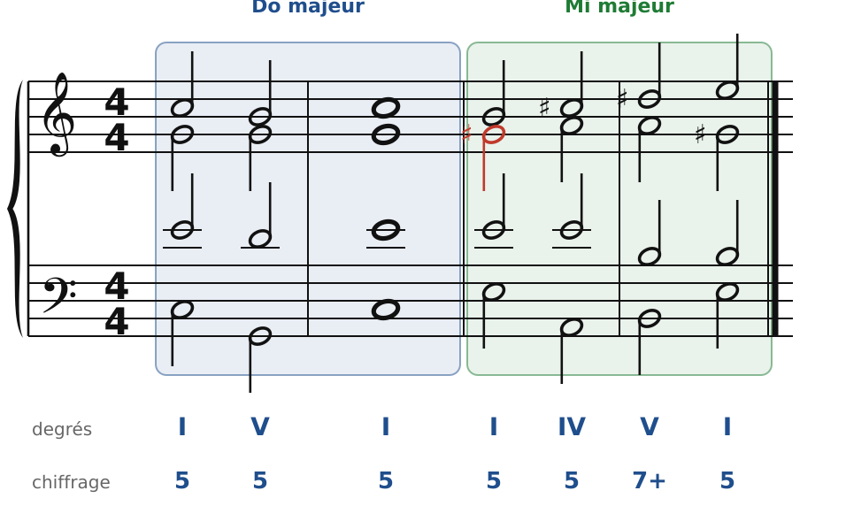

[← 29. Corrigés](29-corriges.md) · [Sommaire](../README.md#sommaire) · [31. Le chromatisme →](31-le-chromatisme.md)

## 30. L'emprunt au mode mineur et les modulations par tierces

Les romantiques (Schubert, Schumann, Chopin, Brahms) aiment faire passer une **ombre** sur une phrase en majeur : quelques notes du mode mineur, le temps d'un accord. Et ils aiment changer de ton par des chemins inattendus, en glissant d'une tierce. Ce chapitre présente ces deux couleurs.

### Les accords empruntés au mineur

🔊 [Écouter](audio/h30-emprunts.mp3) · [MIDI](audio/h30-emprunts.mid)

En Do majeur, on peut **emprunter** des accords à **do mineur** (le mineur de même tonique). Ils contiennent des notes abaissées (en rouge) : surtout le **6e degré** (La♭), parfois le **3e** (Mi♭) ou le **7e** (Si♭).

| Accord emprunté | Notes | Accord | Emploi |
| --- | --- | --- | --- |
| **IVm** (IV mineur) | Fa-La♭-Do | Fm | avant I (cadence plagale « mineure ») ou avant V |
| **VI♭** | La♭-Do-Mi♭ | A♭ | après V : cadence rompue sombre |
| **IIø7** | Ré-Fa-La♭-Do | Dm7♭5 | préparation de la cadence (souvent en 6/5) |
| **III♭**, **VII♭** | Mi♭-Sol-Si♭, Si♭-Ré-Fa | E♭, B♭ | plus rares, couleur « modale » |

L'accord le plus employé est le **IVm** : un simple La♭ dans l'accord de IV, et la phrase s'assombrit.

🔊 [Écouter](audio/h30-ivm.mp3) · [MIDI](audio/h30-ivm.mid)

Écoute le La de l'alto devenir La♭ (en rouge), puis descendre sur Sol : le 6e degré abaissé **descend**, comme une sensible inversée. C'est la règle de toutes les notes empruntées.

### La cadence rompue sur VI♭

🔊 [Écouter](audio/h30-rompue.mp3) · [MIDI](audio/h30-rompue.mid)

Au lieu du VI (Am), le V7 va sur **VI♭** (A♭) : la surprise est plus forte, plus sombre. Les règles sont celles de la cadence rompue ordinaire : la sensible monte (Si-Do), la 7e descend (Fa-Mi♭), et la **tierce est doublée** (Do). La phrase repart ensuite vers la cadence par un **IIø6/5** (Ré-Fa-La♭-Do), dont la 7e (Do) est préparée et descend sur Si.

### La fausse relation

🔊 [Écouter](audio/h30-fausse.mp3) · [MIDI](audio/h30-fausse.mid)

Quand une note est altérée d'un accord à l'autre (La, puis La♭), l'altération doit se faire **dans la même voix** : la voix qui chantait La chante La♭. Si le La est dans une voix et le La♭ dans une autre (à gauche), on entend une **fausse relation** : un frottement chromatique entre deux voix, qui sonne comme une erreur. À droite, c'est le ténor qui fait La-La♭ : la couleur change en douceur.

Cette règle vaut pour **toutes** les altérations chromatiques : emprunts, dominantes secondaires (Fa-Fa♯ dans le V7/V), modulations. Le vérificateur du cours la contrôle désormais.

### Les modulations par tierces

Jusqu'ici, on modulait vers les tons voisins, avec un accord pivot. Les romantiques aiment aussi des modulations plus lointaines, vers un ton situé **une tierce** au-dessus ou au-dessous, sans pivot : on passe directement d'un accord de tonique à l'autre, en gardant une **note commune**.

🔊 [Écouter](audio/h30-tierce-lab.mp3) · [MIDI](audio/h30-tierce-lab.mid)

De C à A♭ : Do reste en place, Mi descend sur Mi♭, Sol monte sur La♭. Deux voix bougent d'un demi-ton, une voix reste : c'est un changement de couleur saisissant, très doux pourtant. Puis une cadence (IV - V7 - I) confirme le nouveau ton.

🔊 [Écouter](audio/h30-tierce-mi.mp3) · [MIDI](audio/h30-tierce-mi.mid)

De C à E : Mi reste, Sol monte sur Sol♯, Do descend sur Si. Ce type de modulation est la signature de **Schubert** (le Quintette à deux violoncelles, de nombreux lieder) ; on l'entend aussi chez Beethoven (la sonate « Waldstein ») et partout chez Brahms.

Pour réussir une modulation par tierce :

1. Garde la **note commune** à la même voix.
2. Fais bouger les autres voix **par demi-tons**, chacune dans sa voix (pas de fausse relation).
3. Confirme le nouveau ton par une **cadence**.

### Les règles à retenir

- On peut **emprunter** au mineur de même tonique : IVm, VI♭, IIø7 (et plus rarement III♭, VII♭). Le 6e degré abaissé descend.
- Cadence rompue **V7 - VI♭** : tierce doublée, comme pour V7 - VI.
- **Fausse relation** : une note altérée chromatiquement se prend dans la voix qui chantait la note naturelle.
- **Modulation par tierce** : note commune tenue, autres voix par demi-tons, puis cadence.

---

[← 29. Corrigés](29-corriges.md) · [Sommaire](../README.md#sommaire) · [31. Le chromatisme →](31-le-chromatisme.md)
