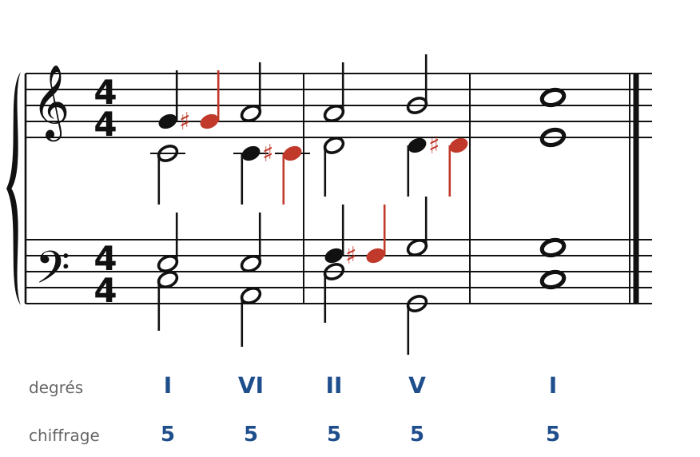
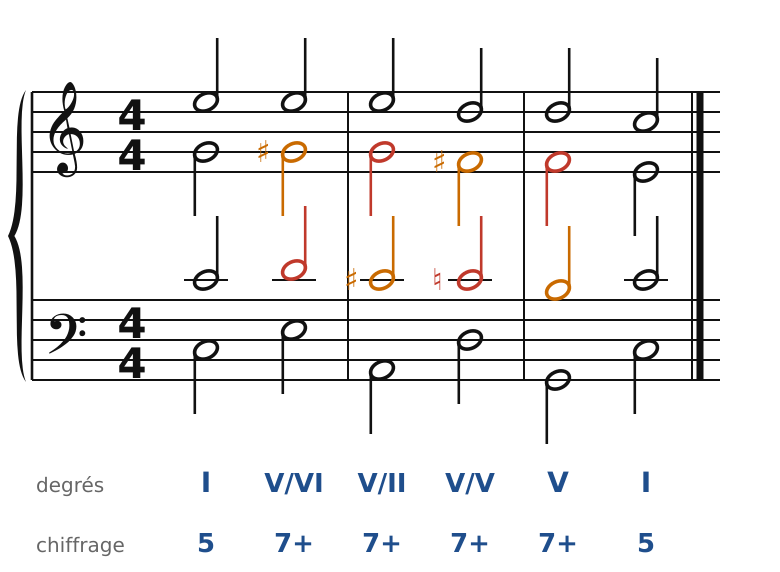
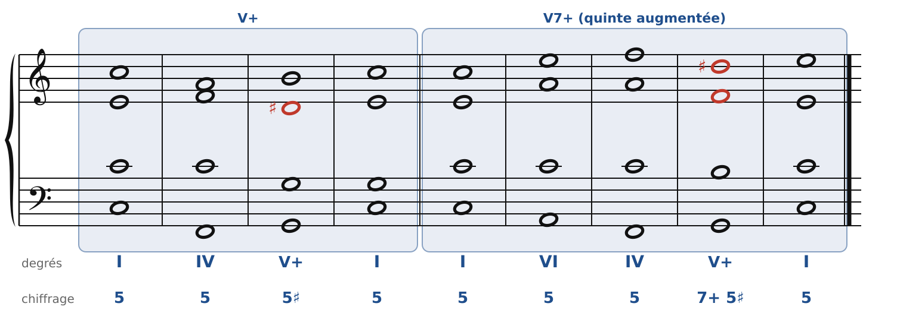

[← 30. L'emprunt au mode mineur](30-l-emprunt-au-mode-mineur.md) · [Sommaire](../README.md#sommaire) · [32. Du piano aux quatre voix →](32-du-piano-aux-quatre-voix.md)

## 31. Le chromatisme

Le **chromatisme**, c'est l'emploi des demi-tons qui n'appartiennent pas à la gamme. Chez les romantiques, il est partout : dans les mélodies, dans les voix intérieures, et dans les accords eux-mêmes. Ce chapitre en présente trois formes.

### Les notes de passage chromatiques

🔊 [Écouter](audio/h31-passage.mp3) · [MIDI](audio/h31-passage.mid)

Quand une voix monte d'un **ton** entre deux accords (Sol-La), on peut remplir ce ton par un **demi-ton** : Sol-Sol♯-La. La note ajoutée (en rouge) est une note de passage **chromatique**. Ici, les voix prennent chacune leur tour (soprano, alto, ténor, puis alto) : l'harmonie ne change pas (I - VI - II - V - I), mais la musique devient plus souple, plus expressive.

Les règles sont celles des notes de passage (chapitre 13) :

- elle se place sur le temps faible, entre deux notes réelles ;
- en montant, on l'écrit avec un **dièse** (Sol♯) ; en descendant, avec un **bémol** (La♭) ;
- elle ne doit pas créer de fausse relation avec une autre voix, ni de quintes ou d'octaves.

### La chaîne de dominantes

🔊 [Écouter](audio/h31-chaine.mp3) · [MIDI](audio/h31-chaine.mid)

Au chapitre 21, on a placé une dominante secondaire devant un accord. Les romantiques les **enchaînent** : chaque accord de 7e de dominante se résout sur une autre 7e de dominante, une quinte plus bas. En Do majeur : V7/VI (E7) - V7/II (A7) - V7/V (D7) - V7 (G7) - I.

C'est une **marche** (chapitre 19), mais chromatique :

- chaque **7e** (en rouge) descend d'un demi-ton et devient la **tierce** (la sensible) de l'accord suivant : Ré-Do♯, Do-Si… ;
- chaque **sensible** (en orange) descend d'un demi-ton et devient la **7e** de l'accord suivant : Sol♯-Sol, Do♯-Do… ;
- comme dans toute marche, on alterne accords complets et accords sans quinte.

Les voix intérieures descendent ainsi par demi-tons : c'est le son typique du « cycle des quintes » romantique, qu'on retrouve aussi dans le jazz (les « dominantes en cascade » d'une grille comme *Rhythm changes*).

### La dominante à quinte augmentée

🔊 [Écouter](audio/h31-augmentee.mp3) · [MIDI](audio/h31-augmentee.mid)

On peut aussi **altérer** une note de l'accord de dominante. La plus fréquente : la quinte haussée. En Do majeur, Sol-Si-Ré devient **Sol-Si-Ré♯** (un accord augmenté, **V+**), ou Sol-Si-Ré♯-Fa avec la 7e. Le Ré♯ (en rouge) est une nouvelle « sensible » vers Mi : il **monte** d'un demi-ton.

Dans le V7+ (à droite), le Ré♯ monte sur Mi et la 7e (Fa) descend sur Mi : les deux voix arrivent sur la même note, et la tierce du I est **doublée**. C'est permis ici.

### Les règles à retenir

- **Note de passage chromatique** : remplit un ton par un demi-ton, sur le temps faible ; dièse en montant, bémol en descendant.
- **Chaîne de dominantes** : chaque 7e descend sur la tierce de l'accord suivant ; les voix glissent par demi-tons.
- **Quinte augmentée** (V+, V7+) : elle monte d'un demi-ton.
- Toujours : pas de **fausse relation**, l'altération reste dans la même voix.

---

[← 30. L'emprunt au mode mineur](30-l-emprunt-au-mode-mineur.md) · [Sommaire](../README.md#sommaire) · [32. Du piano aux quatre voix →](32-du-piano-aux-quatre-voix.md)
