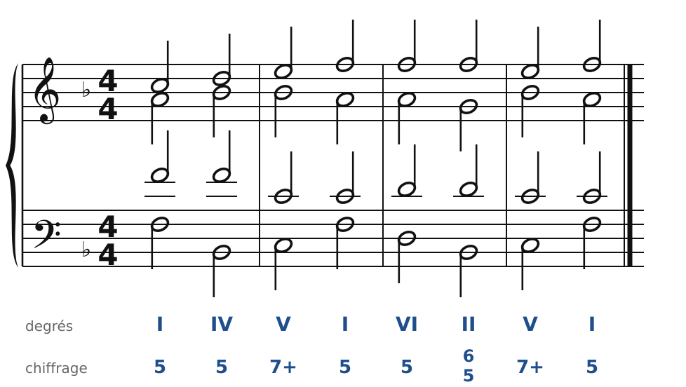
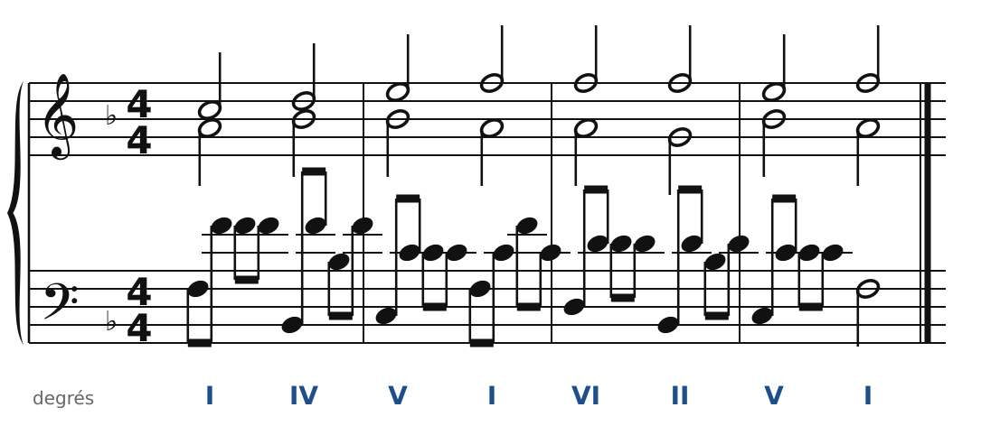
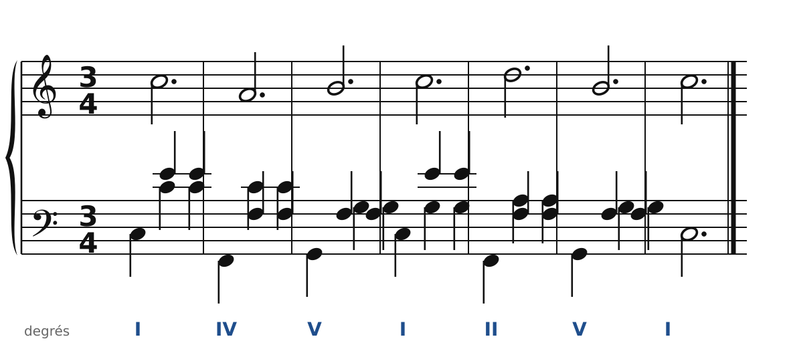
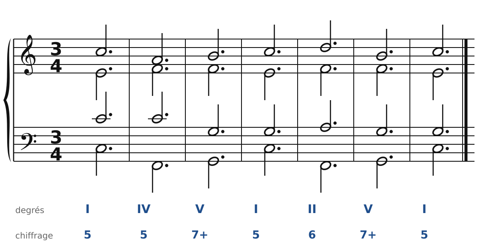

[← 31. Le chromatisme](31-le-chromatisme.md) · [Sommaire](../README.md#sommaire) · [33. Analyse : Schumann, quatuor op. 41 n° 1 →](33-analyse-schumann-op41-n1.md)

## 32. Du piano aux quatre voix

La musique romantique, c'est d'abord le **piano** : Schumann, Chopin, Mendelssohn, Brahms écrivent des pièces où l'on ne voit plus quatre voix bien séparées, mais des arpèges, des accords répétés, une mélodie qui chante au-dessus. Pourtant, sous cette texture, il y a presque toujours **une harmonie à quatre voix**. Savoir passer de l'une à l'autre, dans les deux sens, est l'un des meilleurs exercices d'écriture.

### Le choral caché

🔊 [Écouter](audio/h32-choral.mp3) · [MIDI](audio/h32-choral.mid)

Voici une phrase toute simple, à quatre voix, en Fa majeur. On va l'habiller de deux façons.

### Les arpèges de la main gauche

🔊 [Écouter](audio/h32-arpeges.mp3) · [MIDI](audio/h32-arpeges.mid)

La **main droite** garde le soprano et l'alto. La **main gauche** joue la basse, puis le ténor, puis la basse à l'octave, puis le ténor : un arpège en croches qui fait sonner l'accord. C'est la texture de nombreuses *Romances sans paroles* de Mendelssohn et de plusieurs pièces de l'*Album pour la jeunesse* de Schumann.

Ce qu'il faut savoir :

- la **première note** de chaque arpège est la basse réelle : c'est elle qui compte pour l'harmonie (pour les quintes et octaves avec le soprano, pour l'état de l'accord) ;
- les autres notes de l'arpège ne font que **répéter** les notes de l'accord ; on ne les juge pas comme des voix réelles ;
- l'octave de la basse est permise : elle double, elle ne crée pas de nouvelle voix.

### La valse

🔊 [Écouter](audio/h32-valse.mp3) · [MIDI](audio/h32-valse.mid)

En mesure à 3/4, la main gauche fait **basse - accord - accord** : la basse sur le premier temps, puis le ténor et l'alto (souvent descendus d'une octave) sur les deuxième et troisième temps. La main droite chante la mélodie. C'est la texture des valses et des mazurkas de Chopin.

🔊 [Écouter](audio/h32-valse-reduction.mp3) · [MIDI](audio/h32-valse-reduction.mid)

Et voici le **choral caché** sous cette valse : une note par voix et par mesure. C'est en faisant ce chemin à l'envers, du piano vers les quatre voix, qu'on comprend comment les romantiques écrivent.

### La méthode pour réduire une pièce de piano

1. Repère **un accord par temps** (ou par mesure, si l'harmonie change lentement).
2. Note la **basse réelle** : la note la plus grave, sur le temps fort.
3. Note la **mélodie** : souvent la note la plus aiguë de la main droite.
4. Cherche les **deux voix intérieures** dans ce qui reste, en suivant le plus court chemin d'un accord à l'autre.
5. Mets de côté les notes étrangères (passages, appoggiatures, broderies) : elles ne changent pas l'accord.

### Les règles à retenir

- Une texture de piano est souvent un **choral à quatre voix habillé** : arpèges, accords répétés, basse à l'octave.
- Les **voix réelles** sont la basse (première note de l'arpège), la mélodie et deux voix intérieures ; ce sont elles qui suivent les règles.
- Pour analyser, on fait le chemin inverse : **réduire** à quatre voix.

---

[← 31. Le chromatisme](31-le-chromatisme.md) · [Sommaire](../README.md#sommaire) · [33. Analyse : Schumann, quatuor op. 41 n° 1 →](33-analyse-schumann-op41-n1.md)
