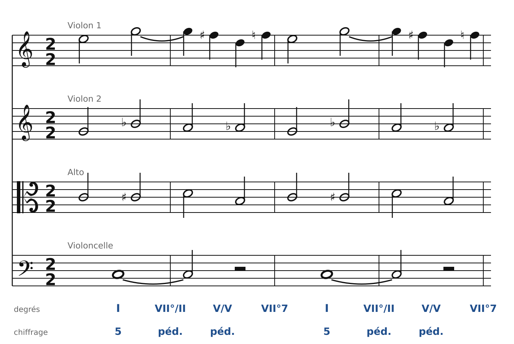
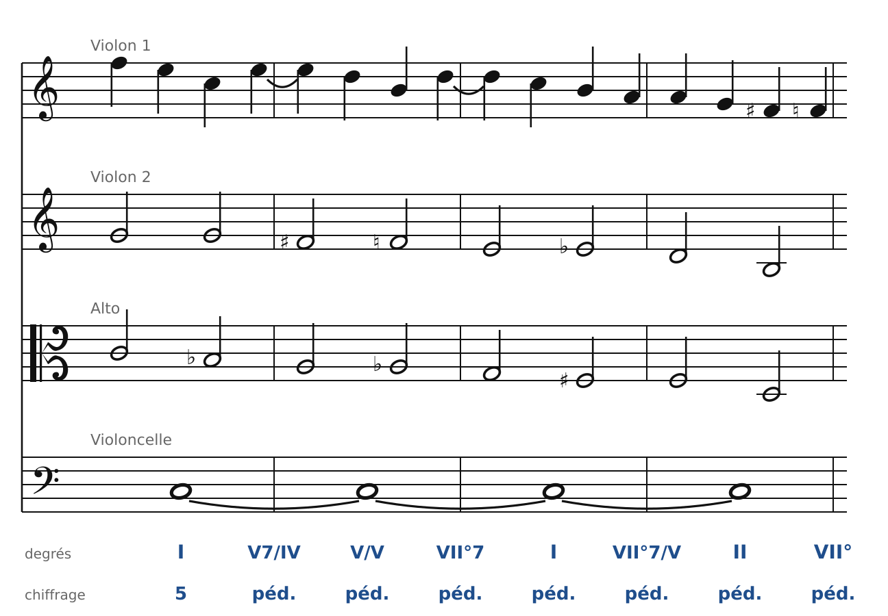

[← 32. Du piano aux quatre voix](32-du-piano-aux-quatre-voix.md) · [Sommaire](../README.md#sommaire) · [34. Exercices →](34-exercices.md)

## 33. Analyse : Schumann, quatuor op. 41 n° 1, Intermezzo

En 1842, Schumann écrit d'un seul élan ses trois quatuors à cordes op. 41, après avoir étudié ceux de Haydn, de Mozart et de Beethoven. Le premier (en la mineur) contient un Scherzo avec, en son milieu, un **Intermezzo** en Do majeur, d'une douceur étonnante. Voici ses huit premières mesures.

La mesure est à **2/2** (deux blanches) : on analyse un accord par blanche.

### Mesures 1 à 4 : des accords chromatiques sur une pédale de tonique

🔊 [Écouter](audio/h33-mes1-4.mp3) · [MIDI](audio/h33-mes1-4.mid)

- Le **violoncelle** tient un **Do** : c'est une **pédale de tonique** (chapitre 25).
- Au-dessus, les trois autres instruments font un petit enchaînement de deux mesures, répété : **I**, puis **Do♯-Mi-Sol-Si♭** (une 7e diminuée sur Do♯, la dominante de Ré : VII°/II), puis **Ré-Fa♯-La** (D, la dominante de la dominante : V/V), puis **Si-Ré-Fa-La♭** (la 7e diminuée de Do : VII°7), qui ramène sur I.
- Tous ces accords sont **chromatiques**, et pourtant tout est doux : chaque voix ne bouge que d'un demi-ton ou d'un ton (Do-Do♯-Ré à l'alto, Sol-Si♭-La-La♭ au 2e violon). C'est la pédale qui garde l'oreille en Do majeur.

### Mesures 5 à 8 : deux lignes chromatiques descendantes

🔊 [Écouter](audio/h33-mes5-8.mp3) · [MIDI](audio/h33-mes5-8.mid)

La pédale continue. Écoute maintenant les **voix intérieures** :

- le **2e violon** descend : Sol - Fa♯ - Fa - Mi - Mi♭ - Ré - Si ;
- l'**alto** descend aussi : Do - Si♭ - La - La♭ - Sol - Fa♯ - Fa - Ré.

Ce sont deux **lignes chromatiques** (chapitre 31) qui descendent ensemble, souvent à la sixte ou à la tierce l'une de l'autre. Chaque accord qu'elles forment avec le 1er violon et la pédale a un nom :

- **I** (avec une appoggiature Fa-Mi au 1er violon), puis **V7/IV** (C7 : le Si♭ de l'alto) ;
- **V/V** (Ré-Fa♯-La sur la pédale), puis **VII°7** (Si-Ré-Fa-La♭) ;
- **I** (Do-Mi-Sol avec une appoggiature Ré-Do), puis **VII°7/V** (Fa♯-La-Do-Mi♭ : la 7e diminuée de la dominante) ;
- **II** (Ré-Fa-La), puis **VII°** (Si-Ré-Fa) : la dominante sans fondamentale, qui ramène sur I à la mesure 9.

La phrase est une suite de **dominantes secondaires et de 7es diminuées**, reliées par le chromatisme des voix intérieures, sur une basse immobile.

### Ce qu'il faut retenir

- Une **pédale** permet des accords très chromatiques sans perdre la tonalité.
- Le chromatisme romantique naît souvent **des voix intérieures** : des lignes qui descendent par demi-tons, et qui forment en passant des dominantes secondaires et des 7es diminuées.
- Comme chez Beethoven (chapitre 27), l'écriture de quatuor repose sur **quatre voix réelles** très claires : on peut presque chanter ce passage comme un choral.

---

[← 32. Du piano aux quatre voix](32-du-piano-aux-quatre-voix.md) · [Sommaire](../README.md#sommaire) · [34. Exercices →](34-exercices.md)
