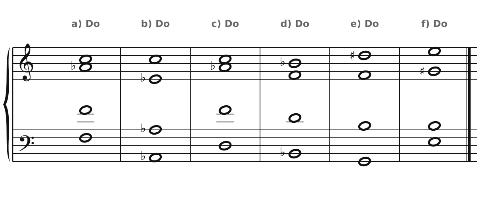
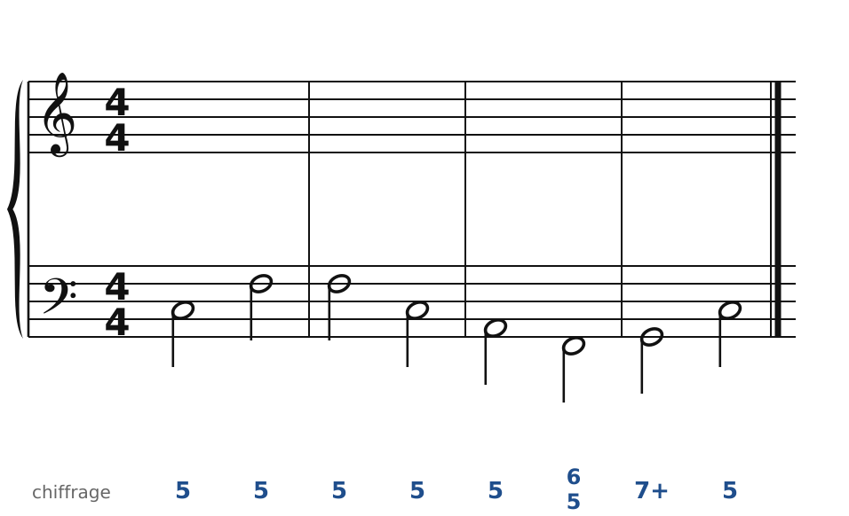
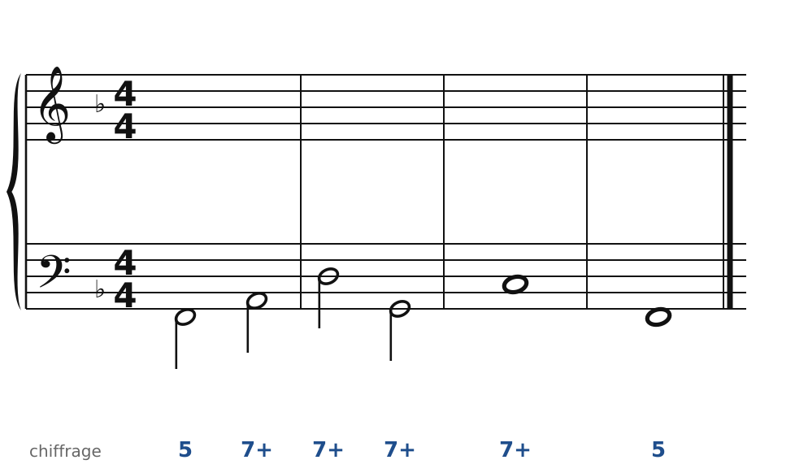
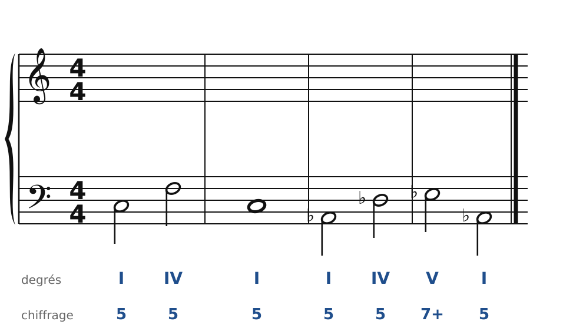
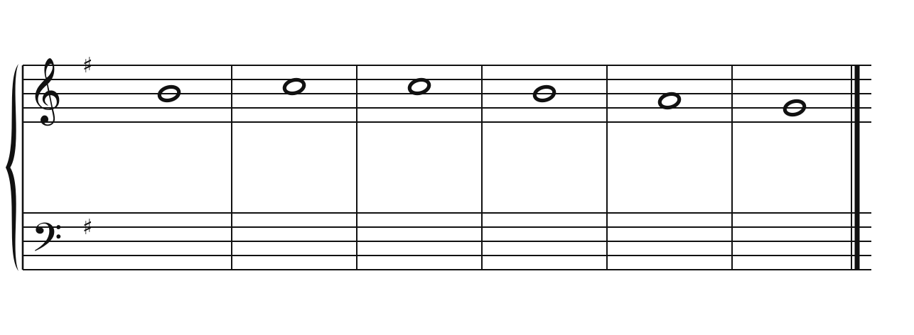
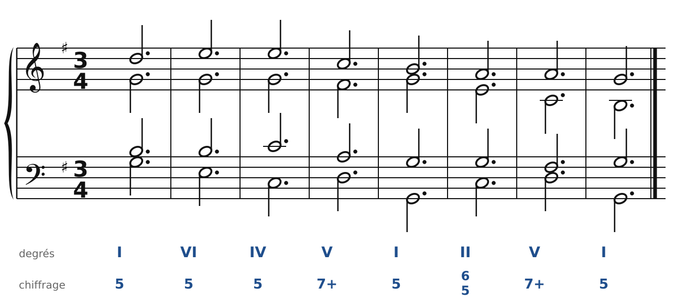

[← 33. Analyse : Schumann, quatuor op. 41 n° 1](33-analyse-schumann-op41-n1.md) · [Sommaire](../README.md#sommaire) · [35. Corrigés →](35-corriges.md)

## 34. Exercices

Dans la **version web** du cours, les exercices 2 à 5 se font directement sur la portée (bouton **✏️ Faire l'exercice ici**). Le menu des accords propose les accords empruntés au mineur (**IVm**, **VI♭**, **IIø7**) et les dominantes secondaires. Les fausses relations sont signalées au fur et à mesure.

Pour t'entraîner davantage, le [cahier d'exercices](../cahier/README.md) propose 11 autres exercices sur les chapitres 30 à 32.

### Exercice 1 : reconnaître les accords

En Do majeur, nomme chaque accord : accord emprunté au mineur (lequel ?), dominante altérée, dominante secondaire…

### Exercice 2 : basse chiffrée en Do majeur, avec des emprunts

**Indice** : le même Fa à la basse sert deux fois, d'abord avec La, puis avec La♭. Plus loin, un 6/5 sur Fa avec La♭ : c'est le IIø6/5.

### Exercice 3 : basse chiffrée en Fa majeur, une chaîne de dominantes

**Indice** : chaque accord est le V7 du suivant. Cherche la 7e de chacun : elle descend d'un demi-ton dans l'accord suivant.

### Exercice 4 : une modulation par tierce

Basse donnée avec ses accords : de Do majeur à La♭ majeur, sans accord pivot. Écris le soprano, puis l'alto et le ténor. Garde la note commune, et fais les altérations dans la même voix.

### Exercice 5 : chant donné en Sol majeur

Harmonise cette mélodie. Sur le deuxième Do du soprano, essaie un accord emprunté au mineur : le IVm (Do-Mi♭-Sol en Sol majeur).

### Exercice 6 : pour piano (sur papier)

Récris ce choral pour piano, en **valse** : la mélodie à la main droite, et à la main gauche basse - accord - accord.

🔊 [Écouter](audio/h34-ex6.mp3) · [MIDI](audio/h34-ex6.mid)

---

[← 33. Analyse : Schumann, quatuor op. 41 n° 1](33-analyse-schumann-op41-n1.md) · [Sommaire](../README.md#sommaire) · [35. Corrigés →](35-corriges.md)
