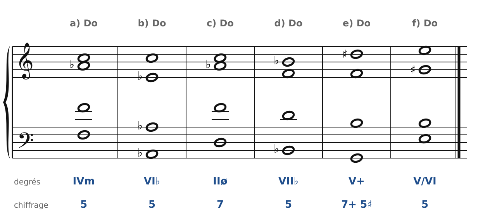
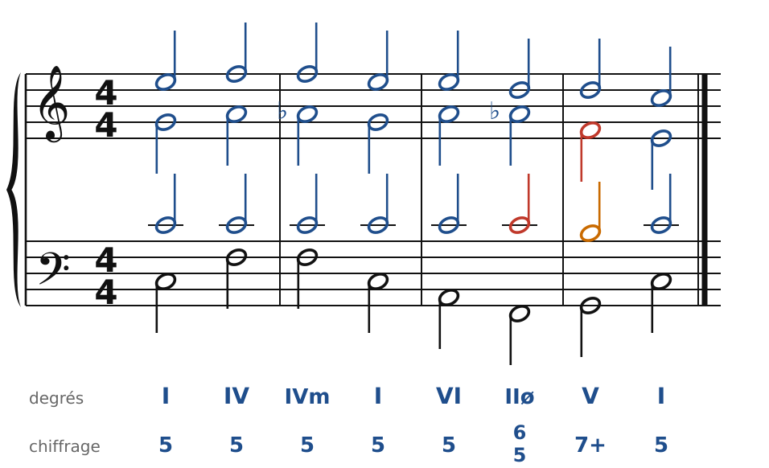
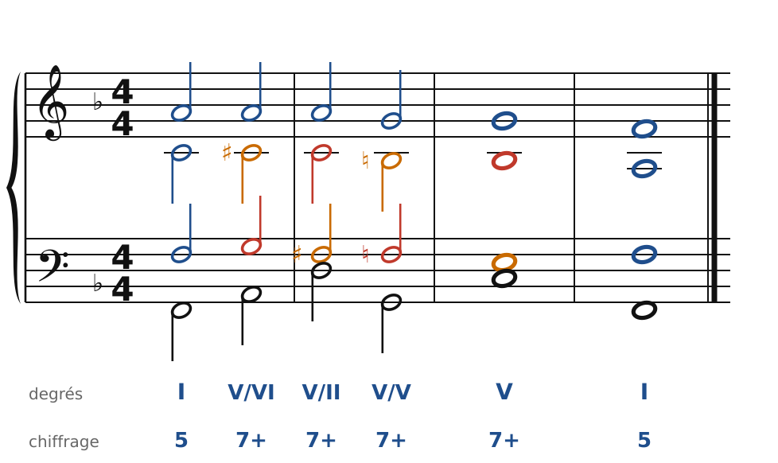
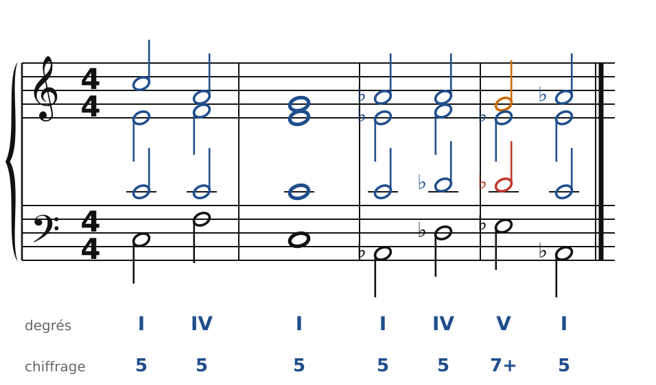
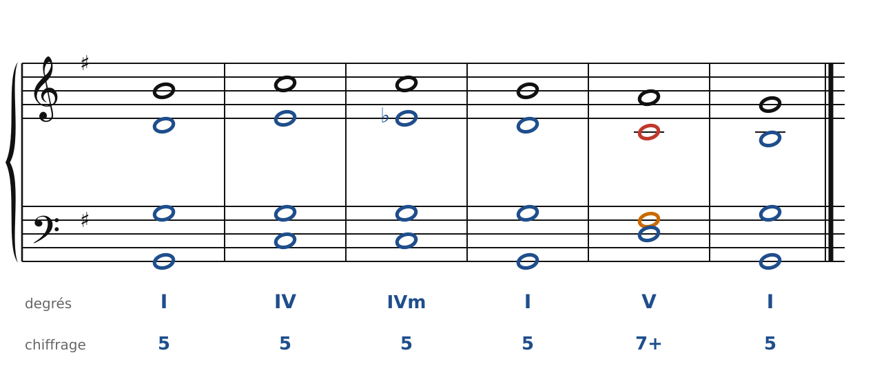
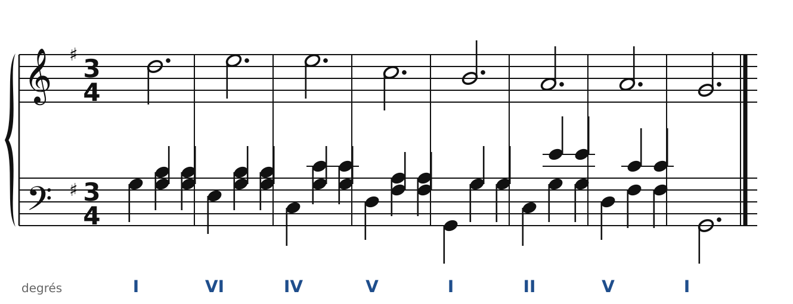

[← 34. Exercices](34-exercices.md) · [Sommaire](../README.md#sommaire) · [36. Enharmonie et modulations éloignées →](36-enharmonie-et-modulations-eloignees.md)

## 35. Corrigés

Il y a souvent plusieurs bonnes réponses : les corrigés montrent une solution, contrôlée par le vérificateur du cours.

### Exercice 1 : reconnaître les accords

🔊 [Écouter](audio/h35-c1.mp3) · [MIDI](audio/h35-c1.mid)

- **a)** Fa-La♭-Do : **IVm** (Fm), emprunté à do mineur.
- **b)** La♭-Do-Mi♭ : **VI♭** (A♭).
- **c)** Ré-Fa-La♭-Do avec Ré à la basse : **IIø7** (Dm7♭5), à l'état fondamental (chiffré 7).
- **d)** Si♭-Ré-Fa : **VII♭** (B♭), emprunt plus rare, couleur modale.
- **e)** Sol-Si-Ré♯-Fa : **V7+**, dominante à quinte augmentée. Le Ré♯ montera sur Mi.
- **f)** Mi-Sol♯-Si : **V/VI** (E), la dominante de La mineur.

### Exercice 2 : basse chiffrée en Do majeur

🔊 [Écouter](audio/h35-c2.mp3) · [MIDI](audio/h35-c2.mid)

Accords : I - IV - IVm - I - VI - IIø6/5 - V7 - I. Le La de l'alto devient La♭ dans la même voix (pas de fausse relation), puis descend sur Sol. La 7e du IIø6/5 (Do, au ténor) est préparée par le VI et descend sur Si.

### Exercice 3 : basse chiffrée en Fa majeur

🔊 [Écouter](audio/h35-c3.mp3) · [MIDI](audio/h35-c3.mid)

Accords : I - V7/VI (A7) - V7/II (D7) - V7/V (G7) - V7 (C7) - I. Chaque 7e descend d'un degré dans l'accord suivant, et chaque sensible passagère glisse d'un demi-ton.

### Exercice 4 : une modulation par tierce

🔊 [Écouter](audio/h35-c4.mp3) · [MIDI](audio/h35-c4.mid)

De C à A♭ : le Do du ténor reste en place, Mi devient Mi♭ à l'alto, Sol monte sur La♭ au soprano. Puis IV - V7 - I en La♭ majeur.

### Exercice 5 : chant donné en Sol majeur

🔊 [Écouter](audio/h35-c5.mp3) · [MIDI](audio/h35-c5.mid)

Accords : I - IV - IVm - I - V7 - I. Dans le IVm, le Mi de l'alto devient Mi♭ (même voix), puis descend sur Ré.

### Exercice 6 : pour piano

🔊 [Écouter](audio/h35-c6.mp3) · [MIDI](audio/h35-c6.mid)

La mélodie (le soprano du choral) passe à la main droite, en blanches pointées. La main gauche joue la basse sur le premier temps, puis le ténor et l'alto sur les deuxième et troisième temps.

---

[← 34. Exercices](34-exercices.md) · [Sommaire](../README.md#sommaire) · [36. Enharmonie et modulations éloignées →](36-enharmonie-et-modulations-eloignees.md)
