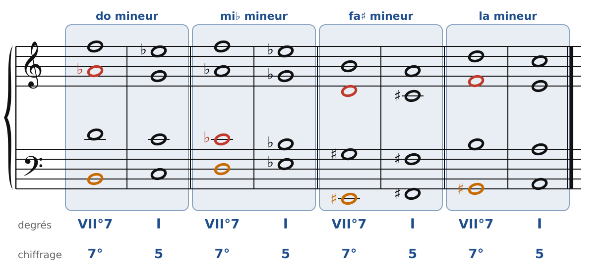
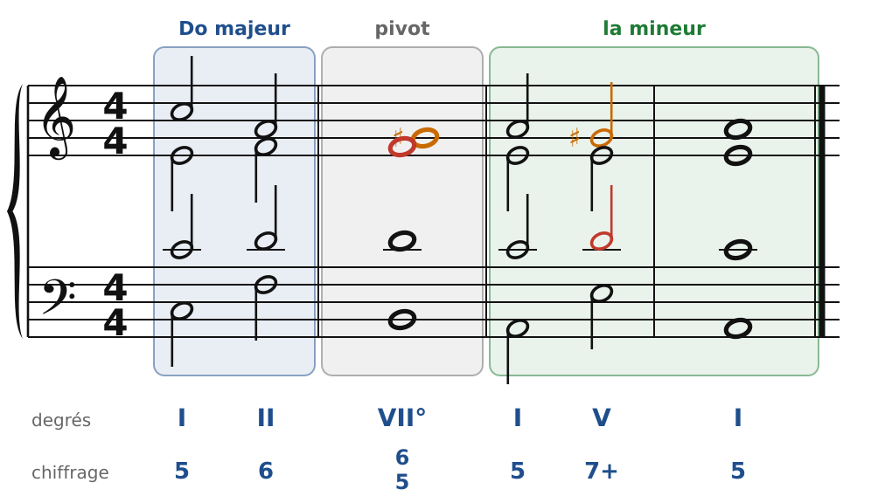
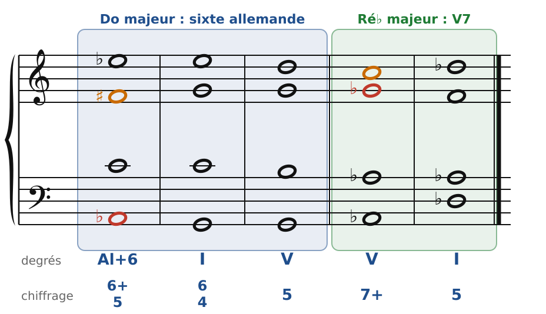
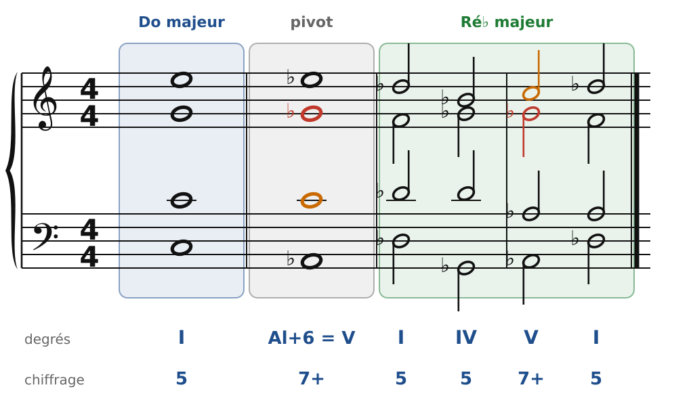

[← 35. Corrigés](35-corriges.md) · [Sommaire](../README.md#sommaire) · [37. L'accord augmenté et les tierces →](37-l-accord-augmente-et-les-tierces.md)

## 36. Enharmonie et modulations éloignées

Deux notes **enharmoniques** sonnent pareil mais s'écrivent différemment : Sol♯ et La♭, Fa♯ et Sol♭. Sur un piano, c'est la même touche. Les romantiques s'en servent pour **changer le sens** d'un accord : on l'entend dans un ton, puis on le résout comme s'il appartenait à un autre. C'est la porte vers les tons les plus éloignés.

### Une 7e diminuée, quatre tonalités

🔊 [Écouter](audio/h36-dim-quatre.mp3) · [MIDI](audio/h36-dim-quatre.mid)

La 7e diminuée est faite de quatre tierces mineures : elle partage l'octave en quatre parts égales (chapitre 20). Conséquence : **chacune de ses notes peut être la sensible**. Les quatre accords de la figure sonnent exactement pareil (Si-Ré-Fa-La♭), mais on les écrit autrement selon la sensible choisie :

- **Si** sensible : Si-Ré-Fa-La♭, vers **do** mineur ;
- **Ré** sensible : Ré-Fa-La♭-Do♭, vers **mi♭** mineur ;
- **Mi♯** (= Fa) sensible : Mi♯-Sol♯-Si-Ré, vers **fa♯** mineur ;
- **Sol♯** (= La♭) sensible : Sol♯-Si-Ré-Fa, vers **la** mineur.

Une seule 7e diminuée ouvre donc quatre tonalités (et autant en majeur). Il n'existe que trois 7es diminuées différentes : avec elles, on peut aller partout.

### Moduler par la 7e diminuée

🔊 [Écouter](audio/h36-modulation.mp3) · [MIDI](audio/h36-modulation.mid)

En Do majeur, la 7e diminuée Si-Ré-Fa-La♭ est le VII°7 (chapitre 20). On l'**écrit** Sol♯-Si-Ré-Fa : elle devient le VII°7 de **la mineur**, et se résout sur Am. Puis une cadence V7-I confirme le nouveau ton. C'est la même méthode qu'avec un accord pivot (chapitre 21) ; seulement, ici, le pivot change de nom en route.

### La sixte allemande et la 7e de dominante

🔊 [Écouter](audio/h36-al-v7.mp3) · [MIDI](audio/h36-al-v7.mid)

La sixte allemande de Do majeur (La♭-Do-Mi♭-Fa♯, chapitre 24) sonne exactement comme **A♭7** (La♭-Do-Mi♭-Sol♭), le V7 de **Ré♭ majeur**. Seule l'écriture de Fa♯ / Sol♭ change :

- Fa♯ **monte** sur Sol : c'est une sixte augmentée, et l'on va vers la dominante de Do ;
- Sol♭ **descend** sur Fa : c'est la 7e d'un V7, et l'on va vers le I de Ré♭.

🔊 [Écouter](audio/h36-modulation-reb.mp3) · [MIDI](audio/h36-modulation-reb.mid)

On peut donc partir de Do majeur, faire entendre un accord que l'oreille prend pour une sixte allemande… et le résoudre en V7 de Ré♭. On arrive un demi-ton plus haut, dans un ton très éloigné (cinq bémols), en un seul accord. Schubert adorait ce tour.

### Les règles à retenir

- **Enharmonie** : même son, autre nom, autre résolution.
- Une **7e diminuée** peut se résoudre dans quatre tons : chacune de ses notes peut être la sensible.
- **Sixte allemande = V7** : Fa♯ (qui monte) ou Sol♭ (qui descend).
- Pour moduler : l'accord pivot change de nom, puis une **cadence** confirme le nouveau ton.

---

[← 35. Corrigés](35-corriges.md) · [Sommaire](../README.md#sommaire) · [37. L'accord augmenté et les tierces →](37-l-accord-augmente-et-les-tierces.md)
