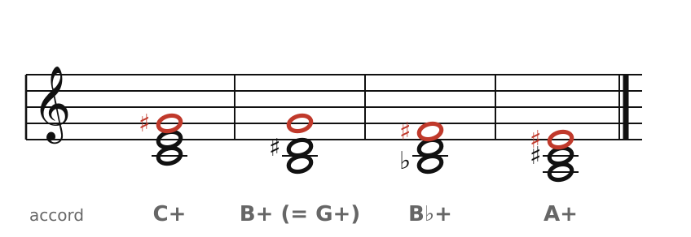
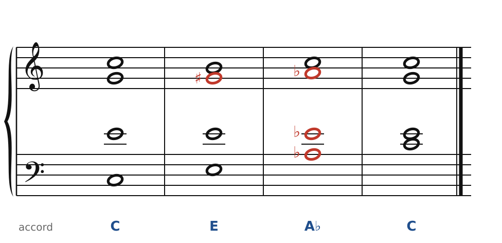
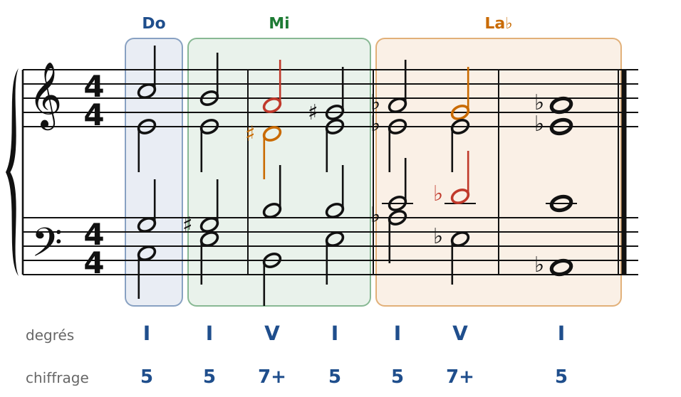

[← 36. Enharmonie et modulations éloignées](36-enharmonie-et-modulations-eloignees.md) · [Sommaire](../README.md#sommaire) · [38. Wagner : l'accord de Tristan →](38-wagner-l-accord-de-tristan.md)

## 37. L'accord augmenté et l'harmonie par tierces

Après la 7e diminuée, qui partage l'octave en quatre, voici l'**accord augmenté**, qui la partage en **trois**. Liszt en a fait un emblème, et il ouvre la voie à une harmonie qui avance par **tierces majeures**.

### L'accord augmenté

🔊 [Écouter](audio/h37-augmentes.mp3) · [MIDI](audio/h37-augmentes.mid)

Do-Mi-Sol♯ : deux tierces majeures. Si l'on ajoute encore une tierce majeure (Sol♯-Si♯ = Do), on revient à la note de départ. L'accord augmenté partage donc l'octave en **trois parts égales**, et ses renversements sonnent comme lui : il n'en existe que **quatre** différents.

Comme la 7e diminuée, il est **ambigu** : chacune de ses notes peut être la quinte augmentée d'une dominante (chapitre 31). On ne sait pas où il va ; c'est ce flottement qu'aimait Liszt. La *Faust-Symphonie* (1854-1857) commence par une suite d'accords augmentés qui descendent par demi-tons, comme ceux de la figure ; *Nuages gris* (1881), pour piano, en est presque entièrement fait.

### Le cycle des tierces majeures

🔊 [Écouter](audio/h37-tierces.mp3) · [MIDI](audio/h37-tierces.mid)

Les trois notes d'un accord augmenté (Do, Mi, Sol♯ = La♭) peuvent aussi servir de **toniques** : C - E - A♭ - C. On fait le tour de l'octave en trois tierces majeures, avec à chaque fois une **note commune** et deux voix qui glissent d'un demi-ton (chapitre 30). C'est le chemin harmonique préféré de Liszt, et on le retrouve chez Schubert, Brahms… et dans le jazz : c'est le principe des « Coltrane changes » de *Giant Steps*.

🔊 [Écouter](audio/h37-tierces-cadences.mp3) · [MIDI](audio/h37-tierces-cadences.mid)

Pour que chaque ton soit bien installé, on peut le confirmer par une cadence V7-I : Do, puis Mi (avec le V7 B7), puis La♭ (avec E♭7).

### Les règles à retenir

- L'**accord augmenté** partage l'octave en trois : il est symétrique et ambigu.
- Sa quinte augmentée monte d'un demi-ton.
- Le **cycle des tierces majeures** (C - E - A♭ - C) : une note commune, deux voix qui glissent d'un demi-ton, puis une cadence pour confirmer chaque ton.

---

[← 36. Enharmonie et modulations éloignées](36-enharmonie-et-modulations-eloignees.md) · [Sommaire](../README.md#sommaire) · [38. Wagner : l'accord de Tristan →](38-wagner-l-accord-de-tristan.md)
