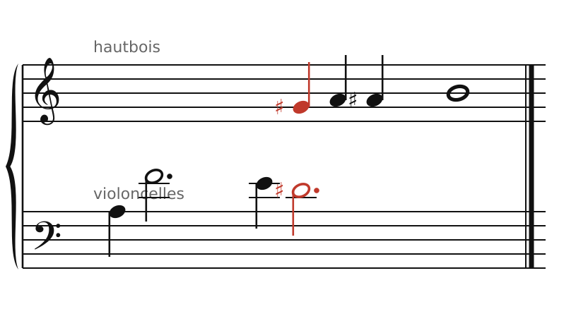
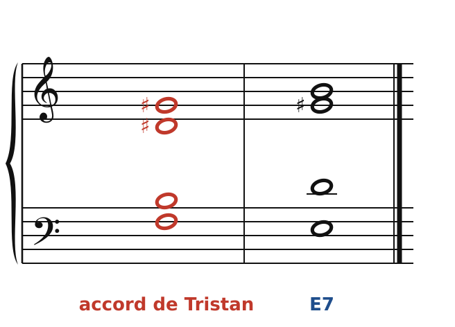
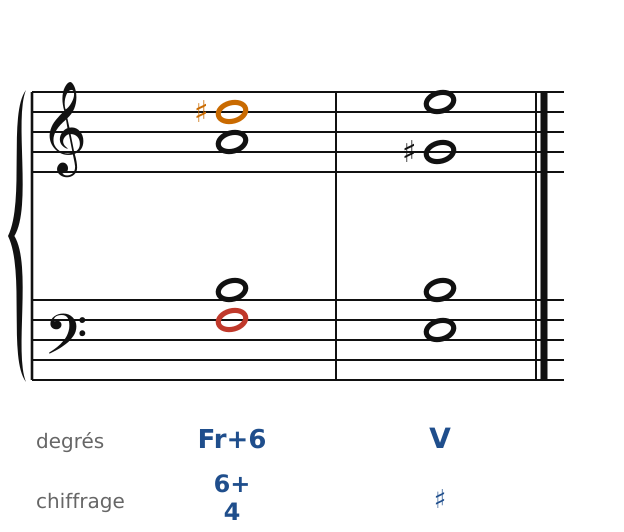
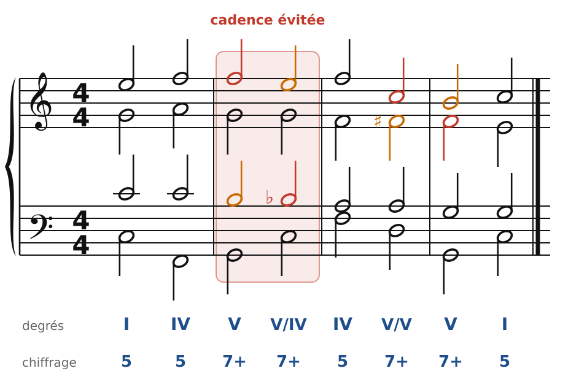
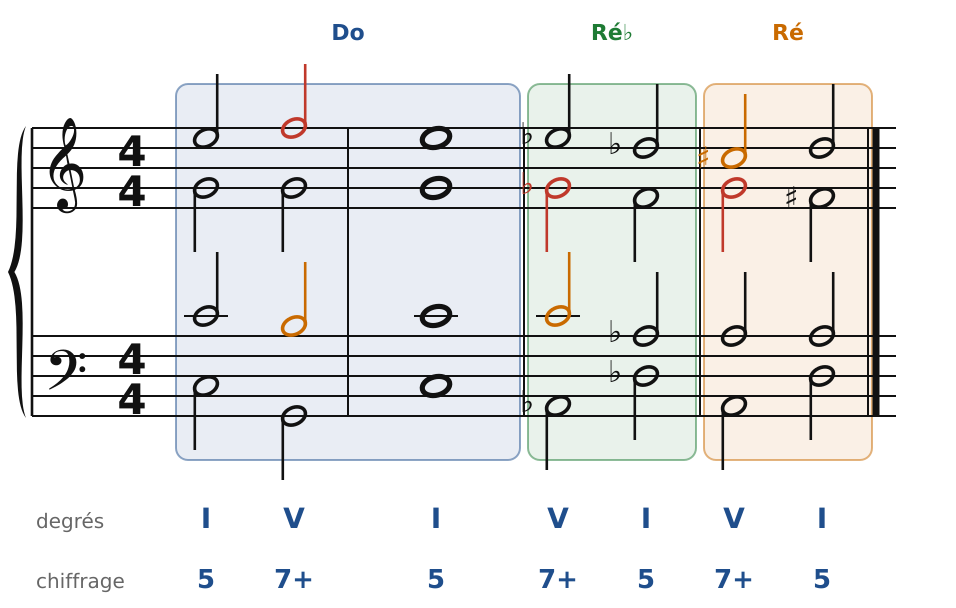

[← 37. L'accord augmenté et les tierces](37-l-accord-augmente-et-les-tierces.md) · [Sommaire](../README.md#sommaire) · [39. Franck et Mahler →](39-franck-et-mahler.md)

## 38. Wagner : l'accord de Tristan, la résolution repoussée

Avec *Tristan et Isolde* (1857-1859), Wagner écrit une musique où le désir n'est jamais satisfait : les dissonances se résolvent… sur d'autres dissonances. Les quatre premières mesures du Prélude sont sans doute les plus commentées de l'histoire de l'harmonie.

### Deux lignes chromatiques

🔊 [Écouter](audio/h38-lignes.mp3) · [MIDI](audio/h38-lignes.mid)

La réduction ci-dessus garde les **hauteurs** exactes des deux lignes principales, avec un rythme simplifié :

- les **violoncelles** montent d'une sixte (La-Fa), puis descendent par demi-tons : **Fa-Mi-Ré♯** ;
- le **hautbois** entre sur **Sol♯** et monte par demi-tons : **Sol♯-La-La♯-Si**.

Une ligne descend, l'autre monte, toutes deux chromatiques. C'est entre elles que naît l'accord.

### L'accord de Tristan

🔊 [Écouter](audio/h38-accords.mp3) · [MIDI](audio/h38-accords.mid)

Au moment où le hautbois attaque Sol♯ et où les violoncelles arrivent sur Ré♯, l'orchestre fait entendre **Fa-Si-Ré♯-Sol♯** : c'est l'**accord de Tristan** (en rouge). Quelques instants plus tard, quand le hautbois atteint Si, on entend **Mi-Sol♯-Si-Ré** : un **E7**, la dominante de la mineur. Et là, tout s'arrête : un silence. Le E7 ne se résout pas.

Que vaut l'accord de Tristan ? On en discute depuis 150 ans. Deux lectures, avec les outils de ce cours :

1. **Une 7e demi-diminuée** (Fa-La♭-Do♭-Mi♭, écrite autrement) : l'accord de 7e de sensible, ou de IIø7… mais il ne se comporte comme aucun des deux.
2. **Une sixte française** sur Fa (Fa-La-Si-Ré♯, en la mineur, chapitre 24), dont le La serait remplacé par une **appoggiature** Sol♯. Le Sol♯ du hautbois monte d'ailleurs aussitôt sur La : c'est bien le La qui est la note réelle.

🔊 [Écouter](audio/h38-sixte-francaise.mp3) · [MIDI](audio/h38-sixte-francaise.mid)

Voici la sixte française de la mineur résolue comme au chapitre 24 : Fa descend sur Mi, Ré♯ monte sur Mi. Chez Wagner, le Ré♯ ne monte pas : il **redescend** sur Ré, la 7e du E7. Au lieu d'arriver sur un accord stable, on arrive sur un nouvel accord dissonant. C'est la **résolution repoussée** : chaque tension en appelle une autre.

### La cadence évitée

🔊 [Écouter](audio/h38-evitee.mp3) · [MIDI](audio/h38-evitee.mid)

Le même principe s'applique aux cadences. Le V7 annonce I… mais la musique va vers un **autre V7** (ici V7/IV, C7) : la 7e se résout bien (Fa-Mi), mais la sensible Si descend sur Si♭, et l'on repart. On appelle cela une **cadence évitée**. Les romantiques tardifs enchaînent ainsi les dominantes, et la tonique n'arrive qu'à la fin de la phrase (ou pas du tout).

### Le glissement chromatique

🔊 [Écouter](audio/h38-glissement.mp3) · [MIDI](audio/h38-glissement.mid)

Dernier procédé : on fait **glisser** toute l'harmonie d'un demi-ton. Le I de Do majeur devient, par deux voix qui bougent d'un demi-ton (Mi-Mi♭, Sol-Sol♭), le V7 de Ré♭ ; puis on recommence vers Ré. Chaque voix bouge le moins possible, mais le ton change complètement. Wagner (et plus tard Franck) en fait un usage constant.

### Les règles à retenir

- Wagner garde les règles de la **conduite des voix** (petits mouvements, dissonances qui bougent par demi-tons) mais **retarde la résolution** : une dissonance se résout sur une autre.
- **Accord de Tristan** : Fa-Si-Ré♯-Sol♯, lu comme une sixte française avec appoggiature, ou comme une 7e demi-diminuée.
- **Cadence évitée** : V7 vers un autre accord de dominante.
- **Glissement chromatique** : tout l'accord bouge d'un demi-ton, et l'on change de ton.

---

[← 37. L'accord augmenté et les tierces](37-l-accord-augmente-et-les-tierces.md) · [Sommaire](../README.md#sommaire) · [39. Franck et Mahler →](39-franck-et-mahler.md)
