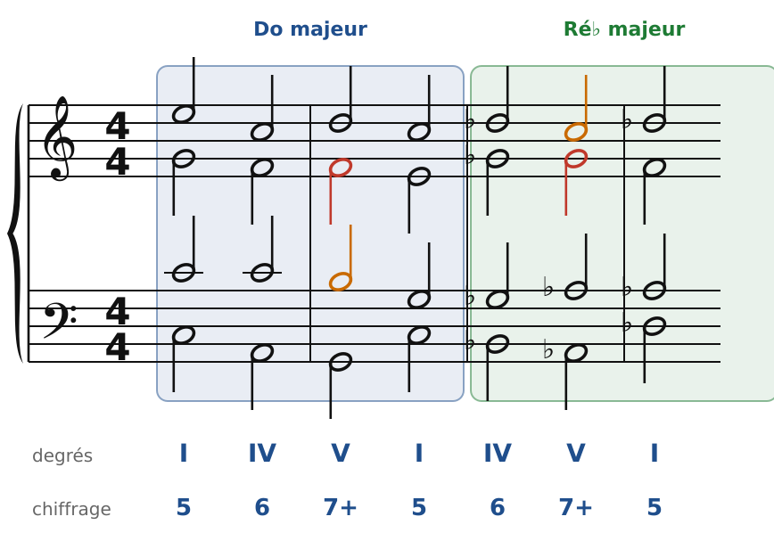
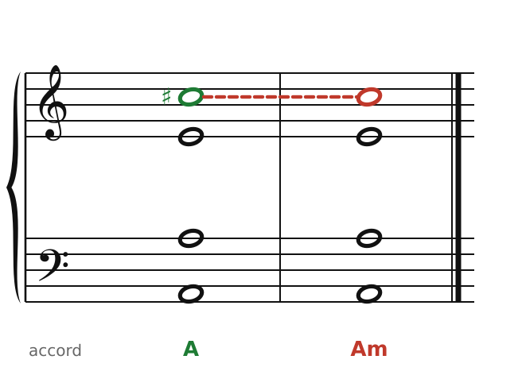
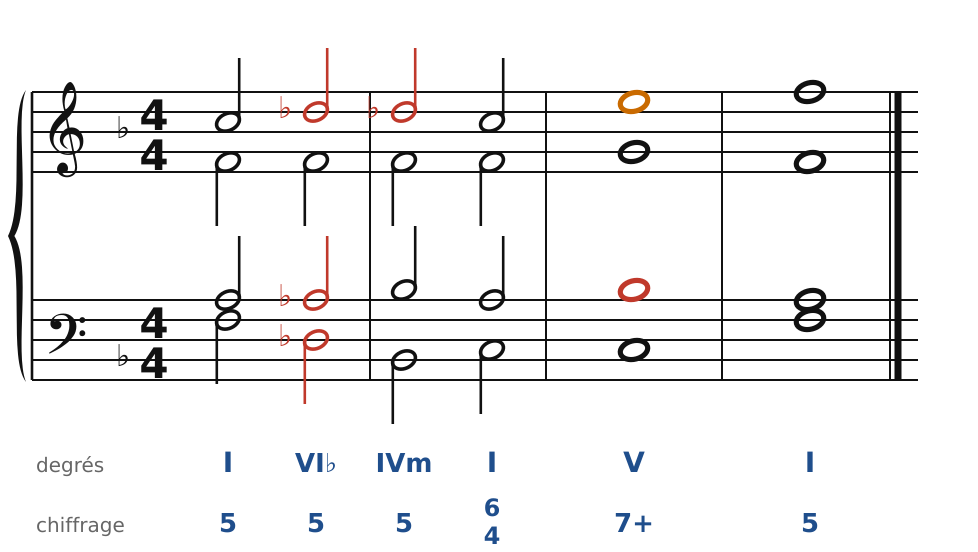

[← 38. Wagner : l'accord de Tristan](38-wagner-l-accord-de-tristan.md) · [Sommaire](../README.md#sommaire) · [40. Analyse : Tristan et l'Adagietto →](40-analyse-tristan-et-adagietto.md)

## 39. Franck et Mahler : chromatisme, majeur et mineur, tonalité progressive

Après Wagner, deux chemins. **César Franck** (1822-1890), organiste à Paris, maître de toute une génération de compositeurs français, fait couler le chromatisme wagnérien dans une écriture très contrapuntique. **Gustav Mahler** (1860-1911), chef d'orchestre à Vienne, garde les grandes formes symphoniques mais fait vaciller la tonalité de l'intérieur : majeur et mineur se mêlent, et une symphonie peut finir dans un autre ton que celui du début.

### Franck : la phrase qui monte d'un demi-ton

🔊 [Écouter](audio/h39-franck.mp3) · [MIDI](audio/h39-franck.mid)

Un procédé typique de Franck : on écrit une phrase complète, puis on la **répète un demi-ton plus haut**, sans transition, ou avec un simple glissement (chapitre 38). L'effet est celui d'une lumière qui change. On l'entend dans la *Sonate pour violon et piano* (1886), la *Symphonie en ré mineur* (1888), ou *Prélude, choral et fugue* pour piano (1884). Les voix intérieures de Franck bougent presque toujours par demi-tons : son écriture est très « organiste », très liée.

Franck a aussi popularisé la **forme cyclique** : les mêmes thèmes reviennent d'un mouvement à l'autre, transformés. Ses élèves (Vincent d'Indy, Ernest Chausson, Henri Duparc) en hériteront.

### Mahler : majeur et mineur

🔊 [Écouter](audio/h39-majeur-mineur.mp3) · [MIDI](audio/h39-majeur-mineur.mid)

Dans la *Sixième symphonie* (1903-1904), Mahler fait entendre un accord de **La majeur** qui se change en **la mineur**, sur un rythme de timbales : c'est la « devise » de la symphonie, qui revient comme un destin. Une seule note bouge, Do♯-Do (en vert, puis en rouge).

🔊 [Écouter](audio/h39-melange.mp3) · [MIDI](audio/h39-melange.mid)

Plus largement, Mahler mêle sans cesse les accords du majeur et ceux du mineur (chapitre 30) : I - VI♭ - IVm - I6/4 - V7 - I, en Fa majeur. Les notes empruntées (Ré♭, La♭) assombrissent une phrase qui reste en Fa.

### La tonalité progressive

Chez Haydn ou Beethoven, une symphonie commence et finit dans le même ton. Chez Mahler, ce n'est plus vrai :

- la *Quatrième symphonie* commence en **Sol majeur** et finit en **Mi majeur** ;
- la *Cinquième* commence en **do♯ mineur** et finit en **Ré majeur** ;
- la *Neuvième* commence en **Ré majeur** et finit en **Ré♭ majeur**.

On parle de **tonalité progressive** : le ton fait partie du « récit » de l'œuvre. La fin de la *Neuvième*, un demi-ton plus bas que le début, sonne comme un adieu.

### Les règles à retenir

- **Franck** : chromatisme très lié, phrases répétées un demi-ton plus haut, forme cyclique.
- **Mahler** : majeur et mineur mêlés (la « devise » La majeur → la mineur), tonalité progressive.
- Dans les deux cas, la conduite des voix reste classique : ce sont les **chemins harmoniques** qui s'élargissent.

---

[← 38. Wagner : l'accord de Tristan](38-wagner-l-accord-de-tristan.md) · [Sommaire](../README.md#sommaire) · [40. Analyse : Tristan et l'Adagietto →](40-analyse-tristan-et-adagietto.md)
