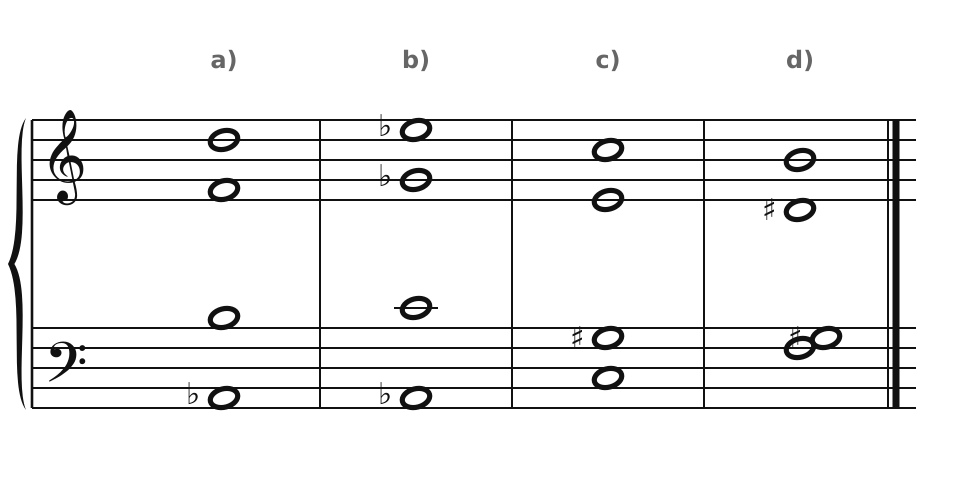
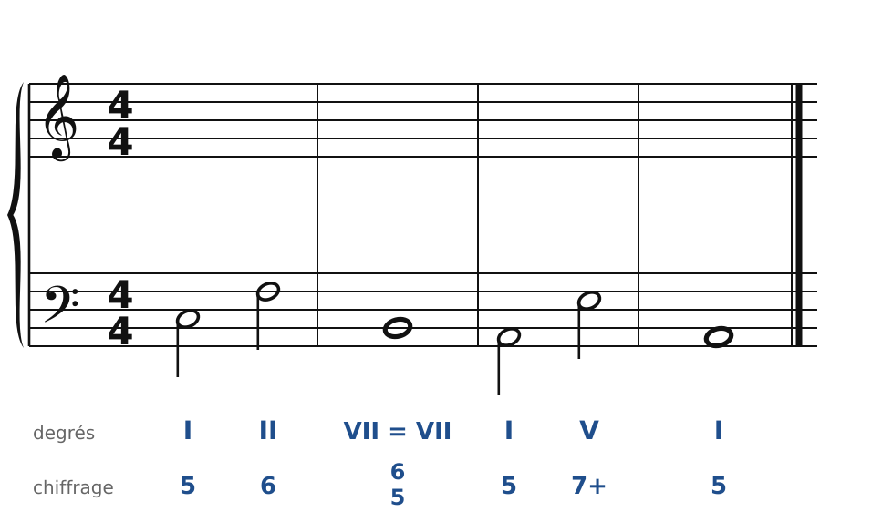
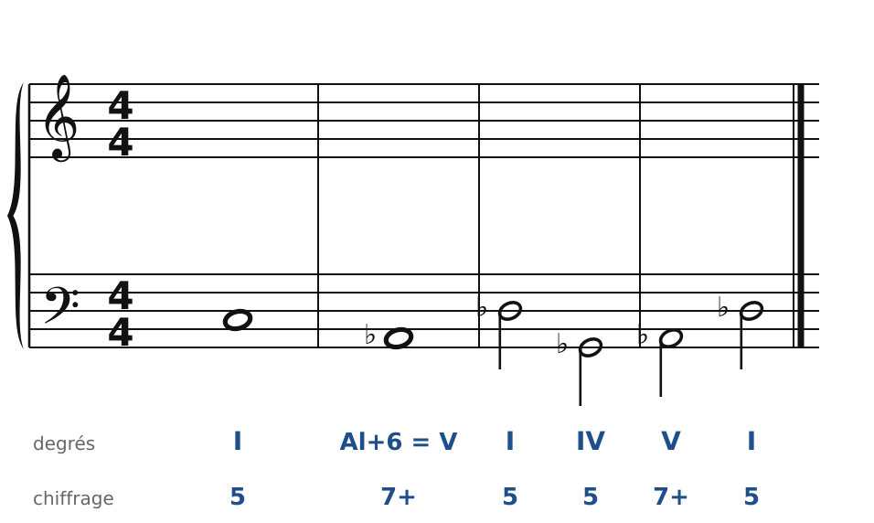
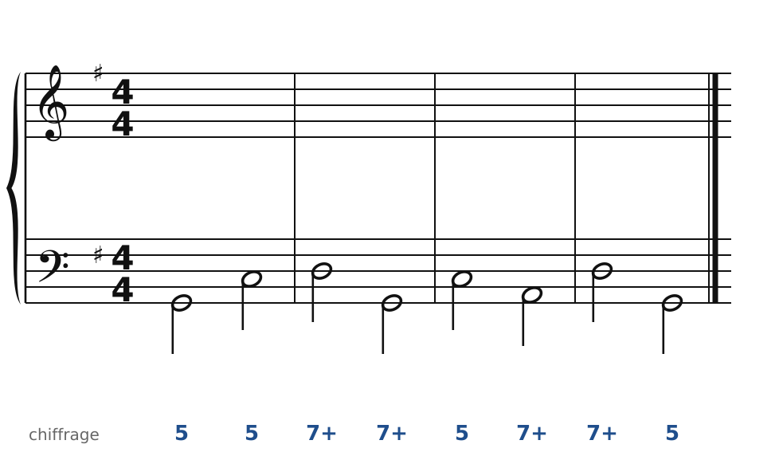
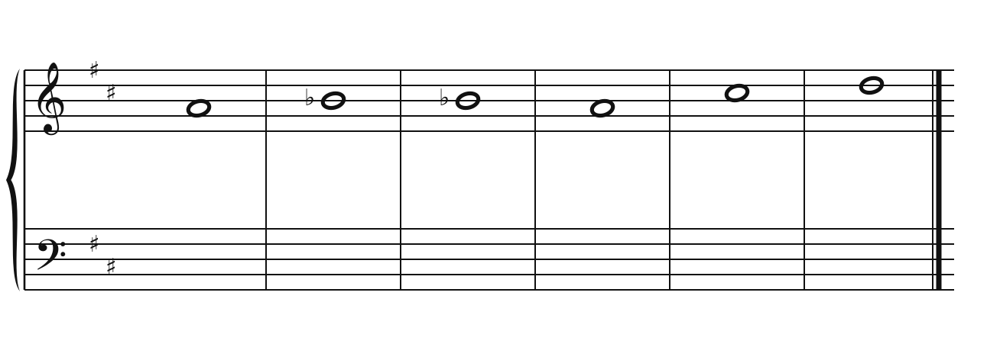

[← 40. Analyse : Tristan et l'Adagietto](40-analyse-tristan-et-adagietto.md) · [Sommaire](../README.md#sommaire) · [42. Corrigés →](42-corriges.md)

## 41. Exercices

Dans la **version web** du cours, les exercices 2 à 5 se font directement sur la portée (bouton **✏️ Faire l'exercice ici**). Dans les modulations, la tonalité de chaque accord est prise en compte : la nouvelle sensible doit monter, et les altérations se font dans la même voix.

Pour t'entraîner davantage, le [cahier d'exercices](../cahier/README.md) propose 9 autres exercices sur les chapitres 36 à 39.

### Exercice 1 : quatre accords ambigus

Pour chaque accord, dis de quoi il s'agit et donne **deux** façons de le comprendre (ou de le résoudre).

### Exercice 2 : moduler par une 7e diminuée

Basse donnée avec ses accords : de Do majeur à la mineur. L'accord 3 est la 7e diminuée Si-Ré-Fa-La♭ de Do… écrite avec Sol♯, comme VII°7 de la mineur. Écris le soprano, puis l'alto et le ténor.

### Exercice 3 : la sixte allemande devient V7

Basse donnée avec ses accords : de Do majeur à Ré♭ majeur. L'accord 2 sonne comme une sixte allemande de Do, mais il est écrit et résolu comme le V7 de Ré♭.

### Exercice 4 : basse chiffrée en Sol majeur, une cadence évitée

**Indice** : après le V7, le chiffrage 7+ sur Sol annonce un autre accord de dominante (le V7 du IV).

### Exercice 5 : chant donné en Ré majeur, majeur et mineur mêlés

Harmonise cette mélodie ; ses notes altérées demandent des accords empruntés au mineur (VI♭, IVm).

### Exercice 6 : écoute

Écoute l'Adagietto de la *Cinquième symphonie* de Mahler (chapitre 40). Note : la tonalité du début et celle de la fin ; le moment où la musique s'éloigne de Fa majeur ; trois appoggiatures de la mélodie (au temps fort, résolues en descendant).

---

[← 40. Analyse : Tristan et l'Adagietto](40-analyse-tristan-et-adagietto.md) · [Sommaire](../README.md#sommaire) · [42. Corrigés →](42-corriges.md)
