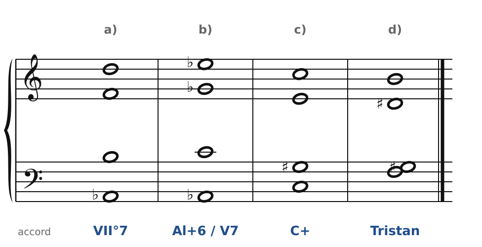
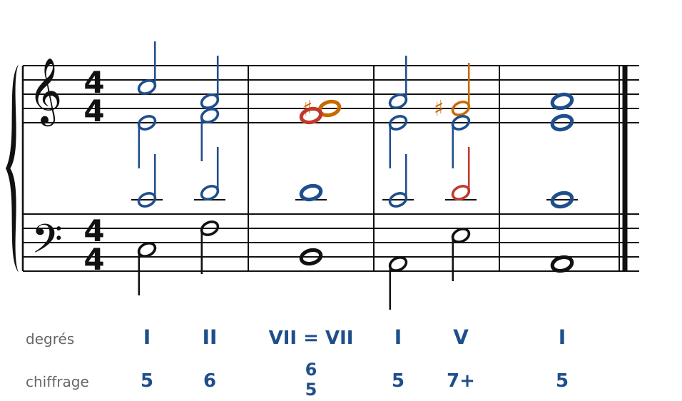
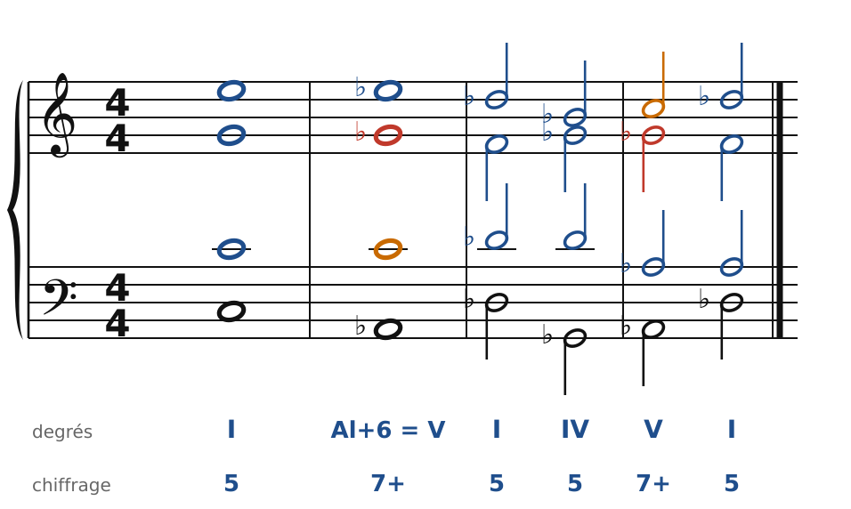
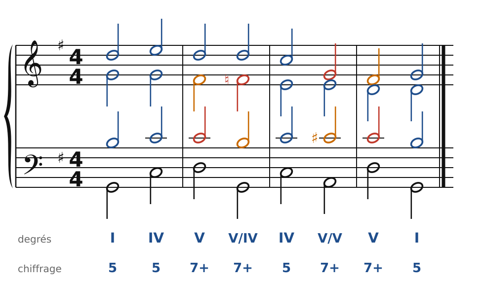
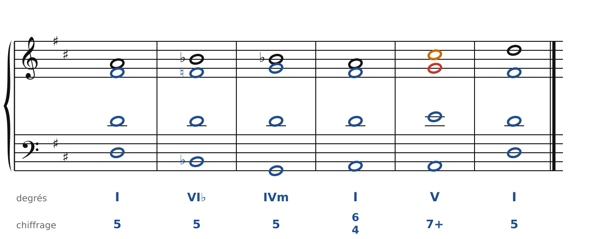

[← 41. Exercices](41-exercices.md) · [Sommaire](../README.md#sommaire) · [43. Fauré →](43-faure-couleurs-modales.md)

## 42. Corrigés

Il y a souvent plusieurs bonnes réponses : les corrigés montrent une solution, contrôlée par le vérificateur du cours.

### Exercice 1 : quatre accords ambigus

🔊 [Écouter](audio/h42-c1.mp3) · [MIDI](audio/h42-c1.mid)

- **a)** Si-Ré-Fa-La♭ : une **7e diminuée**. VII°7 de do (mineur ou majeur), ou, écrite autrement, VII°7 de mi♭, de fa♯ ou de la mineur (chapitre 36).
- **b)** La♭-Do-Mi♭-Sol♭ : le **V7 de Ré♭**. Écrit avec Fa♯, ce serait la **sixte allemande** de Do, qui irait vers le I6/4 de Do.
- **c)** Do-Mi-Sol♯ : un **accord augmenté**. V+ de Fa (le Do est la dominante), ou, lu à partir de Mi ou de La♭, V+ de La ou de Ré♭ (chapitre 37).
- **d)** Fa-Si-Ré♯-Sol♯ : l'**accord de Tristan**. Sixte française de la mineur avec l'appoggiature Sol♯, ou 7e demi-diminuée (chapitre 38).

### Exercice 2 : moduler par une 7e diminuée

🔊 [Écouter](audio/h42-c2.mp3) · [MIDI](audio/h42-c2.mid)

I - II6 - VII°7 (pivot, écrit en la mineur) - I - V7 - I. Le Sol♯ du soprano monte sur La, la 7e (Fa) descend sur Mi.

### Exercice 3 : la sixte allemande devient V7

🔊 [Écouter](audio/h42-c3.mp3) · [MIDI](audio/h42-c3.mid)

De C à A♭7 : Do reste en place, Mi descend sur Mi♭, Sol sur Sol♭, et la basse descend de Do à La♭. Puis le V7 se résout sur Ré♭ : la 7e (Sol♭) descend sur Fa. Puis IV - V7 - I confirme Ré♭ majeur.

### Exercice 4 : une cadence évitée

🔊 [Écouter](audio/h42-c4.mp3) · [MIDI](audio/h42-c4.mid)

I - IV - V7 - V7/IV - IV - V7/V - V7 - I. Le V7 (D7) ne va pas sur I, mais sur G7 (V7/IV) : sa 7e (Do) descend bien sur Si, mais sa sensible (Fa♯) descend sur Fa, la 7e de G7. La tonique n'arrive qu'à la fin.

### Exercice 5 : chant donné en Ré majeur

🔊 [Écouter](audio/h42-c5.mp3) · [MIDI](audio/h42-c5.mid)

I - VI♭ (Si♭-Ré-Fa) - IVm (Sol-Si♭-Ré) - I6/4 - V7 - I. Le Fa♯ de l'alto devient Fa dans la même voix, et le Si♭ du soprano redescend sur La.

### Exercice 6 : écoute

L'Adagietto commence et finit en **Fa majeur**. La partie centrale s'éloigne vers des tons plus sombres, avant le retour du thème. Les appoggiatures de la mélodie sont très nombreuses : presque chaque note longue au temps fort en est une.

---

[← 41. Exercices](41-exercices.md) · [Sommaire](../README.md#sommaire) · [43. Fauré →](43-faure-couleurs-modales.md)
