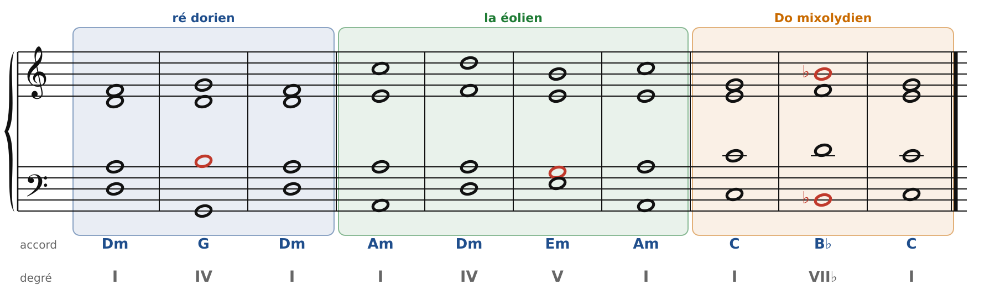
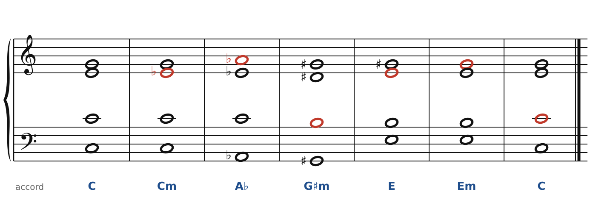
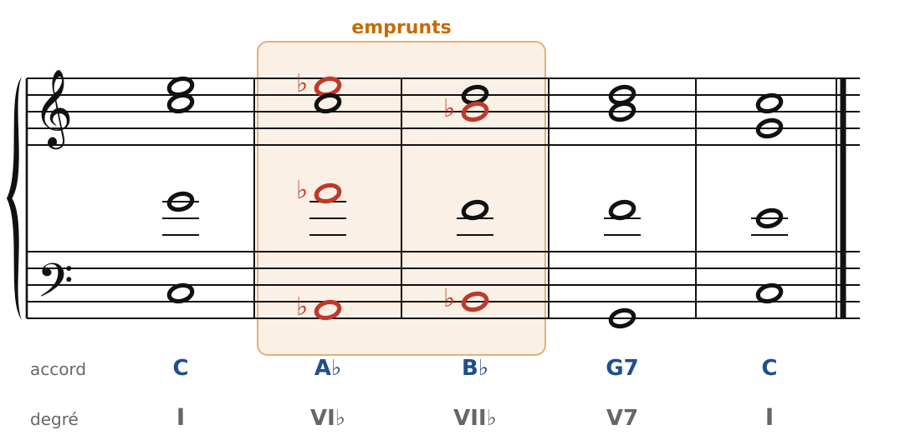

[← 42. Corrigés](42-corriges.md) · [Sommaire](../README.md#sommaire) · [44. Debussy →](44-debussy.md)

## 43. Fauré : couleurs modales, glissements, modulations inattendues

Gabriel Fauré (1845-1924) n'a pas appris la musique au Conservatoire mais à l'**École Niedermeyer**, une école de musique religieuse où l'on chantait le plain-chant, écrit dans les **modes** anciens. Il en a gardé le goût des couleurs modales, qu'il mêle à l'harmonie tonale héritée du XIXe siècle. Sa musique reste tonale, avec des cadences ; mais les chemins entre deux cadences sont souvent imprévus.

Ce qui change par rapport aux chapitres précédents : on garde les règles d'écriture (pas de quintes parallèles, 7e qui descend), mais on accepte des **degrés modaux**, et des accords lointains reliés par des mouvements très doux.

### Les degrés modaux

🔊 [Écouter](audio/h43-modal.mp3) · [MIDI](audio/h43-modal.mid)

Trois manières de « colorer » une tonalité en changeant une seule note de la gamme (en rouge) :

- **ré dorien** : en ré mineur, le IV est **majeur** (G, avec Si naturel au lieu de Si♭). La sixte majeure donne au mineur une couleur claire, moins plaintive ;
- **la éolien** : en la mineur, le V est **mineur** (Em, avec Sol naturel). Sans sensible, la cadence V-I est douce, presque suspendue : c'est la cadence du plain-chant ;
- **Do mixolydien** : en Do majeur, on remplace V par le **VII♭** (B♭, avec Si♭). La cadence VII♭-I garde l'élan d'un accord majeur qui va vers la tonique, sans la sensible.

Dans ces enchaînements, le degré modal arrive par degrés conjoints : la note « changée » est préparée ou atteinte par un pas. C'est ce qui les rend naturels.

### Les glissements : une voix bouge, les autres restent

🔊 [Écouter](audio/h43-glissements.mp3) · [MIDI](audio/h43-glissements.mid)

C, A♭, E : trois accords que rien ne relie dans une tonalité. Pourtant, l'enchaînement sonne simple, parce qu'à chaque étape **une seule voix** bouge, d'un demi-ton (en rouge), pendant que les deux autres restent :

- C → Cm : Mi descend sur Mi♭ ;
- Cm → A♭ : Sol monte sur La♭ ;
- A♭ → G♯m : Do descend sur Si (La♭ et Mi♭ deviennent Sol♯ et Ré♯ : mêmes touches, autre nom) ;
- G♯m → E : Ré♯ monte sur Mi ; et ainsi de suite jusqu'au retour à C.

Fauré aime ces enchaînements où la tonalité semble glisser sous les doigts. L'oreille suit sans effort, parce que les voix ne bougent presque pas. (Les mêmes « glissements » reviennent chez Wagner, chapitre 38, et dans beaucoup de musiques de film.)

### La modulation éclair

🔊 [Écouter](audio/h43-eclair.mp3) · [MIDI](audio/h43-eclair.mid)

Fauré s'échappe souvent pour un ou deux accords, puis revient aussitôt, sans cadence intermédiaire. Ici, A♭ et B♭ sont empruntés à do mineur (chapitre 30) ; ils ne font pas moduler : ils colorent. Le B♭ (VII♭) se retrouve juste à côté du G7, et la cadence parfaite ramène la lumière de Do majeur.

### Pour écrire « à la Fauré »

1. Garde une basse et un soprano qui avancent souvent par degrés conjoints.
2. Remplace une note de la gamme par sa voisine (Si♮ en ré mineur, Sol♮ en la mineur, Si♭ en Do majeur) : tu obtiens un degré modal.
3. Pour aller loin, déplace une seule voix d'un demi-ton à la fois.
4. Reviens à la tonalité par une vraie cadence : la surprise ne vaut que s'il y a un retour.

### À écouter

- *Après un rêve*, op. 7 n° 1 (mélodie) : une ligne qui se déploie longuement au-dessus d'accords répétés, avec des emprunts au majeur et au mineur.
- *Pavane*, op. 50 (1887) : en fa♯ mineur ; écoute les cadences sans sensible.
- Le *Requiem*, op. 48 : la couleur modale y est partout, héritée du plain-chant.
- Le **Quatuor à cordes en mi mineur**, op. 121 (1924), la dernière œuvre de Fauré : quatre voix qui se croisent et se répondent, presque sans repos.

Fauré a dirigé le Conservatoire de Paris et y a enseigné la composition : Ravel et Nadia Boulanger ont été ses élèves. Le cahier propose deux exercices sur ce chapitre ([Fauré : modes et glissements](../cahier/43-faure.md)).

---

[← 42. Corrigés](42-corriges.md) · [Sommaire](../README.md#sommaire) · [44. Debussy →](44-debussy.md)
