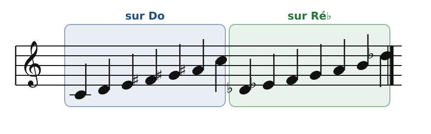
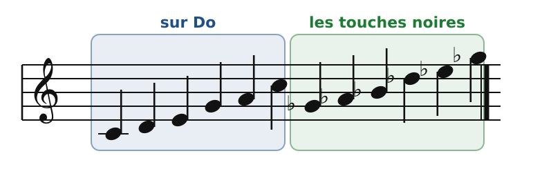
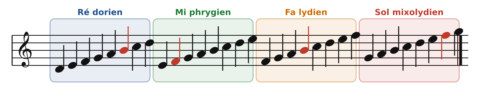
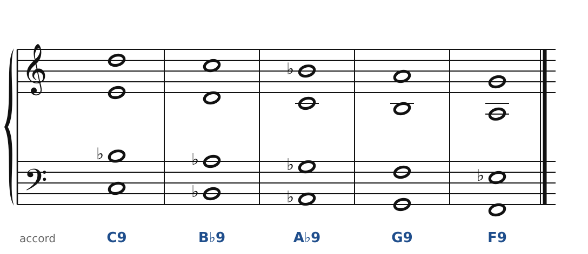
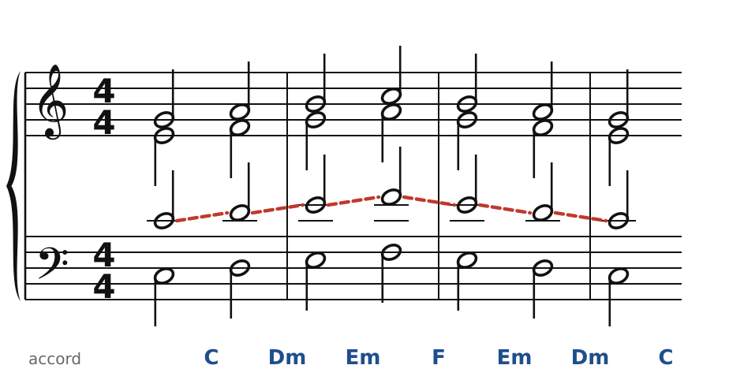
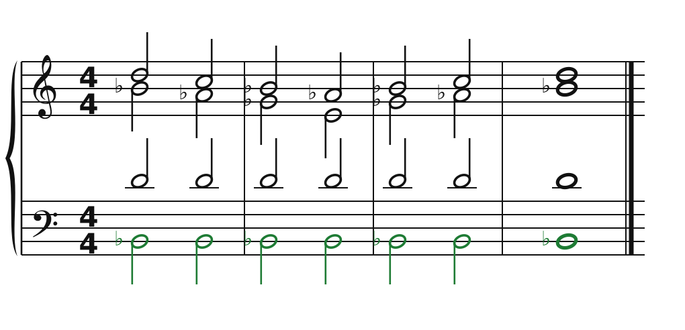
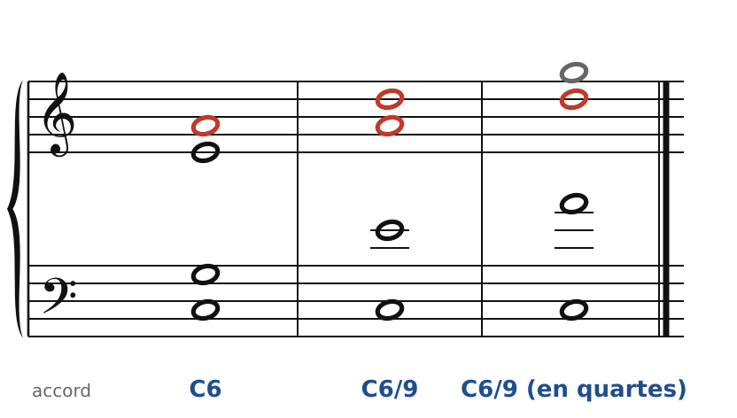

[← 43. Fauré](43-faure-couleurs-modales.md) · [Sommaire](../README.md#sommaire) · [45. Ravel →](45-ravel.md)

## 44. Debussy : accords parallèles, gamme par tons, pentatonique, modes

Avec Claude Debussy (1862-1918), l'accord n'a plus besoin d'aller quelque part. Une 7e peut rester sans résolution, une 9e peut glisser vers une autre 9e : l'accord vaut pour sa **couleur**, comme une touche de peinture. Debussy n'abandonne pas la tonalité, mais il la suspend souvent, en utilisant des gammes qui n'ont pas de sensible.

### Quatre réservoirs de notes

**La gamme par tons** : six notes, toutes à un ton les unes des autres.

🔊 [Écouter](audio/h44-tons.mp3) · [MIDI](audio/h44-tons.mid)

Tous les intervalles sont pareils : il n'y a ni demi-ton, ni quinte juste, donc ni sensible ni tonique. Il n'en existe que **deux** : celle de Do (Do, Ré, Mi, Fa♯, Sol♯, La♯) et celle de Ré♭ (Ré♭, Mi♭, Fa, Sol, La, Si). L'accord augmenté (chapitre 37) y est chez lui, ainsi que la 7e de dominante à quinte abaissée (Sol, Si, Ré♭, Fa).

**La gamme pentatonique** : cinq notes, sans demi-ton. Les touches noires du piano en forment une.

🔊 [Écouter](audio/h44-penta.mp3) · [MIDI](audio/h44-penta.mid)

Debussy l'a entendue dans le gamelan javanais à l'Exposition universelle de 1889 ; elle donne leur couleur à *Pagodes* (*Estampes*, 1903).

**Les modes** : les gammes « sur les touches blanches » à partir de chaque note. Chaque mode a une note caractéristique (en rouge), qui le distingue du majeur ou du mineur.

🔊 [Écouter](audio/h44-modes.mp3) · [MIDI](audio/h44-modes.mid)

- **dorien** : mineur avec une sixte majeure (Si en ré dorien) ;
- **phrygien** : mineur avec une seconde mineure (Fa en mi phrygien), couleur espagnole ;
- **lydien** : majeur avec une quarte augmentée (Si en Fa lydien) ;
- **mixolydien** : majeur avec une septième mineure (Fa en Sol mixolydien).

### Les accords parallèles

C'est la signature de Debussy : tout un accord se déplace en bloc, comme une seule voix « épaisse ». Les quintes et octaves parallèles sont alors **voulues** : elles ne détruisent plus l'indépendance des voix, puisque les voix ne sont plus indépendantes.

**Parallèles réels** : chaque voix bouge exactement du même intervalle. L'accord garde sa qualité (ici, une 9e de dominante, sans quinte).

🔊 [Écouter](audio/h44-paralleles-reels.mp3) · [MIDI](audio/h44-paralleles-reels.mid)

Le soprano chante une simple gamme descendante ; dessous, l'accord C9 glisse sur B♭9, A♭9, etc. Aucune de ces dominantes ne se résout : elles **colorent la mélodie**.

**Parallèles diatoniques** : les voix restent dans la gamme. La disposition est la même, mais les tierces deviennent majeures ou mineures selon l'endroit.

🔊 [Écouter](audio/h44-paralleles-diatoniques.mp3) · [MIDI](audio/h44-paralleles-diatoniques.mid)

La ligne rouge montre les quintes parallèles entre le ténor et la basse. Dans *La Cathédrale engloutie* (*Préludes*, livre I), de grands accords de quintes et d'octaves montent ainsi en bloc, comme des cloches sous l'eau.

### Une pédale et la gamme par tons

🔊 [Écouter](audio/h44-tons-pedale.mp3) · [MIDI](audio/h44-tons-pedale.mid)

Toutes les notes appartiennent à la même gamme par tons. Les tierces majeures du haut descendent et remontent sur une basse immobile (en vert) : aucune tension, aucune cadence, une musique qui flotte. C'est la manière de *Voiles* (*Préludes*, livre I) : la pièce est presque entièrement dans la gamme par tons, sur une longue pédale de Si♭, et sa partie centrale passe brusquement à la gamme pentatonique.

### L'accord de sixte ajoutée et l'accord final

🔊 [Écouter](audio/h44-sixte-ajoutee.mp3) · [MIDI](audio/h44-sixte-ajoutee.mid)

Un accord parfait avec une **sixte ajoutée** (La sur C), voire une neuvième (Ré) : la pièce peut finir dessus, sans que la note ajoutée doive se résoudre. Rangées en quartes (troisième accord : La, Ré, Sol au-dessus de Do), ces notes appartiennent… à la gamme pentatonique de Do (Do, Ré, Mi, Sol, La). Le jazz finira ses morceaux sur ce même accord.

### Pour écrire « à la Debussy »

1. Choisis un réservoir (gamme par tons, pentatonique, mode) et n'en sors pas pendant toute une section.
2. Pour les accords parallèles, écris d'abord la mélodie, puis recopie la même disposition sous chaque note : réelle (mêmes intervalles exacts) ou diatonique (dans la gamme).
3. Une basse tenue (pédale) stabilise tout ce qui bouge au-dessus.
4. Les règles de quintes et d'octaves ne s'appliquent plus aux accords parallèles ; en revanche, la tessiture et l'équilibre des voix restent importants.

### À écouter

- *Prélude à l'après-midi d'un faune* (1894) : la flûte seule, puis une harmonie qui ne se pose jamais vraiment.
- Le **Quatuor à cordes en sol mineur**, op. 10 (1893), seul quatuor de Debussy : un même thème revient, transformé, dans les quatre mouvements ; le deuxième fait la part belle aux pizzicati.
- *Préludes*, livre I (1909-1910) : *Voiles* (gamme par tons et pentatonique), *La Cathédrale engloutie* (accords parallèles).
- *Estampes* : *Pagodes* (pentatonique).

Le cahier propose trois exercices sur ce chapitre ([Debussy : accords parallèles, gamme par tons](../cahier/44-debussy.md)).

---

[← 43. Fauré](43-faure-couleurs-modales.md) · [Sommaire](../README.md#sommaire) · [45. Ravel →](45-ravel.md)
