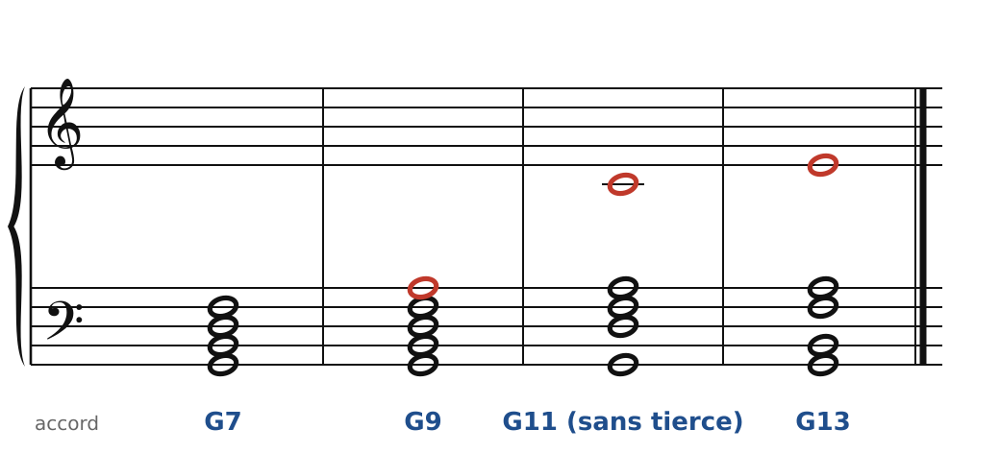
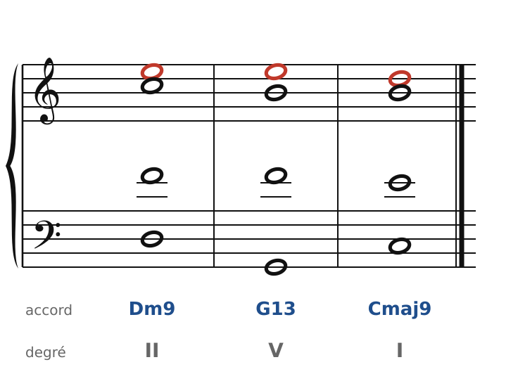
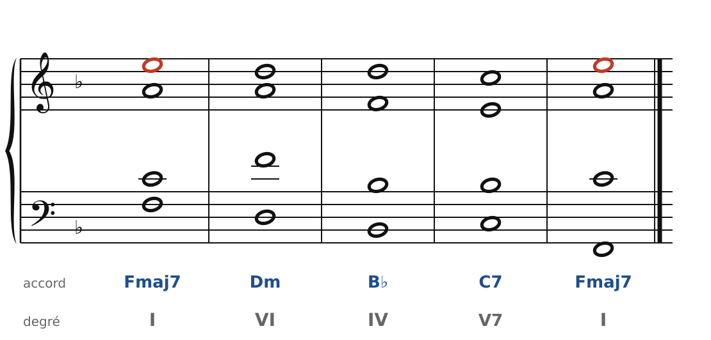
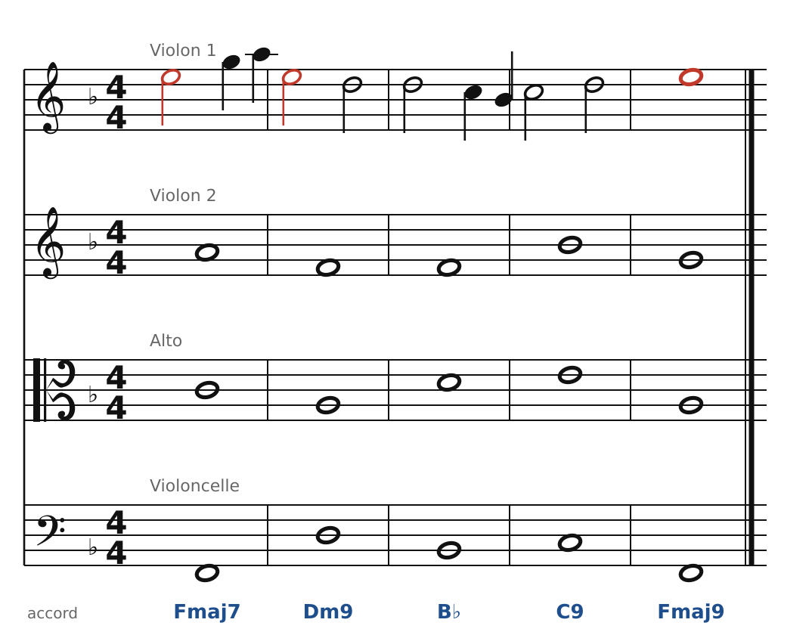

[← 44. Debussy](44-debussy.md) · [Sommaire](../README.md#sommaire) · [46. Vers le jazz →](46-vers-le-jazz.md)

## 45. Ravel : accords de 9e, 11e et 13e, écriture pour cordes

Maurice Ravel (1875-1937), élève de Fauré, se disait volontiers « classique » : ses phrases sont claires, ses cadences nettes, ses formes équilibrées. Mais ses accords sont plus riches que ceux de ses maîtres. On peut les lire comme des accords classiques auxquels on a **empilé** d'autres tierces, ou ajouté des appoggiatures qui ne se résolvent plus.

### Empiler des tierces

🔊 [Écouter](audio/h45-superposition.mp3) · [MIDI](audio/h45-superposition.mid)

Sur la fondamentale Sol, on ajoute une tierce après l'autre : 7e (Fa), **9e** (La), **11e** (Do), **13e** (Mi). Au-delà, on retombe sur Sol : le 13e est le plus grand accord de tierces possible (sept notes, toute la gamme).

À quatre voix, il faut choisir. Les notes qui comptent :

- la **fondamentale** (à la basse) ;
- la **tierce** et la **septième**, qui disent la qualité de l'accord (majeur ou mineur, dominante ou non) ;
- la **note ajoutée** (9e, 11e ou 13e), qui donne la couleur.

La **quinte** se supprime la première. Dans le 11e, on supprime aussi la **tierce** : Si et Do, à une 9e mineure l'un de l'autre, se heurtent trop. Dans le 13e, on garde fondamentale, tierce, septième et 13e.

### 9e et 13e à quatre voix

🔊 [Écouter](audio/h45-neuvieme-treizieme.mp3) · [MIDI](audio/h45-neuvieme-treizieme.mid)

Trois accords, une cadence II-V-I. Le soprano tient Mi (en rouge) : 9e de Dm, puis 13e de G, puis il descend sur Ré, 9e de C. Dessous, l'alto et le ténor font exactement ce que demandait le chapitre 18 : Do (7e de Dm) descend sur Si, Fa (7e de G) descend sur Mi. Les règles anciennes sont toujours là ; ce sont les notes ajoutées qui changent la couleur.

On retrouvera ces trois accords au chapitre suivant : c'est exactement la manière dont un pianiste de jazz joue un II-V-I.

### L'appoggiature qui ne se résout plus

🔊 [Écouter](audio/h45-septieme-majeure.mp3) · [MIDI](audio/h45-septieme-majeure.mid)

En Fa majeur, le soprano commence sur Mi au-dessus de l'accord de F. Dans le style classique, ce Mi serait une appoggiature de Fa : il monterait aussitôt. Ici, il reste. Fa-La-Do-Mi forme un **accord de 7e majeure** (Fmaj7), qui vaut pour lui-même, au début comme à la fin de la phrase. Ravel aime ces dissonances douces et immobiles ; le *Menuet antique* (1895) et la *Pavane pour une infante défunte* (1899) en sont pleins.

### Écrire pour quatuor

🔊 [Écouter](audio/h45-quatuor.mp3) · [MIDI](audio/h45-quatuor.mid)

Avec des accords de quatre ou cinq sons, le quatuor ne peut pas tout jouer : chaque instrument choisit **une note qui compte**. Ici :

- le **violoncelle** joue les fondamentales, assez bas pour que l'accord ait une assise ;
- l'**alto** et le **2e violon** prennent les tierces et les septièmes (les notes guides) ;
- le **1er violon** chante, et ses notes longues sont souvent les notes ajoutées : Mi, 7e majeure de F (en rouge) ; Mi, 9e de Dm ; Ré, 9e de C ; Mi, 7e majeure de F à la fin.

Le dernier accord, Fmaj9 sans quinte, est réparti ainsi : Fa (violoncelle), La (alto), Sol (2e violon), Mi (1er violon). Les intervalles sont larges en bas, plus serrés en haut, comme une série d'harmoniques.

### À écouter

- Le **Quatuor en fa majeur** (1903), dédié à Fauré. Écoute le premier thème, au 1er violon, sur des accords tenus ; puis le deuxième mouvement, avec ses pizzicati et ses rythmes croisés.
- *Ma mère l'Oye* (1910) et *Le Tombeau de Couperin* (1914-1917) : des formes anciennes, des accords neufs.
- La **Sonate pour violon et piano n° 2** (1927), dont le deuxième mouvement s'appelle *Blues*, et le **Concerto en sol** (1931) : Ravel avait entendu le jazz et s'en est servi.

Le cahier propose deux exercices sur ce chapitre ([Ravel : 7e, 9e et 13e](../cahier/45-ravel.md)).

---

[← 44. Debussy](44-debussy.md) · [Sommaire](../README.md#sommaire) · [46. Vers le jazz →](46-vers-le-jazz.md)
