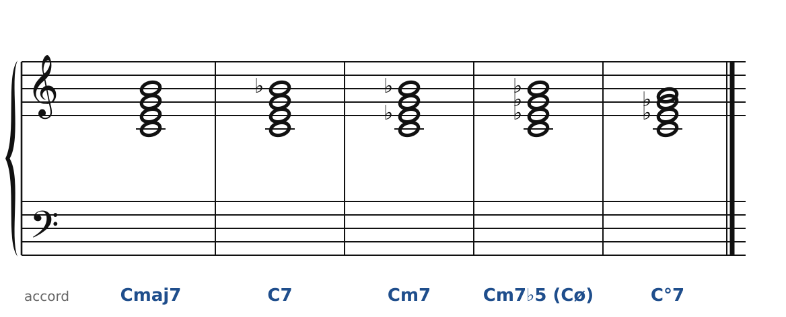
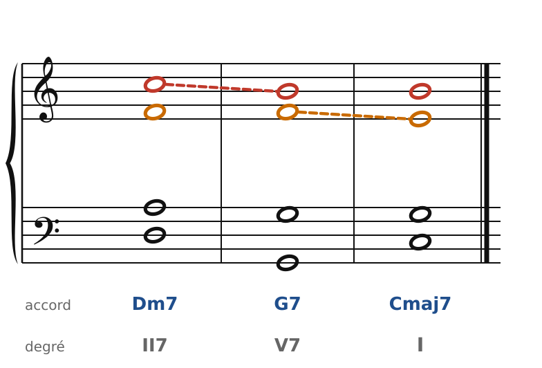
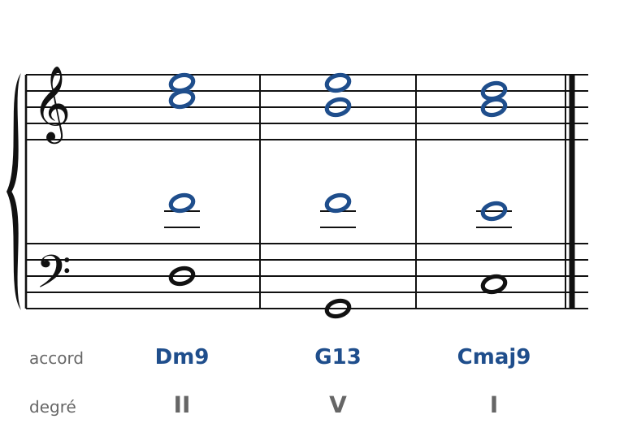
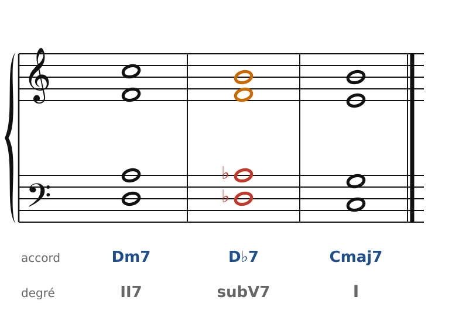
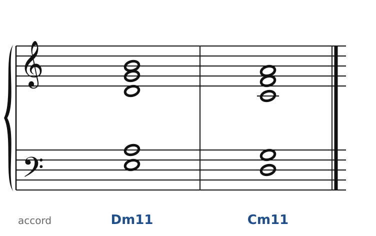

[← 45. Ravel](45-ravel.md) · [Sommaire](../README.md#sommaire) · [47. Exercices →](47-exercices.md)

## 46. Des accords classés aux accords de couleur : le pont vers l'harmonie jazz

L'harmonie du jazz n'est pas venue de nulle part. Les pianistes et arrangeurs des années 1920 à 1960 (Duke Ellington, Bill Evans, Gil Evans…) connaissaient Debussy et Ravel, et l'harmonie qu'ils ont fixée prolonge directement les chapitres précédents. Ce chapitre fait le lien : les mêmes accords, avec deux façons de les écrire.

### Deux noms pour un même accord

Le cours écrit les accords en lettres depuis le début (C, Dm, G7). Le jazz ajoute la qualité de la septième et les notes ajoutées :

🔊 [Écouter](audio/h46-septiemes.mp3) · [MIDI](audio/h46-septiemes.mid)

| Symbole | Notes sur Do | Nom classique | Où on le trouve en Do majeur |
|---|---|---|---|
| Cmaj7 | Do Mi Sol Si | 7e majeure (7e d'espèce) | I7, IV7 |
| C7 | Do Mi Sol Si♭ | 7e de dominante | V7 |
| Cm7 | Do Mi♭ Sol Si♭ | 7e mineure (7e d'espèce) | II7, III7, VI7 |
| Cm7♭5 ou Cø | Do Mi♭ Sol♭ Si♭ | 7e de sensible (demi-diminuée) | VII7 |
| C°7 | Do Mi♭ Sol♭ Si♭♭ (souvent écrit La) | 7e diminuée | VII°7 du mineur |

Ensuite viennent les extensions : **9**, **11**, **13** (chapitre 45), éventuellement altérées (♭9, ♯9, ♯11, ♭13). Le chiffre romain et le symbole disent la même chose de deux manières : le degré dit la **fonction**, le symbole dit les **notes**.

### Le II-V-I et les notes guides

Le jazz a fait du II-V-I (chapitre 19 : II7-V7-I) sa cellule de base.

🔊 [Écouter](audio/h46-ii-v-i.mp3) · [MIDI](audio/h46-ii-v-i.mid)

Suis la tierce et la septième de chaque accord (on les appelle les **notes guides**) :

- la 7e de Dm (Do, en rouge) **descend** d'un demi-ton sur Si, tierce de G7 ;
- la tierce de Dm (Fa, en orange) reste et devient la 7e de G7, qui **descend** à son tour sur Mi, tierce de C.

C'est exactement la règle classique : la septième se prépare et se résout en descendant. Les jazzmen la pratiquent d'instinct : sur un II-V-I, la ligne des notes guides avance par demi-tons, et c'est elle qui donne l'impression que « ça tourne ».

### Les accords sans fondamentale

🔊 [Écouter](audio/h46-sans-fondamentale.mp3) · [MIDI](audio/h46-sans-fondamentale.mid)

Les mêmes trois accords qu'au chapitre 45. Au-dessus de la basse, les trois voix (en bleu) n'ont **pas la fondamentale** : tierce, septième et une note ajoutée (9e ou 13e). Quand un contrebassiste joue la fondamentale, le pianiste ou le guitariste peut s'en passer : c'est le principe des **voicings sans fondamentale**, popularisés par Bill Evans. Remarque que les trois voix du haut ne bougent presque pas d'un accord à l'autre : Mi-Do-Fa, Mi-Si-Fa, Ré-Si-Mi.

Sur une guitare, ces trois notes se jouent sur trois cordes voisines ; la fondamentale est laissée à la basse.

### La substitution tritonique : une vieille connaissance

🔊 [Écouter](audio/h46-triton.mp3) · [MIDI](audio/h46-triton.mid)

Remplace G7 par D♭7 : la basse descend par demi-tons (Ré, Ré♭, Do). Pourquoi ça marche ? G7 et D♭7 ont la **même paire de notes guides** : Fa et Si (= Do♭), à un triton (en orange). Seules la fondamentale et la quinte changent (en rouge).

Écris D♭7 avec Si au lieu de Do♭ : Ré♭-Fa-La♭-Si. C'est la **sixte augmentée allemande** de Do (chapitre 24 : la sixte Ré♭-Si s'ouvre sur l'octave Do-Do) ; et le chapitre 36 avait déjà montré qu'elle sonne comme un accord de 7e de dominante. Le jazz n'a rien inventé ici : il a donné un nouveau nom (« subV7 ») à un accord que Schubert utilisait déjà.

### Les accords en quartes

🔊 [Écouter](audio/h46-quartes.mp3) · [MIDI](audio/h46-quartes.mid)

En 1959, sur l'album *Kind of Blue* de Miles Davis, le morceau *So What* fait entendre un accord de cinq notes : trois quartes justes et une tierce majeure (Mi, La, Ré, Sol, Si, au-dessus d'un Ré à la contrebasse). C'est un Dm11, mais rangé en quartes, il ne sonne plus comme un empilement de tierces : il est ouvert, sans direction, très proche des accords parallèles de Debussy. Ces accords glissent d'ailleurs souvent en bloc, comme chez lui.

Le jeu modal de *So What* (seize mesures en ré dorien, huit en mi♭ dorien, puis retour) est le même geste que les modes de Debussy : une couleur tenue longtemps, plutôt qu'une suite de fonctions.

### Ce qui reste, ce qui change

| | Harmonie classique | Harmonie « de couleur » (Debussy, Ravel, jazz) |
|---|---|---|
| Les notes guides (tierce, septième) | se résolvent | se résolvent dans le II-V-I, ailleurs peuvent rester |
| Quintes et octaves parallèles | interdites | permises dans les accords parallèles |
| Notes ajoutées (6te, 9e, 11e, 13e) | appoggiatures, à résoudre | notes de l'accord |
| Doublures | règles selon l'état | on évite de doubler : chaque voix apporte une couleur |
| Fondamentale | presque toujours présente | peut manquer (la basse s'en charge) |

Le cahier propose trois exercices sur ce chapitre ([Vers le jazz : II-V-I et substitutions](../cahier/46-vers-le-jazz.md)).

---

[← 45. Ravel](45-ravel.md) · [Sommaire](../README.md#sommaire) · [47. Exercices →](47-exercices.md)
