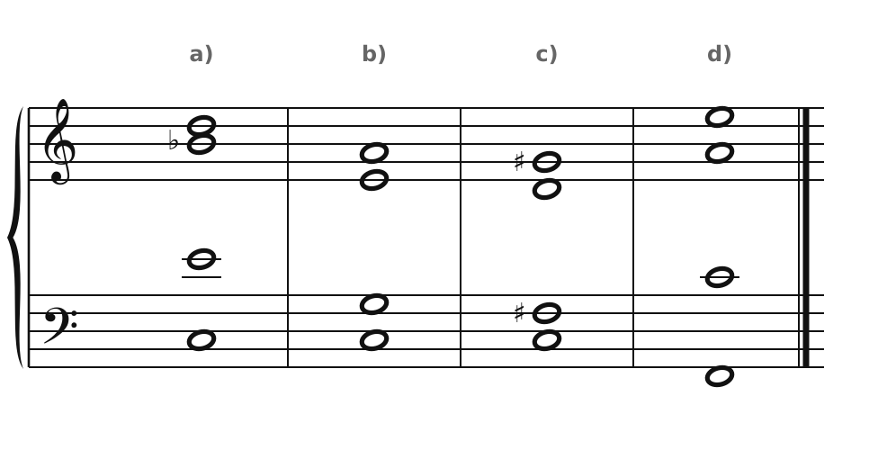
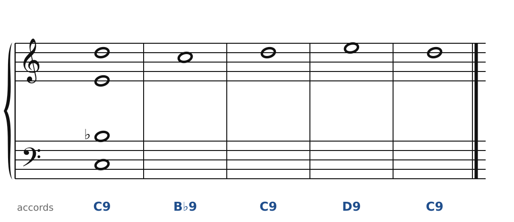
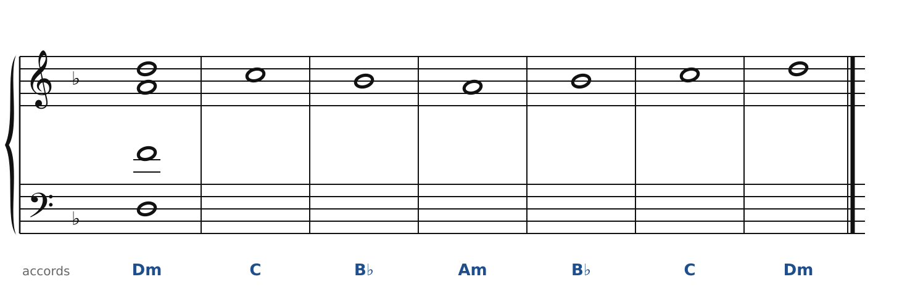
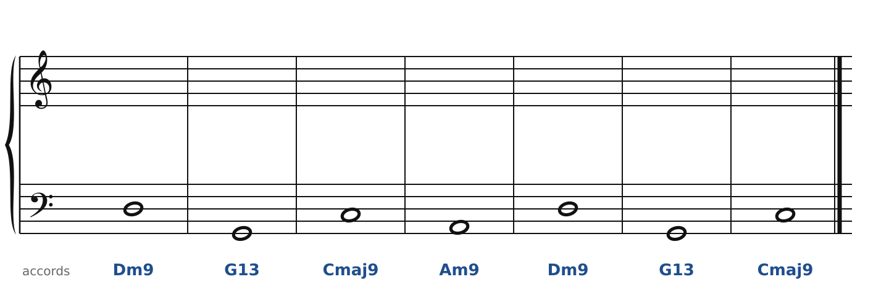
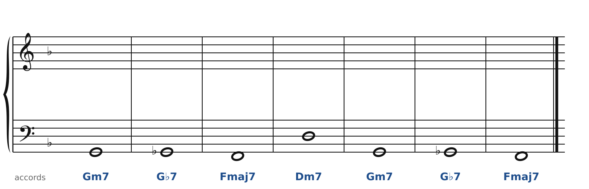

[← 46. Vers le jazz](46-vers-le-jazz.md) · [Sommaire](../README.md#sommaire) · [48. Corrigés →](48-corriges.md)

## 47. Exercices

Dans la **version web** du cours, les exercices 2 à 5 se font directement sur la portée (bouton **✏️ Faire l'exercice ici**). Pour cette partie, le correcteur change de règles : il vérifie que chaque accord contient les notes demandées, que les voix restent dans leur tessiture et ne se croisent pas, et, pour les accords parallèles, que la disposition est bien recopiée. Les quintes parallèles ne sont plus des fautes.

Pour t'entraîner davantage, le [cahier d'exercices](../cahier/README.md) propose 10 autres exercices sur les chapitres 43 à 46.

### Exercice 1 : quatre accords de couleur

Donne le nom de chaque accord (symbole en lettres) et dis à quel chapitre il se rattache.

### Exercice 2 : des 9e parallèles

Le premier accord (C9, sans quinte) et la mélodie sont donnés. Écris l'alto, le ténor et la basse en recopiant **exactement** la même disposition sous chaque note du soprano.

### Exercice 3 : des accords parallèles dans la gamme

En Fa majeur. Le premier accord (Dm) et la mélodie sont donnés. Écris l'alto, le ténor et la basse en restant **dans la gamme** : chaque voix descend ou monte du même nombre de degrés que le soprano.

### Exercice 4 : II-V-I avec 9e et 13e

La basse et les accords sont donnés. Écris le soprano, l'alto et le ténor sans fondamentale : dans chaque accord, la **tierce**, la **septième** et la note ajoutée (9e ou 13e). Cherche les mouvements les plus courts.

### Exercice 5 : la substitution tritonique

En Fa majeur, le V7 (C7) est remplacé par G♭7. La basse et les accords sont donnés. Écris les trois voix du haut, sans fondamentale : dans chaque accord, la tierce, la quinte et la septième.

**Indice** : dans G♭7, la septième Fa♭ est écrite Mi, comme dans une sixte augmentée.

### Exercice 6 : écoute

Écoute le début du **Quatuor en fa** de Ravel et celui du **Quatuor en sol mineur** de Debussy. Pour chacun : quel instrument chante le premier thème ? Les accords dessous se résolvent-ils « comme au chapitre 18 », ou restent-ils suspendus ? Repère un passage en accords parallèles.

---

[← 46. Vers le jazz](46-vers-le-jazz.md) · [Sommaire](../README.md#sommaire) · [48. Corrigés →](48-corriges.md)
