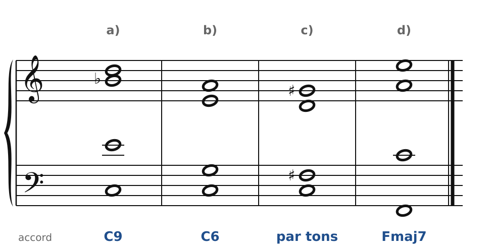
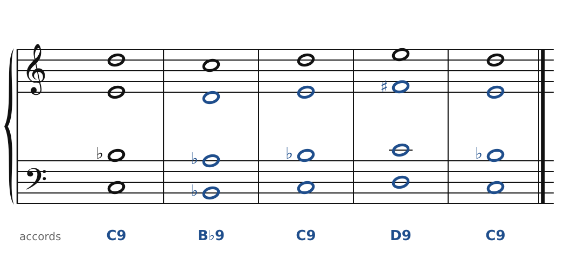
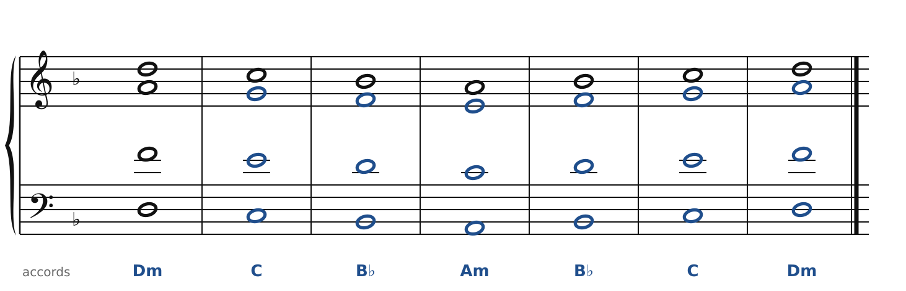
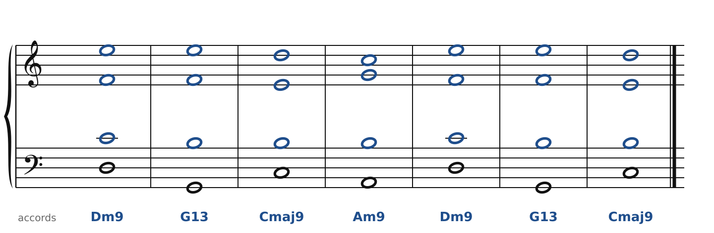
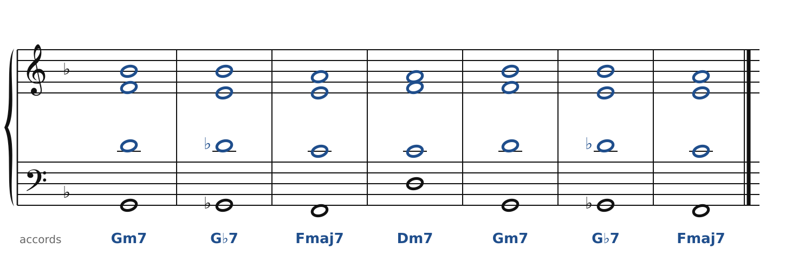

[← 47. Exercices](47-exercices.md) · [Sommaire](../README.md#sommaire) · [49. Scriabine →](49-scriabine.md)

## 48. Corrigés

### Exercice 1

🔊 [Écouter](audio/h48-c1.mp3) · [MIDI](audio/h48-c1.mid)

- a) Do, Mi, Si♭, Ré : **C9** sans quinte (chapitre 45). La fondamentale, la tierce, la 7e et la 9e : les quatre notes qui comptent.
- b) Do, Sol, Mi, La : **C6**, accord parfait avec sixte ajoutée (chapitre 44).
- c) Do, Fa♯, Ré, Sol♯ : quatre notes de la **gamme par tons** sur Do (chapitre 44). On peut l'appeler C7(♯5) sans quinte juste… mais c'est surtout une couleur sans tonique.
- d) Fa, Do, La, Mi : **Fmaj7**, la 7e majeure de Ravel (chapitre 45).

### Exercice 2

🔊 [Écouter](audio/h48-c2.mp3) · [MIDI](audio/h48-c2.mid)

Disposition de départ, vue depuis la basse : 7e au ténor, 10e (la tierce) à l'alto, 9e au soprano, une octave plus haut. On la recopie telle quelle : B♭9 (Si♭, La♭, Ré, Do), C9, D9 (Ré, Do, Fa♯, Mi), C9. Sous D9, il faut un Fa♯ à l'alto pour garder la tierce majeure.

### Exercice 3

🔊 [Écouter](audio/h48-c3.mp3) · [MIDI](audio/h48-c3.mid)

Dm, C, B♭, Am, B♭, C, Dm : trois accords mineurs et deux majeurs, avec la même disposition (fondamentale à la basse et au soprano, deux octaves plus haut ; quinte à l'alto, tierce au ténor… et des quintes parallèles partout). Aucune altération : toutes les notes restent dans la gamme de Fa majeur.

### Exercice 4

🔊 [Écouter](audio/h48-c4.mp3) · [MIDI](audio/h48-c4.mid)

Au-dessus de la basse, trois voix sans fondamentale :

- Dm9 : Mi (9e), Fa (3ce), Do (7e) ; G13 : Mi (13e), Fa (7e), Si (3ce) ; Cmaj9 : Ré (9e), Mi (3ce), Si (7e) ;
- Am9 : Do (3ce), Sol (7e), Si (9e).

Les voix bougent à peine : le soprano tient Mi pendant Dm9-G13, puis descend sur Ré ; l'alto tient Fa avant de descendre sur Mi ; le ténor passe de Do à Si et y reste. C'est toute la beauté des voicings de jazz : de grands changements d'accords avec de tout petits mouvements.

### Exercice 5

🔊 [Écouter](audio/h48-c5.mp3) · [MIDI](audio/h48-c5.mid)

G♭7 s'écrit Sol♭, Si♭, Ré♭, Mi (au lieu de Fa♭). Ses notes guides, Si♭ et Mi, sont celles de C7 (Mi, Si♭) : Si♭ descend sur La (tierce de Fmaj7), Mi reste (7e majeure de F). Ré♭ descend sur Do. La basse descend par demi-tons : Sol, Sol♭, Fa.

### Exercice 6

- **Ravel** : le premier thème est au 1er violon, sur des accords tenus des trois autres instruments. Les septièmes et les neuvièmes ne se résolvent pas toujours : elles colorent la mélodie.
- **Debussy** : le thème, très rythmé, est joué d'abord par le 1er violon, les autres en accords ; il revient, transformé, dans les mouvements suivants (dans le deuxième, l'alto le répète en ostinato sous les pizzicati). Les passages en accords parallèles se reconnaissent à l'oreille : les quatre instruments bougent ensemble, dans le même sens, et l'accord garde sa couleur.

---

[← 47. Exercices](47-exercices.md) · [Sommaire](../README.md#sommaire) · [49. Scriabine →](49-scriabine.md)
