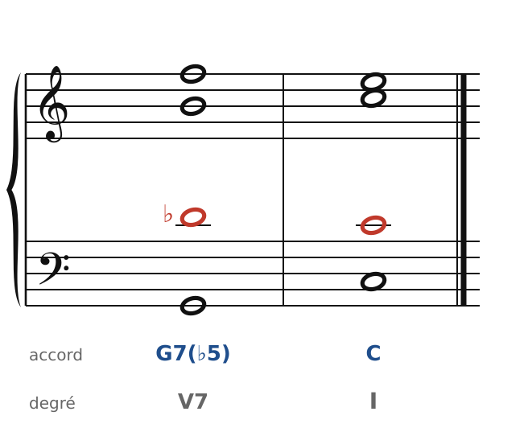
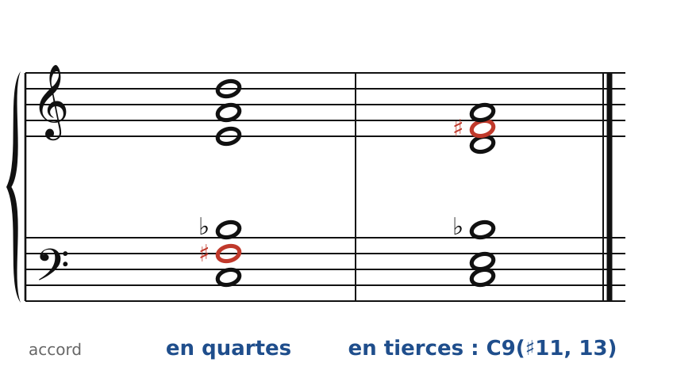
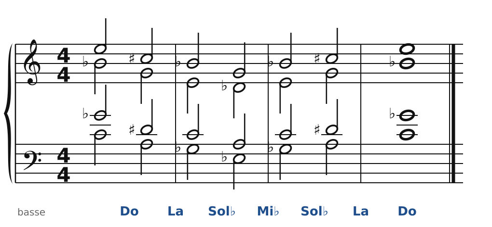

[← 48. Corrigés](48-corriges.md) · [Sommaire](../README.md#sommaire) · [50. Bartók →](50-bartok-et-les-quatuors.md)

## 49. Scriabine : l'accord mystique, l'harmonie en quartes

Neuvième et dernière partie : le XXe siècle. Chaque compositeur y invente sa propre harmonie, et il n'y a plus de « traité » commun. On va donc procéder autrement : pour chacun, **un ou deux gestes** qu'on peut comprendre, écrire, et reconnaître à l'écoute. Le correcteur des exercices garde les règles du chapitre 47 : les bonnes notes, dans la bonne tessiture, sans croisement.

Alexandre Scriabine (1872-1915) commence comme un héritier de Chopin (préludes, études, mazurkas) et finit avec une harmonie entièrement à lui, tirée d'**un seul accord**.

### La dominante qui ne se résout plus

🔊 [Écouter](audio/h49-quinte-alteree.mp3) · [MIDI](audio/h49-quinte-alteree.mid)

Point de départ : la 7e de dominante avec une **quinte abaissée** (Ré♭ au lieu de Ré, en rouge). Ré♭ descend sur Do, Si monte sur Do, Fa descend sur Mi : la résolution est encore classique. Mais cet accord appartient à la gamme par tons (chapitre 44), et il est identique à une sixte française (chapitre 24) : il est ambigu. Peu à peu, Scriabine le garde, le prolonge, et ne le résout plus.

### L'accord mystique

🔊 [Écouter](audio/h49-mystique.mp3) · [MIDI](audio/h49-mystique.mid)

Dans *Prométhée, le poème du feu* (1910), toute l'harmonie vient d'un accord de six notes : **Do, Fa♯, Si♭, Mi, La, Ré**. On l'appelle l'« accord mystique » ou « accord de Prométhée ».

- Rangé **en quartes** (à gauche) : quarte augmentée, quarte diminuée, quarte augmentée, quarte juste, quarte juste. Il sonne ouvert, lumineux, sans direction.
- Rangé **en tierces** (à droite) : Do, Mi, Si♭, Ré, Fa♯, La. C'est une **dominante de Do** avec 9e, 11e augmentée (Fa♯, en rouge) et 13e, sans quinte. On reconnaît les accords empilés de Ravel (chapitre 45).

Ses six notes sont presque toute l'**échelle acoustique** de Do (Do, Ré, Mi, Fa♯, Sol, La, Si♭) : il n'y manque que Sol. On retrouvera cette échelle chez Bartók.

### Transposer plutôt que résoudre

🔊 [Écouter](audio/h49-transpositions.mp3) · [MIDI](audio/h49-transpositions.mid)

Puisque l'accord ne se résout plus, comment avancer ? En le **transposant**. Ici, quatre de ses notes (Do, Fa♯ = Sol♭, Si♭, Mi) glissent en bloc par tierces mineures : sur Do, La, Sol♭, Mi♭, et retour.

Remarque : l'accord sur Sol♭ contient exactement les mêmes notes que l'accord sur Do (Sol♭, Do, Mi, Si♭). Transposé d'un triton, il retombe sur lui-même. Cette **symétrie** est la clé de Scriabine, puis de Messiaen (chapitre 53) : peu de transpositions possibles, donc une harmonie qui tourne sur elle-même, comme suspendue.

### Pour écrire « à la Scriabine »

1. Choisis quatre ou cinq notes de l'accord mystique ; garde la tierce (Mi) et la septième (Si♭), comme dans une dominante.
2. Écris-les plutôt en quartes, dans le haut de la tessiture.
3. Fais avancer l'harmonie par transpositions de l'accord entier (par demi-tons, par tierces mineures), plutôt que par résolutions.

### À écouter

- Les **Préludes op. 11** (1888-1896) : Scriabine chopinien.
- *Vers la flamme*, op. 72 (1914) : un poème pour piano qui monte d'un bout à l'autre, sur des accords de la même famille.
- *Prométhée*, op. 60 (1910), pour orchestre, piano et « clavier à lumières » : Scriabine voyait des couleurs en entendant des tonalités, et voulait projeter des lumières pendant le concert.
- Les sonates pour piano n° 5 à 10, où l'accord mystique et ses parents règnent seuls.

Le cahier propose deux exercices sur ce chapitre ([Scriabine : l'accord mystique](../cahier/49-scriabine.md)).

---

[← 48. Corrigés](48-corriges.md) · [Sommaire](../README.md#sommaire) · [50. Bartók →](50-bartok-et-les-quatuors.md)
