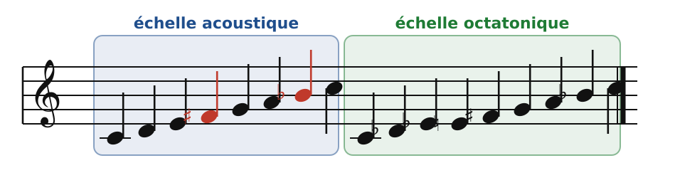
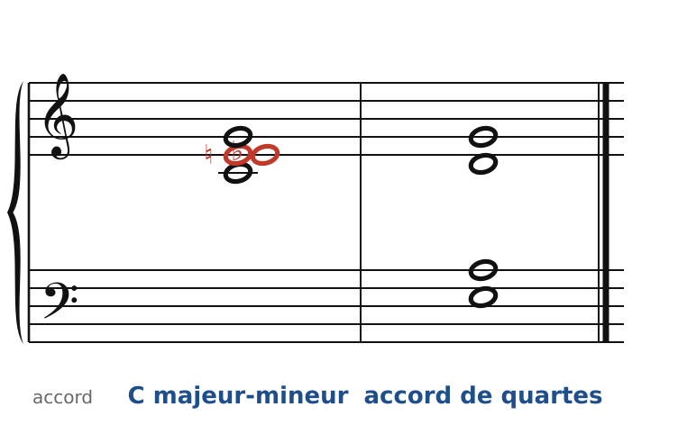
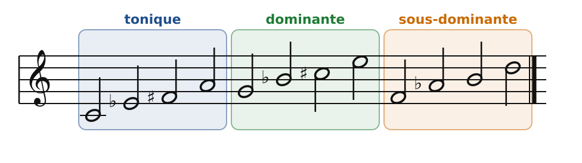
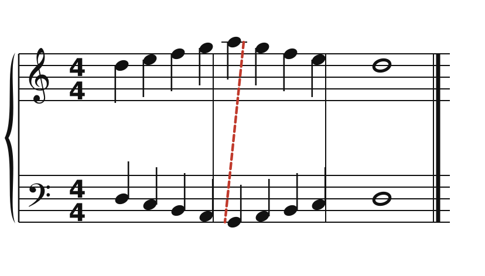
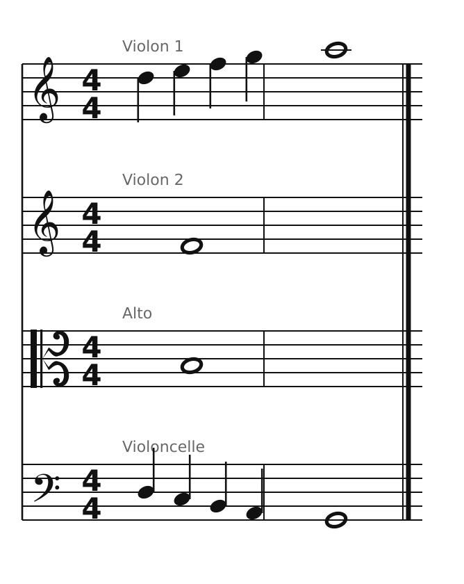

[← 49. Scriabine](49-scriabine.md) · [Sommaire](../README.md#sommaire) · [51. Stravinsky →](51-stravinsky.md)

## 50. Bartók et les quatuors : axes, échelles, miroirs

Béla Bartók (1881-1945) a passé des années à enregistrer, au phonographe, les chants paysans de Hongrie, de Roumanie, de Slovaquie, avec son ami Zoltán Kodály. Il y a trouvé des modes anciens, des rythmes irréguliers, des intervalles « faux » pour une oreille classique. Il a construit avec eux une harmonie nouvelle, très rigoureuse. Ses **six quatuors à cordes** (1908-1939) sont, avec ceux de Beethoven, le sommet du genre : c'est là qu'il faut l'écouter.

### Deux échelles

🔊 [Écouter](audio/h50-echelles.mp3) · [MIDI](audio/h50-echelles.mid)

- L'**échelle acoustique** (Do, Ré, Mi, Fa♯, Sol, La, Si♭) : un majeur avec une quarte augmentée et une septième mineure (en rouge), autrement dit un mode lydien avec 7e mineure. Ses notes sont proches des harmoniques naturels d'un Do grave, d'où son nom. On la retrouve dans les chants populaires… et chez Scriabine (chapitre 49).
- L'**échelle octatonique** (huit notes) : demi-ton, ton, demi-ton, ton… Elle est symétrique : transposée d'une tierce mineure, elle retombe sur elle-même. Messiaen l'appellera « mode 2 » (chapitre 53) ; Stravinsky l'utilise aussi (chapitre 51).

### Deux accords

🔊 [Écouter](audio/h50-accords.mp3) · [MIDI](audio/h50-accords.mid)

- L'accord **majeur-mineur** : Do, Mi♭, Mi, Sol, la tierce majeure et la tierce mineure ensemble (en rouge). Bartók l'entend dans les chants populaires, où la tierce « hésite ». C'est aussi la couleur du blues (la *blue note* Mi♭ sur un accord de Do).
- L'accord **de quartes** (Mi, La, Ré, Sol) : le même qu'au chapitre 46, chez Bartók souvent joué en cordes à vide ou en accords brisés.

Et le **cluster** : plusieurs notes voisines jouées ensemble (Do, Ré♭, Ré, Mi♭…), comme un bloc de bruit coloré. Dans le *Quatuor n° 4*, de petites cellules chromatiques s'agglutinent en clusters.

### Le système des axes

Bartók n'a pas écrit de traité. C'est l'analyste hongrois Ernő Lendvai qui a proposé, en étudiant ses œuvres, le **système des axes** : les douze tonalités se répartissent en trois fonctions, chacune sur un accord de 7e diminuée.

🔊 [Écouter](audio/h50-axes.mp3) · [MIDI](audio/h50-axes.mid)

| Fonction | Axe (quatre tonalités) |
|---|---|
| tonique | Do, Mi♭, Fa♯, La |
| dominante | Sol, Si♭, Do♯, Mi |
| sous-dominante | Fa, La♭, Si, Ré |

L'idée : une tonalité peut être **remplacée** par sa voisine à une tierce mineure, ou par son opposée à un triton, sans changer de fonction. Tu connais déjà ce principe : la substitution tritonique du jazz (chapitre 46) remplace G7 par D♭7, deux points du même axe de dominante. Et le cycle des 7e diminuées du chapitre 36 relie les quatre tonalités d'un même axe.

### Le miroir

🔊 [Écouter](audio/h50-miroir.mp3) · [MIDI](audio/h50-miroir.mid)

Bartók aime la **symétrie**. La basse est ici le reflet exact du soprano : chaque fois que le soprano monte d'un ton, la basse descend d'un ton ; d'un demi-ton, d'un demi-ton. Autour de Ré, les touches blanches se reflètent sur des touches blanches (Mi ↔ Do, Fa ↔ Si, Sol ↔ La) : c'est le centre de symétrie du clavier. Le trait rouge montre le point le plus éloigné, où les deux voix se retournent ensemble.

On peut aussi renverser un thème entier (les intervalles montants deviennent descendants) : c'est l'**inversion**, que Bartók utilise sans cesse dans ses fugues et ses canons.

### Pour quatuor

🔊 [Écouter](audio/h50-quatuor.mp3) · [MIDI](audio/h50-quatuor.mid)

Le 1er violon monte de Ré à La ; le violoncelle descend en miroir, de Ré à Sol. Au centre, le 2e violon et l'alto tiennent **Fa et Si**, un triton lui-même symétrique autour de Ré. Tout l'ensemble est un reflet : l'oreille ne cherche plus de tonique, elle entend un **centre** (Ré), qui joue le même rôle.

### À écouter : les six quatuors

- **n° 1** (1908-1909) : il commence par un duo lent des deux violons, en imitation, très chromatique (l'héritage de Wagner).
- **n° 2** (1915-1917) : un mouvement central rapide et sauvage, des rythmes de danse populaire.
- **n° 3** (1927) : un seul mouvement en quatre parties enchaînées ; glissandos, *sul ponticello*, *col legno*, clusters.
- **n° 4** (1928) : cinq mouvements disposés **en arche** (le 1er répond au 5e, le 2e au 4e, autour d'un mouvement central lent). Le 2e est joué avec sourdine, très vite ; le 4e entièrement **en pizzicati**, dont le « pizzicato Bartók », où la corde claque sur la touche.
- **n° 5** (1934) : encore une arche à cinq mouvements ; au centre, un scherzo aux rythmes « bulgares » (mesures irrégulières, 4 + 2 + 3 croches).
- **n° 6** (1939) : chaque mouvement commence par une même mélodie lente marquée *Mesto* (triste) ; dans le dernier, elle envahit tout. C'est le dernier quatuor de Bartók, écrit juste avant son exil aux États-Unis.

Le cahier propose deux exercices sur ce chapitre ([Bartók : miroirs et échelles](../cahier/50-bartok.md)).

---

[← 49. Scriabine](49-scriabine.md) · [Sommaire](../README.md#sommaire) · [51. Stravinsky →](51-stravinsky.md)
