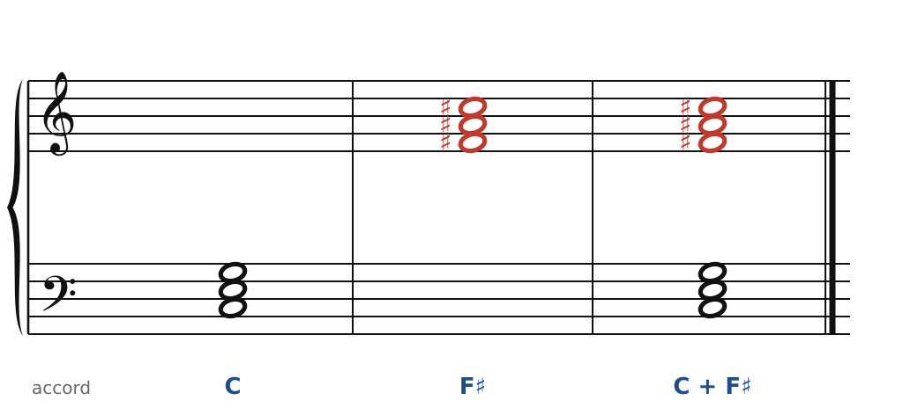
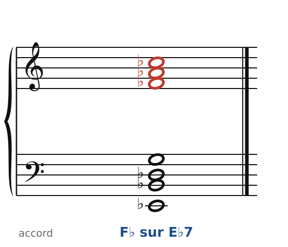
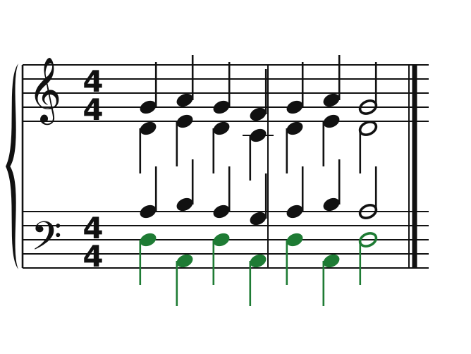

[← 50. Bartók](50-bartok-et-les-quatuors.md) · [Sommaire](../README.md#sommaire) · [52. Prokofiev →](52-prokofiev.md)

## 51. Stravinsky : deux accords à la fois, l'ostinato

Igor Stravinsky (1882-1971) était élève de Rimski-Korsakov, qui aimait déjà l'échelle octatonique (on l'appelle parfois en Russie « la gamme de Rimski »). Ses trois grands ballets pour les Ballets russes de Diaghilev, *L'Oiseau de feu* (1910), *Petrouchka* (1911) et *Le Sacre du printemps* (1913), ont changé la musique du siècle. Les œuvres de Stravinsky sont encore protégées : les exemples ci-dessous ne reproduisent que des **accords**, et les autres exemples sont originaux.

### Deux accords à un triton : *Petrouchka*

🔊 [Écouter](audio/h51-petrouchka.mp3) · [MIDI](audio/h51-petrouchka.mid)

Le pantin Petrouchka est représenté par deux accords joués **en même temps**, aux clarinettes : **C** et **F♯** (en rouge), à un triton l'un de l'autre. C'est la **bitonalité** : deux tonalités superposées. L'effet est grinçant, ironique, comme un personnage en deux morceaux.

Mais ces six notes (Do, Mi, Sol, Fa♯, La♯, Do♯) ont une unité cachée : elles appartiennent toutes à une même **échelle octatonique** (Do, Do♯, Ré♯, Mi, Fa♯, Sol, La, La♯ : demi-ton, ton, demi-ton, ton…). Et C et F♯ sont sur le même **axe** de tonique (chapitre 50). La bitonalité de Stravinsky n'est pas un hasard : c'est une couleur de plus de l'octatonique.

### L'accord du *Sacre*

🔊 [Écouter](audio/h51-augures.mp3) · [MIDI](audio/h51-augures.mid)

Au début des *Augures printaniers* (*Le Sacre du printemps*), les cordes répètent un même accord, des dizaines de fois, avec des accents à des endroits imprévisibles. En bas : **E♭7** (Mi♭, Si♭, Ré♭, Sol) ; en haut : **F♭** (Fa♭, La♭, Do♭, en rouge), qui sonne comme un accord de Mi majeur. Deux accords à un demi-ton : une dominante et un accord étranger, en même temps.

L'accord ne change pas : ce sont le **rythme** et les **accents** qui font avancer la musique. C'est un renversement complet : l'harmonie devient une couleur fixe, et le rythme prend sa place de moteur.

### L'ostinato

🔊 [Écouter](audio/h51-ostinato.mp3) · [MIDI](audio/h51-ostinato.mid)

Un **ostinato** est une formule répétée obstinément. Ici, la basse (en vert) alterne Ré et La, et les accords du haut (des quintes et quartes empilées : Ré-La-Ré-Sol, La-Si-Mi-La…) alternent eux aussi, sans jamais cadencer. Toute la musique tient sur deux couleurs qui s'échangent. Chez Stravinsky, plusieurs ostinatos de longueurs différentes se superposent souvent : ils se décalent, et c'est ce décalage qui crée la tension.

### Pour écrire « à la Stravinsky »

1. Superpose deux accords parfaits **simples** : la dissonance vient de leur rencontre, pas de l'accord lui-même. Les couples à un triton (C et F♯) ou à un demi-ton (E♭ et E) sont les plus forts.
2. Garde les deux couleurs séparées : un accord par groupe d'instruments, ou un accord à chaque main au piano.
3. Laisse le rythme faire le travail : répète, accentue, décale.

### À écouter

- *Petrouchka* (1911), le deuxième tableau (« Chez Petrouchka ») : l'accord C + F♯ aux clarinettes.
- *Le Sacre du printemps* (1913), *Augures printaniers* : l'accord répété et ses accents.
- **Trois pièces pour quatuor à cordes** (1914) : très courtes ; la première superpose quatre ostinatos de longueurs différentes, un par instrument.
- *Symphonie de psaumes* (1930) : le premier accord, un mi mineur où la tierce (Sol) est doublée partout, sonne comme un coup de cloche.

Le cahier propose un exercice sur ce chapitre ([Stravinsky : deux accords à un triton](../cahier/51-stravinsky.md)).

---

[← 50. Bartók](50-bartok-et-les-quatuors.md) · [Sommaire](../README.md#sommaire) · [52. Prokofiev →](52-prokofiev.md)
