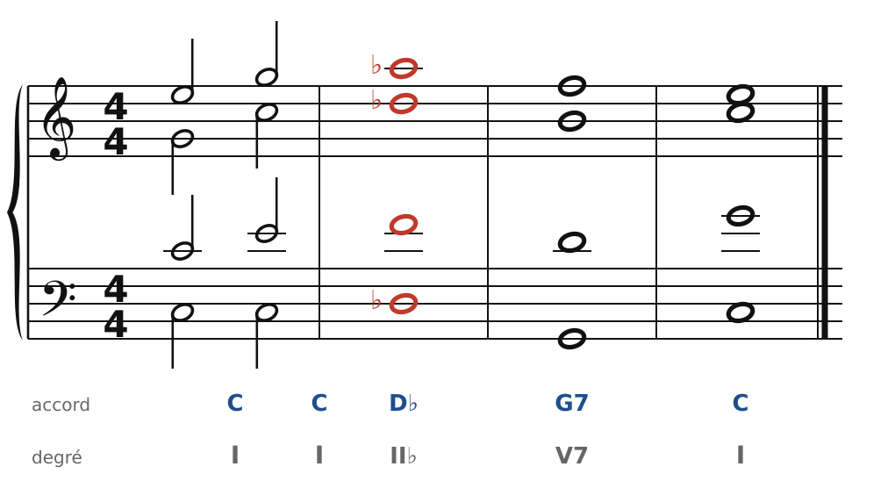
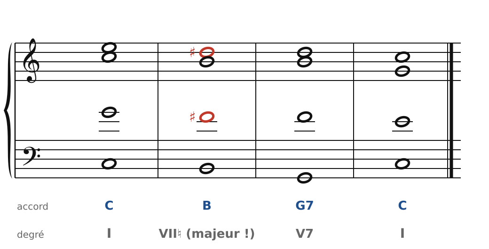

[← 51. Stravinsky](51-stravinsky.md) · [Sommaire](../README.md#sommaire) · [53. Messiaen →](53-messiaen.md)

## 52. Prokofiev : la tonalité qui fait des écarts

Serge Prokofiev (1891-1953) n'abandonne jamais la tonalité. Ses mélodies sont claires, ses cadences nettes, souvent en Do majeur ! Mais en chemin, il fait des **écarts** : un accord inattendu, un demi-ton à côté, une modulation éclair vers une tonalité très lointaine… puis un retour immédiat, comme si de rien n'était. On parle parfois de ses « fausses notes » : ce sont des notes justes, placées exactement là où on ne les attend pas. Ses œuvres sont encore protégées : les exemples sont originaux.

### Un accord à côté

🔊 [Écouter](audio/h52-a-cote.mp3) · [MIDI](audio/h52-a-cote.mid)

La phrase monte gaiement sur l'accord de Do. Puis, au lieu d'aller vers F ou G, tout l'accord **glisse d'un demi-ton** : D♭ (en rouge). L'oreille est surprise… mais ce D♭ n'est pas étranger : c'est l'accord de la **sixte napolitaine** (chapitre 24), ici en position fondamentale. Il mène tout droit au G7, et la cadence parfaite rétablit l'ordre.

Le principe : le chemin est surprenant, mais l'arrivée est classique. Plus la cadence est franche, plus l'écart précédent paraît drôle.

### Un demi-ton en dessous

🔊 [Écouter](audio/h52-demi-ton.mp3) · [MIDI](audio/h52-demi-ton.mid)

Autre écart : l'accord de **Si majeur** juste après celui de Do (le soprano descend de Mi à Ré♯, en rouge). En Do majeur, le VII devrait être un accord diminué ; ici, il est majeur, un demi-ton sous la tonique. Mais Si est une note commune avec G7 : la basse descend de Si à Sol, Ré♯ redevient Ré, et la cadence arrive. C'est un emprunt très lointain, pour un seul temps.

### La mélodie qui saute

Chez Prokofiev, la mélodie elle-même fait des écarts : de grands sauts (octave, neuvième, dixième) au milieu d'une ligne simple, ou une note altérée brusquement au milieu d'une gamme. La ligne reste chantable parce qu'elle revient aussitôt à la gamme. Écoute le thème de Pierre dans *Pierre et le loup* (1936) : il part en Do majeur, fait un détour par des tonalités lointaines en quelques notes, et revient en Do.

### Pour écrire « à la Prokofiev »

1. Commence par une phrase très simple, en Do majeur, avec une cadence parfaite à la fin.
2. Remplace un accord du milieu par un accord parfait situé **un demi-ton** au-dessus ou en dessous d'un accord attendu.
3. Relie-le à la cadence par une note commune ou un demi-ton (comme toujours : les voix bougent peu).
4. Ne reste pas : un écart d'un ou deux accords, puis le retour.

### À écouter

- **Symphonie n° 1, « Classique »** (1917) : une symphonie « comme Haydn l'aurait écrite aujourd'hui », selon Prokofiev ; la *Gavotte* est un catalogue d'écarts et de retours.
- *Pierre et le loup* (1936) : chaque personnage a son instrument et son thème.
- *Roméo et Juliette* (1935-1936) : la *Danse des chevaliers*.
- Les deux **quatuors à cordes** (1930 et 1941) : le second utilise des mélodies populaires de Kabardie (Caucase), recueillies pendant la guerre.

Le cahier propose un exercice sur ce chapitre ([Prokofiev : les accords « à côté »](../cahier/52-prokofiev.md)).

---

[← 51. Stravinsky](51-stravinsky.md) · [Sommaire](../README.md#sommaire) · [53. Messiaen →](53-messiaen.md)
