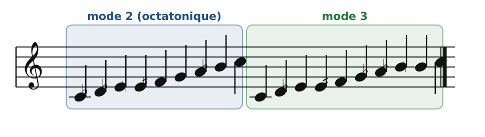
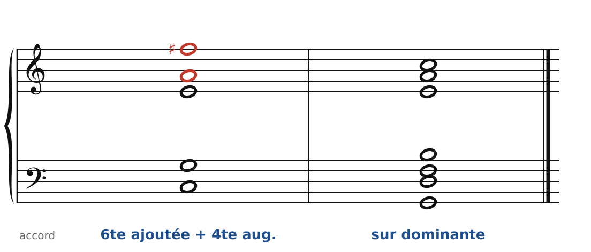
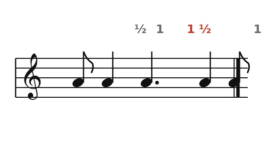

[← 52. Prokofiev](52-prokofiev.md) · [Sommaire](../README.md#sommaire) · [54. Dutilleux →](54-dutilleux.md)

## 53. Messiaen : modes à transposition limitée, rythmes

Olivier Messiaen (1908-1992), organiste de l'église de la Trinité à Paris pendant plus de soixante ans, a expliqué lui-même son langage dans un livre, *Technique de mon langage musical* (1944). C'est donc l'un des rares compositeurs du siècle dont on peut apprendre l'harmonie « dans le texte ». Ses œuvres sont encore protégées : les exemples ci-dessous montrent des **matériaux** (modes, accords, rythmes), pas des extraits.

### Les modes à transposition limitée

Une gamme majeure peut se transposer sur les douze notes : douze gammes différentes. Certaines gammes, au contraire, retombent sur elles-mêmes après quelques transpositions, parce qu'elles sont **symétriques**. Messiaen les appelle les **modes à transposition limitée**, et il en a retenu sept.

- **Mode 1** : la gamme par tons (chapitre 44). Deux transpositions seulement.
- **Mode 2** : l'échelle octatonique (chapitres 50 et 51), demi-ton, ton, demi-ton, ton… Trois transpositions.
- **Mode 3** : ton, demi-ton, demi-ton, répété trois fois (neuf notes). Quatre transpositions.
- Modes 4 à 7 : six transpositions chacun.

🔊 [Écouter](audio/h53-modes.mp3) · [MIDI](audio/h53-modes.mid)

Messiaen parle du « charme des impossibilités » : ces modes ne peuvent pas moduler vraiment (on retombe toujours sur les mêmes notes), ils n'ont pas de sensible ni de tonique obligée. Ils créent une harmonie **immobile**, qui convient à sa musique, souvent religieuse, tournée vers l'éternité.

### Dans le mode 2 : quatre 7e de dominante

Le mode 2 sur Do (Do, Ré♭, Mi♭, Mi, Fa♯, Sol, La, Si♭) contient **quatre accords de 7e de dominante** : C7, E♭7, F♯7 et A7. Leurs fondamentales forment une 7e diminuée (Do, Mi♭, Fa♯, La), c'est-à-dire… un axe de Bartók (chapitre 50). Messiaen les enchaîne librement : quatre dominantes qui ne se résolvent jamais, une couleur chaude et suspendue. L'exercice 3 du chapitre 55 te les fera écrire.

### Deux accords de Messiaen

🔊 [Écouter](audio/h53-accords.mp3) · [MIDI](audio/h53-accords.mid)

- **Sixte ajoutée et quarte augmentée** : Do, Mi, Sol, La, Fa♯. L'accord de sixte ajoutée de Debussy (chapitre 44), auquel s'ajoute la quarte augmentée (en rouge). Messiaen l'utilise comme accord final : un repos, mais un repos « lumineux ».
- **L'accord sur dominante** : sur la basse Sol, les sept notes de la gamme de Do majeur. Rangées en tierces, elles formeraient un accord de 13e complet (chapitre 45) ; ici, elles sont étalées pour que chacune sonne : toute la tonalité en un seul accord.

### Le rythme

Messiaen a autant renouvelé le rythme que l'harmonie. Deux procédés :

- les **valeurs ajoutées** : on ajoute à un rythme régulier une petite valeur (une double croche, un point) qui le rend boiteux, imprévisible ;
- les **rythmes non rétrogradables** : des rythmes qui se lisent de la même façon dans les deux sens, comme un palindrome.

🔊 [Écouter](audio/h53-rythme.mp3) · [MIDI](audio/h53-rythme.mid)

Croche, noire, noire pointée, noire, croche : autour de la valeur centrale (en rouge), les deux côtés sont en miroir. C'est la même idée que le miroir de Bartók (chapitre 50), appliquée aux durées ; et la même idée que les modes à transposition limitée : une symétrie qui empêche d'avancer, et qui suspend le temps.

### Le *Quatuor pour la fin du Temps*

Prisonnier de guerre au stalag VIII-A, à Görlitz, Messiaen y compose en 1940-1941 son *Quatuor pour la fin du Temps* pour les instruments que jouent ses compagnons de captivité : **violon, clarinette, violoncelle et piano**. L'œuvre est créée dans le camp, le 15 janvier 1941, devant les prisonniers.

Elle compte huit mouvements. À écouter en particulier :

- *Abîme des oiseaux*, pour clarinette seule : des chants d'oiseaux (Messiaen les notait en pleine nature) et de très longues notes qui partent du silence ;
- *Danse de la fureur, pour les sept trompettes* : les quatre instruments à l'unisson, avec valeurs ajoutées et rythmes non rétrogradables ;
- *Louange à l'Éternité de Jésus*, pour violoncelle et piano, et *Louange à l'Immortalité de Jésus*, pour violon et piano : des mélodies infiniment lentes sur des accords qui changent à peine.

Messiaen a enseigné l'analyse et la composition au Conservatoire de Paris ; Pierre Boulez, Karlheinz Stockhausen et Iannis Xenakis ont été ses élèves.

Le cahier propose deux exercices sur ce chapitre ([Messiaen : le mode 2 et son accord](../cahier/53-messiaen.md)).

---

[← 52. Prokofiev](52-prokofiev.md) · [Sommaire](../README.md#sommaire) · [54. Dutilleux →](54-dutilleux.md)
