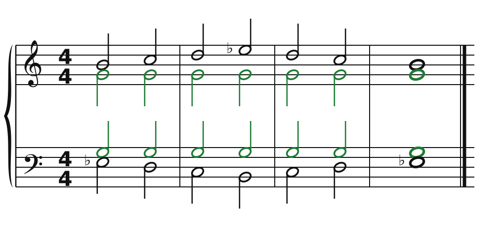
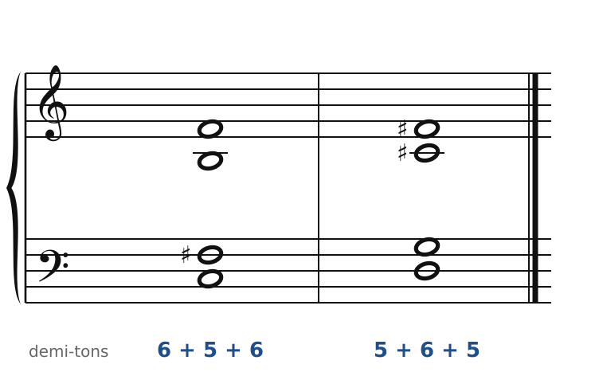

[← 53. Messiaen](53-messiaen.md) · [Sommaire](../README.md#sommaire) · [55. Exercices →](55-exercices.md)

## 54. Dutilleux : notes pivots, symétries, *Ainsi la nuit*

Henri Dutilleux (1916-2013) n'a appartenu à aucune école. Il a écrit peu, lentement, en reprenant chaque œuvre pendant des années. Sa musique hérite de Debussy et de Ravel (la couleur, l'orchestre), de Bartók (la symétrie), un peu du jazz ; elle n'est ni tonale ni « sérielle ». Elle repose sur une idée simple : la **mémoire**. Une note, un accord, un motif reviennent, transformés, et l'oreille les reconnaît. Ses œuvres sont protégées : les exemples sont originaux.

### La note pivot

🔊 [Écouter](audio/h54-pivot.mp3) · [MIDI](audio/h54-pivot.mid)

L'alto et le ténor tiennent **Sol** (en vert) du début à la fin. Autour de cette note fixe, le soprano monte par demi-tons et tons, et la basse fait exactement le chemin inverse (le miroir de Bartók, chapitre 50). Chaque accord est différent, mais tous sont « éclairés » par le même Sol : c'est lui qui donne l'unité. Dutilleux appelle ces notes des **notes pivots** ; elles remplacent la tonique.

C'est aussi, à plus grande échelle, le principe de la pédale (chapitre 25) : une note qui reste pendant que l'harmonie change. Mais la pédale classique est à la basse, sur la tonique ou la dominante ; la note pivot peut être n'importe où, et n'importe laquelle.

### Les accords symétriques

🔊 [Écouter](audio/h54-symetrie.mp3) · [MIDI](audio/h54-symetrie.mid)

Lus de bas en haut ou de haut en bas, ces accords ont les **mêmes intervalles** : 6, 5, 6 demi-tons pour le premier (Do, Fa♯, Si, Fa), 5, 6, 5 pour le second (Ré, Sol, Do♯, Fa♯). Un accord symétrique n'a pas de « haut » ni de « bas » : il n'a ni fondamentale ni direction, comme les modes de Messiaen. Dutilleux aime les faire grandir ou rétrécir autour d'un axe, en écartant les voix par mouvement contraire.

### La croissance progressive

Plutôt qu'un thème exposé puis développé, Dutilleux préfère faire **naître** une idée peu à peu : un intervalle, puis deux notes, puis un fragment, jusqu'au thème complet, souvent tard dans l'œuvre. Il appelait cela la « croissance progressive ». L'auditeur ne reçoit pas un thème : il assiste à sa naissance.

### *Ainsi la nuit*, pour quatuor à cordes

*Ainsi la nuit* (1976) est le seul quatuor de Dutilleux, et l'un des grands quatuors du XXe siècle. Sept pièces s'enchaînent, reliées par de courtes **parenthèses** qui annoncent ou rappellent les motifs (encore la mémoire) :

1. *Nocturne*
2. *Miroir d'espace*
3. *Litanies*
4. *Litanies 2*
5. *Constellations*
6. *Nocturne 2*
7. *Temps suspendu*

Ce qu'on y entend, avec les outils de cette partie :

- des **notes pivots** tenues par un instrument pendant que les autres tournent autour ;
- des **miroirs** : dans *Miroir d'espace*, les lignes et les accords se reflètent autour d'un axe ;
- des **sonorités** de cordes très variées (harmoniques, *sul ponticello*, glissandos, pizzicati), héritées de Bartók, au service de la couleur ;
- un temps qui semble s'arrêter : le titre du dernier mouvement le dit.

### Autres œuvres à écouter

- **Symphonie n° 2, « Le Double »** (1959) : un petit orchestre de douze musiciens dialogue avec le grand orchestre, comme un reflet.
- **Métaboles** (1964), pour orchestre : chaque pièce se transforme peu à peu en la suivante (le mot veut dire « changements »).
- ***Tout un monde lointain…*** (1970), concerto pour violoncelle écrit pour Mstislav Rostropovitch, d'après des poèmes de Baudelaire.

Le cahier propose un exercice sur ce chapitre ([Dutilleux : la note pivot](../cahier/54-dutilleux.md)).

---

[← 53. Messiaen](53-messiaen.md) · [Sommaire](../README.md#sommaire) · [55. Exercices →](55-exercices.md)
