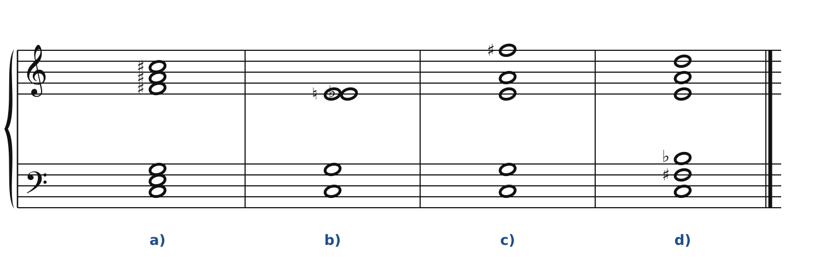
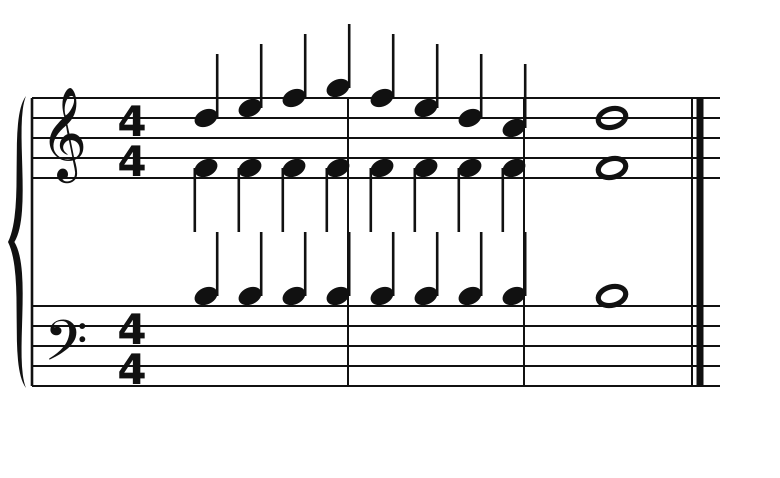
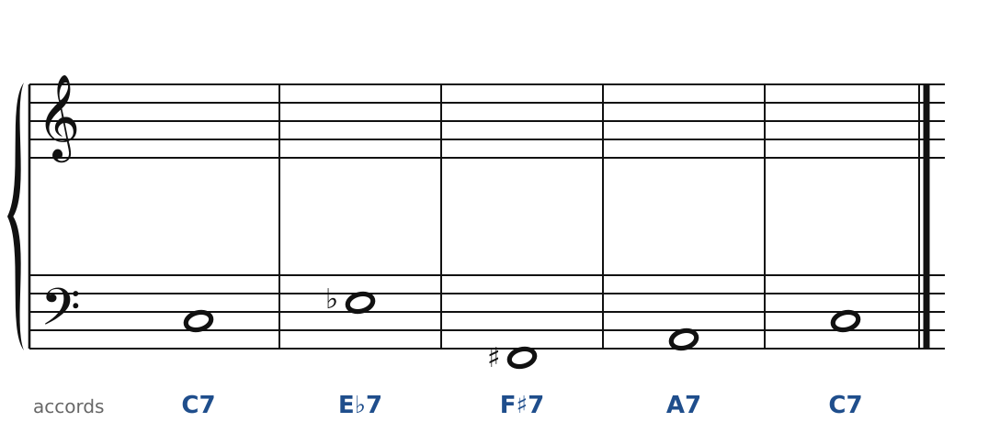
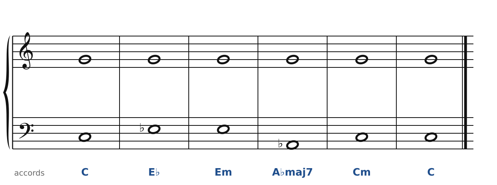
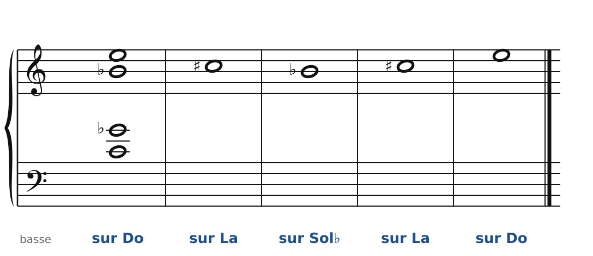

[← 54. Dutilleux](54-dutilleux.md) · [Sommaire](../README.md#sommaire) · [56. Corrigés →](56-corriges.md)

## 55. Exercices

Dans la **version web** du cours, les exercices 2 à 5 se font directement sur la portée (bouton **✏️ Faire l'exercice ici**), avec le correcteur de la huitième partie : les bonnes notes, dans la bonne tessiture, sans croisement.

Pour t'entraîner davantage, le [cahier d'exercices](../cahier/README.md) propose 9 autres exercices sur les chapitres 49 à 54.

### Exercice 1 : quatre accords du XXe siècle

Nomme chaque accord, et le compositeur à qui il fait penser.

### Exercice 2 : le miroir

Le soprano, l'alto et le ténor sont donnés. Écris la basse **en miroir** du soprano autour de Ré : quand le soprano monte d'un ton, la basse descend d'un ton (de même pour les demi-tons). Première note : Ré3.

### Exercice 3 : les quatre dominantes du mode 2

La basse et les accords sont donnés. Écris le soprano, l'alto et le ténor : dans chaque accord, la **tierce**, la **quinte** et la **septième**. Les quatre accords appartiennent au mode 2 sur Do : utilise ses notes telles qu'elles sont écrites dans les symboles (F♯7 : Fa♯, La♯, Do♯, Mi).

### Exercice 4 : une note pivot

Le soprano tient Sol pendant toute la phrase. La basse et les accords sont donnés : écris l'alto et le ténor. Chaque accord doit être **complet** (toutes ses notes présentes).

### Exercice 5 : l'accord de Scriabine en tierces mineures

Le premier accord (Do, Sol♭, Si♭, Mi : quatre notes de l'accord mystique) et la mélodie sont donnés. Recopie la même disposition sous chaque note : l'accord descend par tierces mineures, puis remonte.

**Question** : l'accord sur Sol♭ contient-il de nouvelles notes ?

### Exercice 6 : écoute

Écoute le 4e mouvement (*Allegretto pizzicato*) du *Quatuor n° 4* de Bartók, puis *Nocturne* et *Miroir d'espace* d'*Ainsi la nuit* de Dutilleux. Pour chacun : y a-t-il une note ou un accord qui revient comme un centre ? Repère un passage où deux instruments vont en sens contraire (miroir).

---

[← 54. Dutilleux](54-dutilleux.md) · [Sommaire](../README.md#sommaire) · [56. Corrigés →](56-corriges.md)
