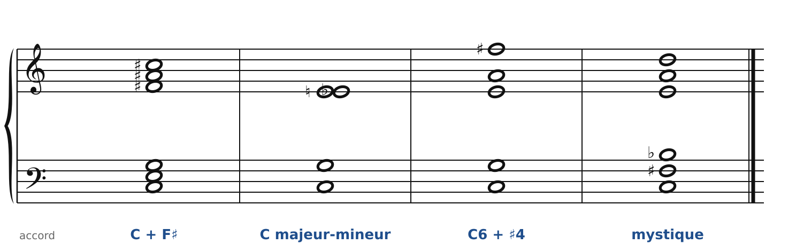
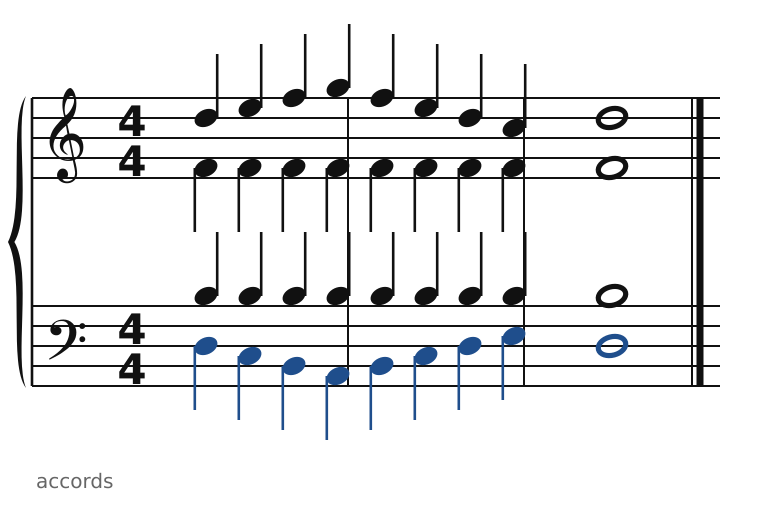
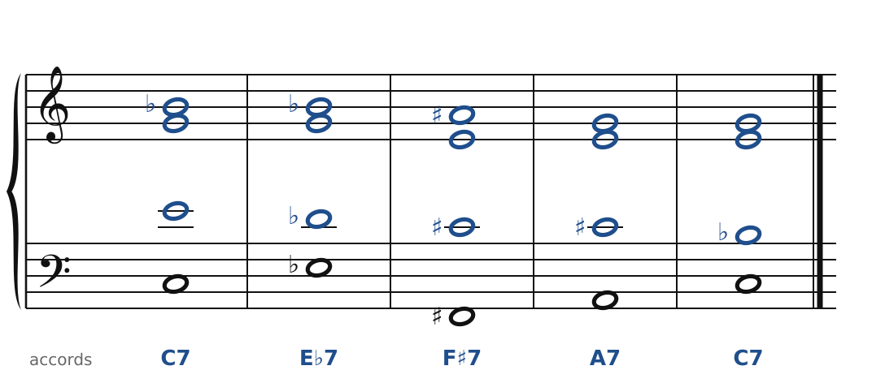
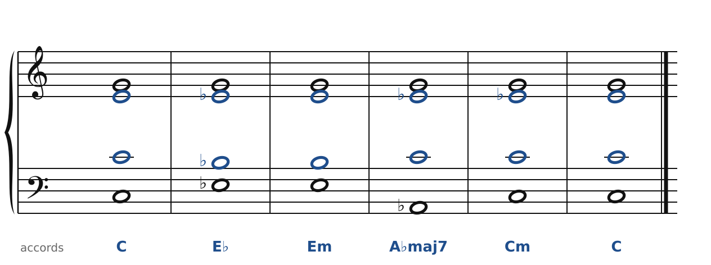
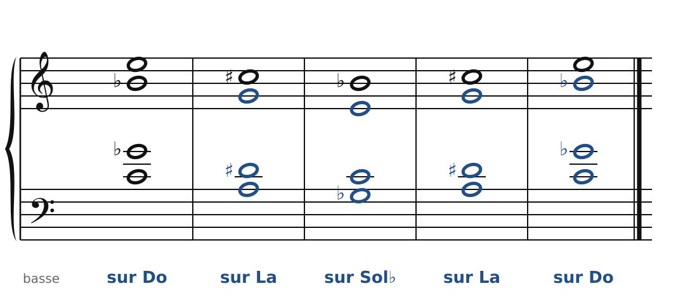

[← 55. Exercices](55-exercices.md) · [Sommaire](../README.md#sommaire)

## 56. Corrigés

### Exercice 1

🔊 [Écouter](audio/h56-c1.mp3) · [MIDI](audio/h56-c1.mid)

- a) C en bas, F♯ en haut : l'accord de **Petrouchka**, Stravinsky (chapitre 51).
- b) Do, Sol, Mi♭, Mi : l'accord **majeur-mineur**, Bartók (chapitre 50), et la *blue note* du jazz.
- c) Do, Sol, Mi, La, Fa♯ : **sixte ajoutée et quarte augmentée**, Messiaen (chapitre 53).
- d) Do, Fa♯, Si♭, Mi, La, Ré en quartes : l'**accord mystique**, Scriabine (chapitre 49).

### Exercice 2

🔊 [Écouter](audio/h56-c2.mp3) · [MIDI](audio/h56-c2.mid)

Soprano : Ré, Mi, Fa, Sol, Fa, Mi, Ré, Do, Ré. Basse : Ré, Do, Si, La, Si, Do, Ré, Mi, Ré. Le soprano monte d'un ton (Ré-Mi), la basse descend d'un ton (Ré-Do) ; d'un demi-ton (Mi-Fa), d'un demi-ton (Do-Si). Le Fa et le Si tenus au centre forment eux-mêmes un triton symétrique autour de Ré.

### Exercice 3

🔊 [Écouter](audio/h56-c3.mp3) · [MIDI](audio/h56-c3.mid)

Les trois voix du haut bougent très peu : Si♭ et Sol restent du C7 au E♭7 (ce sont des notes communes), Mi descend sur Ré♭. Puis La♯ (= Si♭) reste encore pour F♯7, et Mi revient. Toutes les notes appartiennent au mode 2 sur Do : quatre dominantes, mais aucune ne se résout, et pourtant l'enchaînement est fluide, parce que le mode est un réservoir commun.

### Exercice 4

🔊 [Écouter](audio/h56-c4.mp3) · [MIDI](audio/h56-c4.mid)

Sol est tour à tour quinte de C, tierce de E♭, tierce mineure de Em, septième majeure de A♭maj7, quinte de Cm. La même note change de couleur à chaque accord : c'est tout l'intérêt de la note pivot. L'alto et le ténor glissent par demi-tons (Mi-Mi♭-Mi…), comme dans les glissements de Fauré (chapitre 43).

### Exercice 5

🔊 [Écouter](audio/h56-c5.mp3) · [MIDI](audio/h56-c5.mid)

Sur La : La, Ré♯, Sol, Do♯ ; sur Sol♭ : Sol♭, Do, Mi, Si♭. Réponse à la question : **non**. L'accord sur Sol♭ a les mêmes notes que l'accord sur Do (Do, Sol♭, Si♭, Mi), dans une autre disposition. Ces quatre notes forment un ensemble symétrique (deux tritons à un ton d'écart) : transposé d'un triton, il retombe sur lui-même. Il n'existe que six versions différentes de cet accord, et l'accord sur La est le seul « nouveau » de l'exercice.

### Exercice 6

- **Bartók** : tout le mouvement est en pizzicati ; un motif de quelques notes revient sans cesse, varié, renversé, et des accords arpégés en pizzicato sonnent comme une guitare (ou un cymbalum). Les accords « claqués » (pizzicato Bartók) ponctuent les fins de phrases.
- **Dutilleux** : dans *Nocturne*, des notes tenues longuement servent de repères ; dans *Miroir d'espace*, les voix s'écartent et se rapprochent symétriquement autour d'une note centrale.

---

## Pour finir

Ce cours est parti de trois notes et d'une basse, avec des règles strictes : pas de quintes parallèles, la sensible monte, la septième descend. Il arrive à des musiques où les quintes parallèles sont voulues, où les dominantes ne se résolvent plus, où une seule note tenue remplace la tonique.

Pourtant, rien n'a été jeté en route. La septième qui descend est devenue la note guide du jazz ; la sixte augmentée est devenue la substitution tritonique ; la 7e diminuée a donné les axes de Bartók et les modes de Messiaen ; la pédale a donné la note pivot de Dutilleux. Chaque génération a pris les règles de la précédente comme un point de départ, pas comme une prison. C'est la meilleure raison d'apprendre ces règles : savoir exactement ce qu'on garde, et ce qu'on décide de changer.

Bonne écriture !

---

[← 55. Exercices](55-exercices.md) · [Sommaire](../README.md#sommaire)
